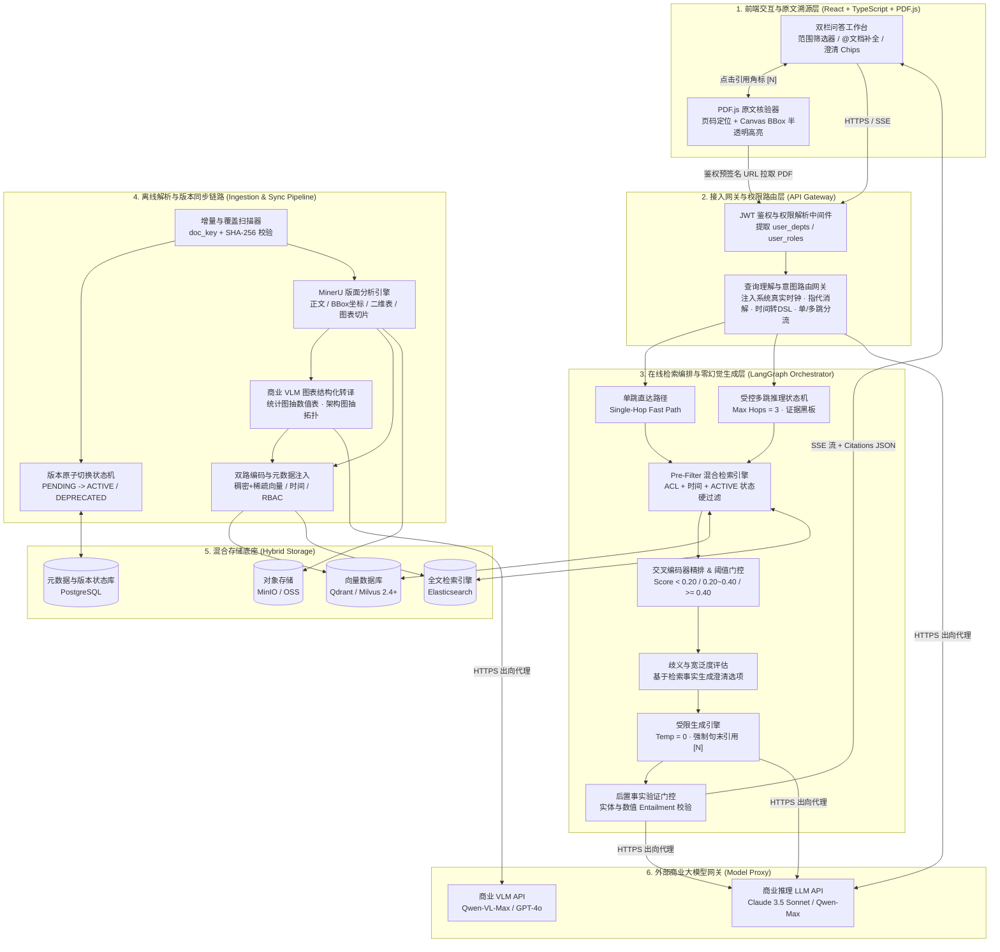
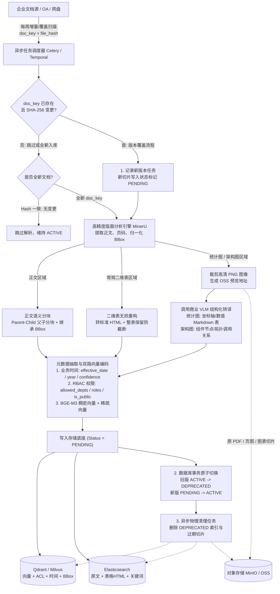
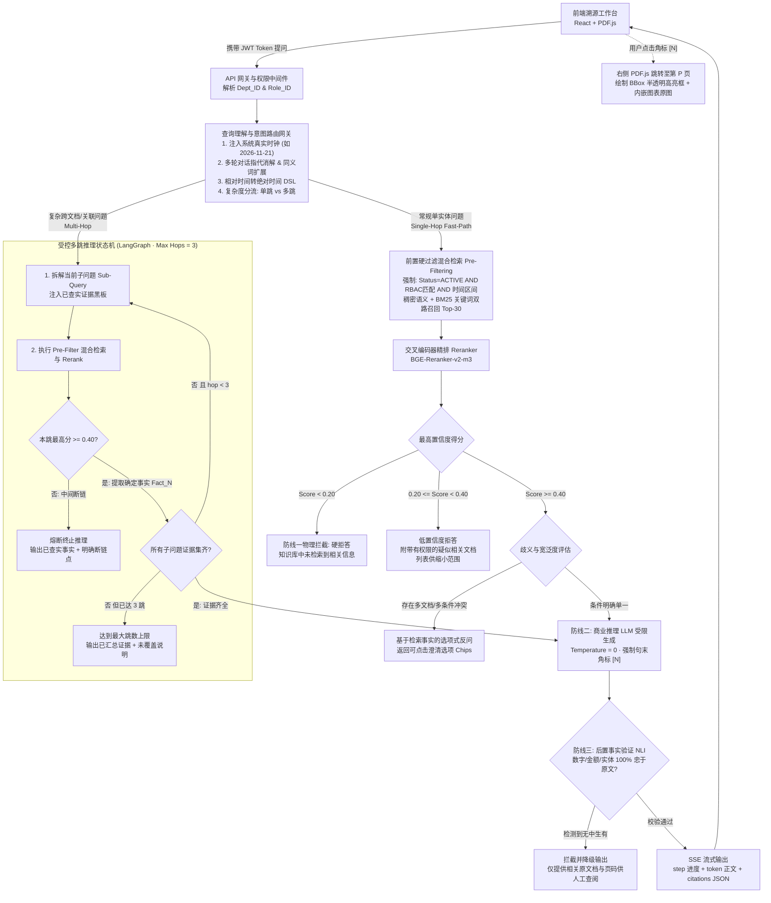
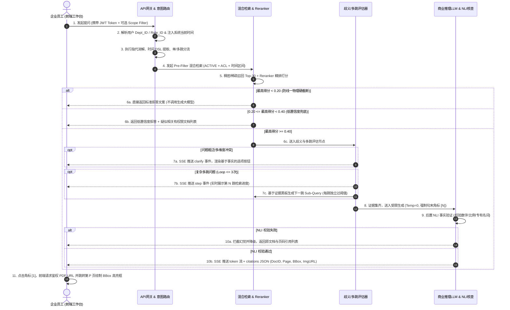
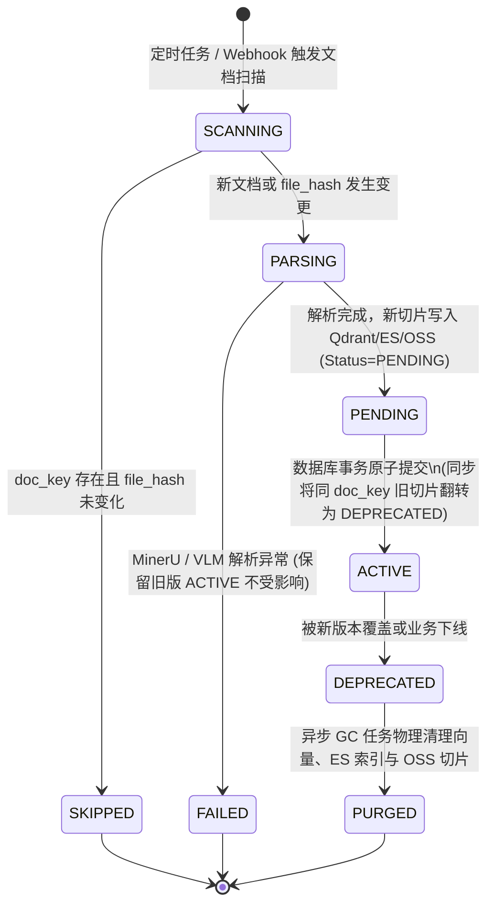
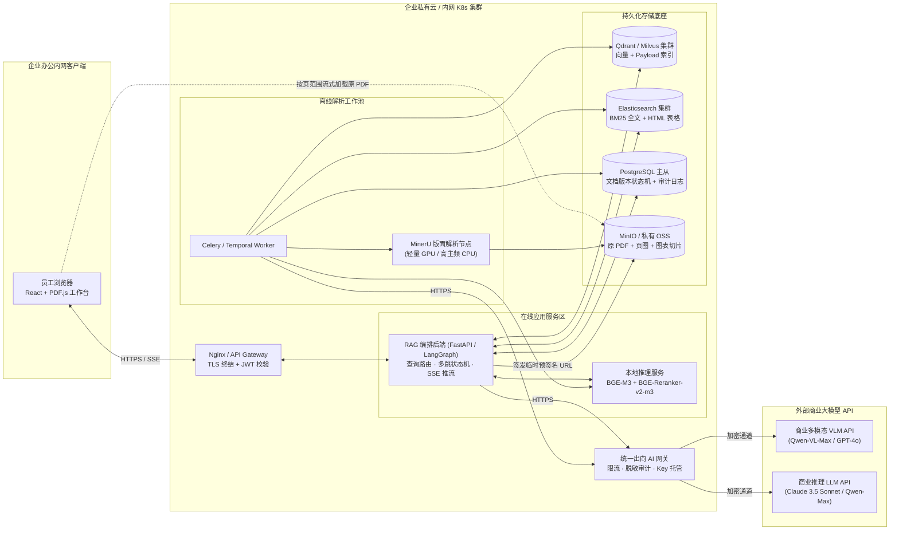

# 企业级零幻觉多模态知识库系统 — 系统架构图集 (`architecture.md`)

> 本文档为《企业级零幻觉多模态知识库系统》的独立架构视图文档，配套完整文字规格说明请参见 [`design_spec.md`](./design_spec.md)。所有图表均采用标准 Mermaid 语法编写，可在 GitHub、GitLab、Typora、Obsidian、Notion 或本工作台中直接渲染为矢量图。

---

## 1. 架构设计边界与约束矩阵

| 架构维度 | 已对齐的业务与技术边界 | 对架构设计的核心约束 |
| :--- | :--- | :--- |
| **模型与算力策略** | 允许调用外部商业大模型 API（VLM 读图 + 强指令遵循推理） | 本地仅部署轻量化 MinerU 版面解析与向量/精排服务，无需本地扛大显存模型 |
| **数据规模与演进** | PoC 阶段 100 份 PDF；全量 10,000 份；每周存在新增与版本覆盖 | 必须设计 `doc_key + file_hash` 驱动的原子化版本切换状态机，防止新旧版本并存冲突 |
| **文档内部特征** | 常规二维数据表 + 统计数据图（折线/柱状/饼图）+ 系统/业务架构图 | 二维表无损转 HTML 整表保留；统计图与架构图经由 VLM 结构化转译并绑定原图 URL |
| **安全权限隔离** | 严格的部门/角色权限隔离（RBAC） | 必须在检索前执行前置硬过滤（Pre-Filtering），无权限文档在物理召回层不可见 |
| **幻觉与溯源要求** | 对幻觉零容忍；需要前端原文框选高亮溯源工作台 | 三道防线（Rerank 阈值拦截 + Temp=0 强制引用 + 后置 NLI 核查）+ BBox 像素级坐标回传 |

---

## 2. 系统总体分层逻辑架构图

---

## 3. 离线解析与原子版本同步流水线

---

## 4. 在线查询理解、多跳推理与零幻觉生成链路

---

## 5. 核心业务端到端时序流转图

---

## 6. 文档版本覆盖原子状态机

---

## 7. 混合部署架构拓扑图

