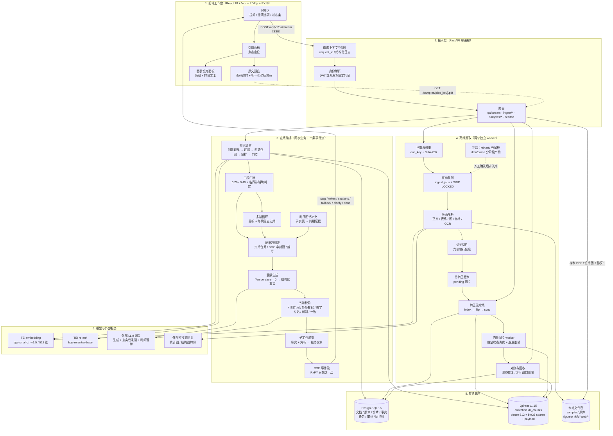
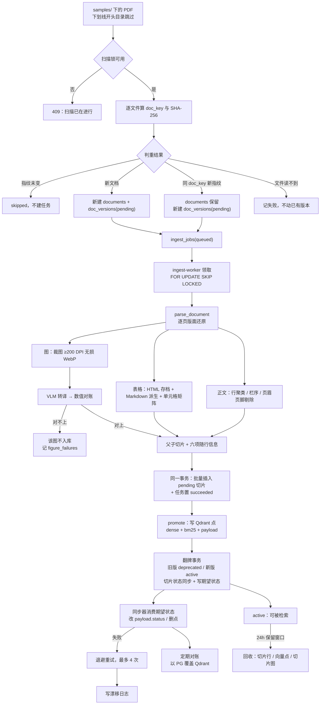
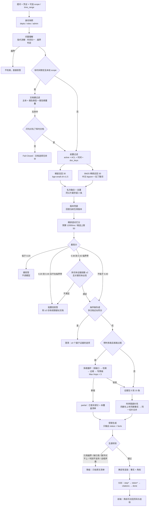
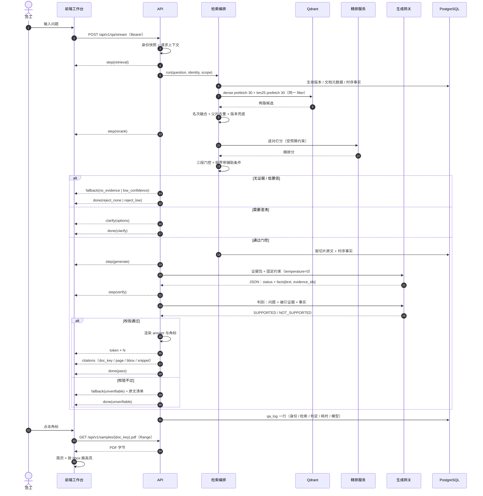
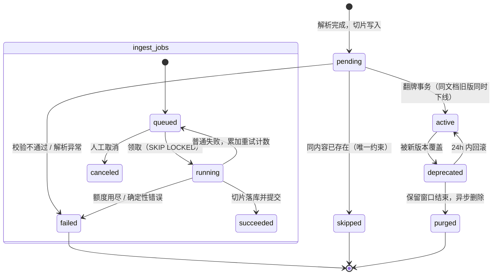
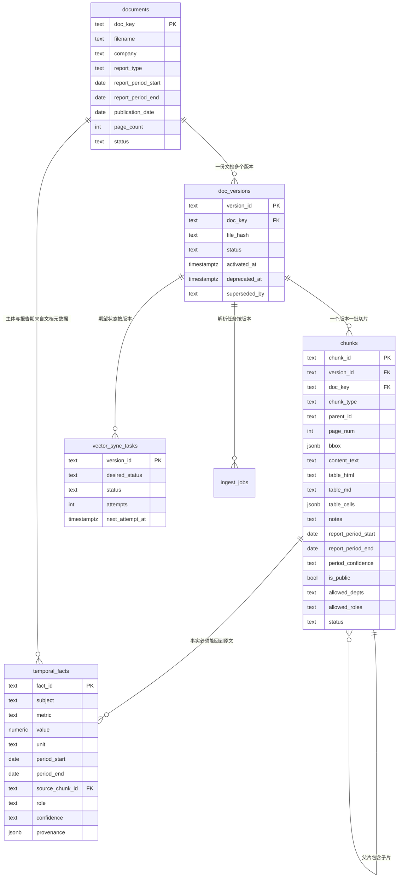
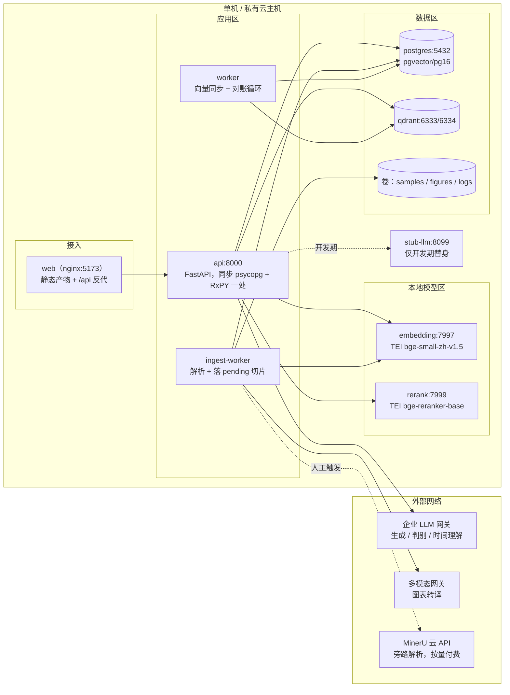
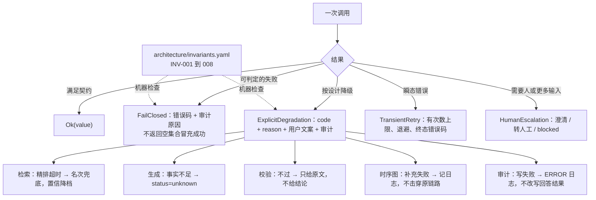

# ai-rag 架构图集

> 配套文字规格见 [`概要设计.md`](./概要设计.md) 与 [`详细设计.md`](./详细设计.md)。
> 本文件只画"东西怎么连、状态怎么走、一次请求怎么流动"，不重复字段口径与实现细节。
> 所有图用 Mermaid 编写，可在 GitHub、Typora、Obsidian、VS Code 与本工作台直接渲染。
>
> 版本：v2.0 ｜ 日期：2026-11-27 ｜ 对应实现：`api/` + `worker/` + `web/` 当前主线

---

## 1. 边界与约束矩阵

| 维度 | 已定版的边界 | 对架构的硬约束 |
|---|---|---|
| 语料 | 本地 `samples/` 目录内的中文 PDF，开发期 6 份财报，全量按 1 万份规划 | 摄取靠扫目录而不是上传接口；样本原件随仓库走，不进对象存储 |
| 解析 | 主链为本地 CPU 版面解析（pdfplumber + pypdfium2 + Pillow + RapidOCR）；MinerU 云解析是旁路实验链 | 在线镜像不装解析依赖；解析失败不入库；图转译数值对不上即拒收 |
| 模型 | 生成、判别、读图走外部 OpenAI 兼容网关；向量与精排是本地 TEI 服务 | 出向只有 HTTPS；密钥只走环境变量；`temperature` 固定 0 |
| 存储 | PostgreSQL 16（pgvector 扩展只为兼容历史列）+ Qdrant 单节点两库 | PG 是唯一真相源；Qdrant 是可重建副本；不引入独立检索引擎与对象存储 |
| 权限 | 部门 / 角色 / 公开三支取或；管理员跨部门可审计 | 过滤必须发生在召回前，Qdrant 与 PG 两条渲染路径共用同一份条件 |
| 时间 | 报告期、发布日期、生效日期三层分开；只认显式时间 | 不用文档发布日期冒充报告期；不把预测年份写进报告期；无结构化命中不回退全库 |
| 幻觉 | 目标是把幻觉压到可复核的水平，不承诺绝对零幻觉 | 证据不足拒答；答案由结构化事实渲染，不由模型自由成文；五道校验任何一道不过即降级 |
| 规模 | 试点 6 份；全量 1 万份约 40–60 万子切片 | 单节点 Qdrant 足够；瓶颈先出现在编码与精排算力，不在存储 |
| 运维 | 单机 docker compose，9 个服务；一条 `make` 命令链 | 每个进程单一职责；失败必须显式、带码、可审计（见 `architecture/invariants.yaml`） |

---

## 2. 系统分层架构

---

## 3. 离线摄取与版本流水线

**旁路（实验）**：`api/docparse/` 走 MinerU 云 API + Docling 表格 + 确定性修复，产物按
`data/parse/<doc_key>/<version_id>/01..05 + manifest.json` 分阶段落盘，`state=READY_FOR_REVIEW`
之前不写 PG/Qdrant。付费闸门要求显式给页数上限，只暴露单文件入口；批量与入库入口在单文件
产物人工确认后才解锁。

---

## 4. 在线问答链路

---

## 5. 一次问答的时序

---

## 6. 版本与任务状态机

翻牌与同步的边界是这张图最容易被误画的地方：**翻牌事务只写 PG（含期望状态），不直接调 Qdrant**。
Qdrant 没有事务，跨库"两阶段"只能靠"期望状态 + 消费 + 对账"实现，见详细设计 §4.6。

---

## 7. 数据模型

`qa_log` 与 `vector_drift_log` 是两条独立账，不与业务对象建外键：审计记录必须能在切片被回收后
仍然回答"当时是哪条证据"，所以只存编号与分数摘要，不挂引用约束。

---

## 8. 部署拓扑

---

## 9. 失败出口与不变量

八条不可协商的规则（详见 `docs/engineering/ENGINEERING_CONSTITUTION.md`）：

1. 捕获异常后不得返回空值继续成功路径；
2. 外部响应不得用 `or []` / `or {}` / `or ""` 静默降级；
3. 确定性模块不得调用生成模型；
4. 缺失 metadata 必须 fail-closed；
5. 所有降级必须经统一网关并带原因与审计；
6. 确定性模块不得用关键词特判补语义；
7. 任何降级必须在审计中可见；
8. 生产代码不得出现中文字符串字面量（提示词、词表、文案只在 `api/prompts/` 与 `api/resources/`）。
