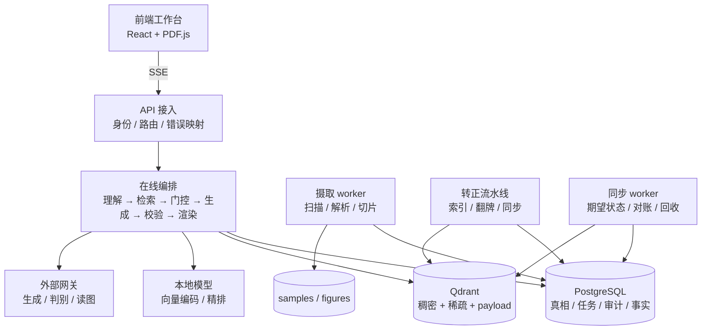

# ai-rag 概要设计

> 版本：v2.0 ｜ 日期：2026-11-27 ｜ 状态：与当前实现对齐
> 上游视图：同目录 [`架构图集.md`](./架构图集.md)；实现级契约：[`详细设计.md`](./详细设计.md)
> 适用范围：私有化部署、中文 PDF 知识库问答（含表格、图表、跨期数据）
> 核心目标：证据不足一律拒答；每条结论可点回原文；把幻觉压到可复核、可追责的水平

---

## 1. 背景与目标

### 1.1 背景

企业知识大量沉淀在 PDF 里（财报、制度、合同、手册）。通用大模型在缺乏证据约束时会编造事实、
错引来源、把"同类文档的常见说法"当成"这份文档的结论"。金融与合规场景下，这类错误一次就足以
让系统失去信任。

本系统把问题重新定义：**不是"让模型答得更多"，而是"让每一句放出去的话都有出处，没有出处就
不说"**。因此在线链路的默认终态是拒答，只有证据、生成、校验三层同时放行才输出答案。

### 1.2 设计目标

| 目标 | 定义 | 验收导向 |
|---|---|---|
| 未知即拒答 | 超出库内范围、证据不足、答案无法被原文支持，一律返回"未找到可验证依据" | 陷阱题安全拒答率 100% |
| 证据可追溯 | 事实性陈述由结构化事实渲染，每条事实绑定切片编号；角标可定位到页码与坐标 | 角标可点回 ≥98% |
| 数值可信 | 金额、比例、日期必须能在被引证据中定位；派生值必须由确定性计算工具产生 | 数值准确率 ≥96% |
| 不混版本 | 同一文档任何时刻只有一个生效版本；旧版在检索入口被版本校验挡掉 | 无跨版本混答 |
| 可运营 | 全链路审计、配置指纹可查、参数可回滚、失败有码 | `qa_log` 可回放一次问答 |
| 务实可落地 | 两库 + 本地模型 + 外部生成，单机 compose 跑通全链路 | 一条命令起停，评测可重复 |

### 1.3 非目标

- 不承诺"绝对零幻觉"。目标是多重机制把幻觉压到可复核水平，并让残余错误可被发现、可被追责。
- 不做自由问答：不用常识、训练记忆、经验推断补充答案；不回答预测、投资建议、主观评价。
- 不做图表目测：不让模型凭肉眼估数，统计图与结构图一律走结构化转译 + 数值对账。
- 不做"先检索再过滤"：无权限文档不得进入候选池，也不得向用户暴露其存在。
- 不做文件服务：本期只扫项目内样本目录；上传、签名下发、按页流式另行设计。
- 不做多租户与跨库联邦：等第二个知识库或第二个租户出现再做。
- 不做自动文档改写：解析只做确定性修复，不调模型润色原文。

---

## 2. 设计原则与硬约束

### 2.1 六条原则

1. **Fail-Closed**：任一环节不确定、不满足约束、或缺关键 metadata，一律按失败处理，不"尽力猜一个"。
2. **先筛后答**：权限、时间、生效状态必须在召回前生效；过滤条件只有一份定义，同时渲染到两条取数路径。
3. **结构化优先**：能用结构化字段表达的关系（报告期、主体、指标、来源）不交给自然语言；确定性模块不调用生成模型。
4. **答案可重建**：最终文本由"事实 + 角标"确定性渲染；模型只负责抽取与归纳事实，不负责最终排版与引用编号。
5. **失败分层**：硬拒、低置信拒、澄清、部分结论、系统异常五类出口各有各的用户可见结果与告警口径。
6. **降级显式**：每一次降级都带错误码、原因、用户文案与审计字段；禁止静默 fallback。

### 2.2 工程宪法（项目级硬约束）

`docs/engineering/ENGINEERING_CONSTITUTION.md` 规定四类允许的失败出口：
`FailClosed`、`ExplicitDegradation`、`TransientRetry`、`HumanEscalation`。
统一类型契约为 `Ok(value)` / `Fail(code, reason)` / `Degraded(value, code, reason, audit)`；
`None`、空集合、空字符串不能表示失败。

`architecture/invariants.yaml` 把八条规则落成可执行检查（INV-001..008）：

| 编号 | 规则 | 范围 |
|---|---|---|
| INV-001 | 捕获异常后不得返回空值、`None` 或继续成功路径 | `api/**` |
| INV-002 | 外部响应不得用 `or []` / `or {}` / `or ""` 静默降级 | `api/**` |
| INV-003 | 时间/查询解析不得调用生成模型兜底 | `time_range`、`temporal`、`query` |
| INV-004 | 缺失 metadata 必须 fail-closed | `temporal`、`retrieval`、`filters` |
| INV-005 | 所有显式降级必须经统一网关并带 reason/audit | `api/**` |
| INV-006 | 确定性模块不得用关键词特判补语义 | `time_range`、`temporal`、`query` |
| INV-007 | 任何降级必须在审计中可见 | `api/**` |
| INV-008 | 生产代码不得出现中文字符串字面量 | `api/**`（提示词/词表/文案限 `prompts/`、`resources/`） |

---

## 3. 系统边界与总体架构

### 3.1 分层

| 层 | 职责 | 不做什么 |
|---|---|---|
| 前端工作台 | 提问、澄清点选、状态展示、角标跳转、PDF 高亮、图表切片查看 | 不解析业务规则；不直接访问数据库 |
| 接入层 | 身份解析、请求上下文、错误映射、SSE 输出 | 不做检索与判定 |
| 在线编排 | 问题理解、过滤、两路召回、精排、门控、多跳、证据包、生成、五道校验、渲染 | 不写库（审计除外）；不改切片 |
| 离线摄取 | 扫描判重、解析、切片、任务状态、转正、同步、对账、回收 | 不服务在线请求；不直接改旧版状态 |
| 存储 | PG 存真相与账本；Qdrant 存向量副本；文件卷存原件与切片图 | 不引入第二个真相源 |
| 模型服务 | 本地向量与精排；外部生成、判别、读图 | 不参与确定性规则 |

### 3.2 组件与目录对应

| 组件 | 落点 | 关键约束 |
|---|---|---|
| 应用装配 | `api/main.py` | `create_app()` 唯一装配入口；测试可在无 PG/Qdrant 时 import |
| 配置 | `api/config.py` | 单一来源；`/healthz` 暴露非密钥配置指纹 |
| 身份 | `api/identity.py` | JWT 声明 → 身份快照；凭证无效 401 |
| 过滤 | `api/filters.py` | 一份条件，渲染成 Qdrant filter 与 PG WHERE，两路对拍 |
| 问题理解 | `api/query/`、`api/time_range.py` | 指代消解、时间归一、越界；确定性优先 |
| 检索 | `api/retrieval/` | 两路召回、名次融合、精排、版本兜底、门控、多跳 |
| 时序 | `api/temporal/` | 报告期元数据、事实抽取、知识图查询、证据补充 |
| 生成 | `api/generate/` | 证据包、受限生成、计算工具、判别、渲染 |
| 校验 | `api/verify/` | 五道校验、数字归一、降级决策 |
| 编排 | `api/qa/` | 事件出口映射、审计组装、单次收尾 |
| 摄取 | `api/ingest/`、`api/parse/`、`worker/` | 扫描、任务、解析、切片、翻牌、同步、对账、回收 |
| 旁路解析 | `api/docparse/` | MinerU 云 + 分阶段产物；人工确认前不入库 |
| 前端 | `web/src/` | `useChat` 唯一订阅点；六类事件；五态界面 |
| 评测 | `eval/` | 30 题、四条红线、门禁退出码 |
| 工程门禁 | `architecture/`、`scripts/check_*.py` | 不变量、中文源码、Google Style |

### 3.3 数据流

**离线**：扫目录 → 判重 → 任务队列 → 版面解析 → 父子切片 → 待转正 → 转正（索引/翻牌/同步）
→ 生效 → 对账 → 24 小时后回收。解析失败与校验失败都不进入检索库；旧版在新版生效前一直可服务。

**在线**：凭证 → 身份快照 → 问题理解 → 文档选择（有结构化条件时）→ 前置过滤 → 两路召回 →
名次融合 → 版本兜底 → 精排 → 三段门控 → 澄清/多跳/直通 → 时序图谱补充 → 证据包 → 受限生成
→ 五道校验 → 确定性渲染 → SSE → 审计落库。

**闭环**：每次问答落 `qa_log`；评测集按红线判分；参数、提示词、模型名三者版本化，回滚以版本为单位。

---

## 4. 离线摄取

### 4.1 双解析路径

| 路径 | 状态 | 用途 | 产物 |
|---|---|---|---|
| 主链 `api/parse/` | 已接库 | 日常入库、评测语料 | 直接产出 `Chunk` 对象 → PG → Qdrant |
| 旁路 `api/docparse/` | 实验、人工确认 | 复杂版式兜底、比较不同解析器质量 | `data/parse/<doc_key>/<version_id>/` 分阶段 JSON + manifest |

旁路是**付费且分阶段**的：MinerU 云 API 按量计费，必须显式给页数上限；只暴露单文件入口；
`READY_FOR_REVIEW` 之后才允许人工确认并进入现有索引/翻牌链。它不替换主链，也不与主链共享切片编号规则。

### 4.2 主链步骤

1. **扫描**：`samples/` 下逐文件算 `doc_key` 与 SHA-256。下划线开头目录整棵跳过。
2. **判重**：指纹未变跳过；同 `doc_key` 新指纹建新版本；新文档建文档 + 版本。扫描用单任务锁，第二次返回 409。
3. **解析**：逐页版面还原，输出正文行、表格区域、图区域、页眉页脚行与归一化坐标；扫描页走 OCR。
4. **表格**：HTML 保真存档、Markdown 派生文本、单元格矩阵三份；转换规则写死，不交给模型。
5. **图表**：≥200 DPI 裁无损 WebP → VLM 转译 → 数值对账；对不上则该图不入库。
6. **切片**：子片 256–512 字、重叠 64 字；父片 1024–2048 字或整章；六项随行信息一次补齐。
7. **落库**：解析在库外完成，切片批量插入与任务置成功在同一事务；失败按确定性/瞬态分类。
8. **转正**：索引（dense + bm25 + payload）→ 翻牌事务 → 同步期望状态 → 对账。
9. **回收**：旧版下线后保留 24 小时，再级联删除切片行、向量点与切片图；样本原件不删。

### 4.3 幂等与并发

- 同一文档同一内容只允许一个版本（`UNIQUE(doc_key, file_hash)` 兜底）。
- 同一文档同一时刻只有一个生效版本（部分唯一索引兜底）。
- 扫描、翻牌、回收共用同一把文档级咨询锁，锁表达式只有一处定义。
- 同一版本同时只有一个未结束任务；重试是 `running → queued` 原地累加，不是新建任务。

---

## 5. 在线问答

### 5.1 身份与范围

身份从凭证解出四个字段：用户标识、部门列表、角色列表、是否管理员。权限表达式三支取或：
公开文档、部门交集、角色交集；管理员去掉整条 ACL，但审计必须标记跨部门访问。

`scope.doc_keys` 是用户显式收窄范围，作为硬过滤；`time_range` 是前端点选的时间窗，优先于
从问句里归一出来的窗口。两者都为空时，在用户有权限的全部生效文档里检索。

### 5.2 时间三层

| 层 | 字段 | 口径 |
|---|---|---|
| 报告期 | `report_period_start/end` | 该文档覆盖的报告期，权威来源是文档元数据 |
| 发布日期 | `publication_date` | 对外披露日，不参与"问题问哪一期"的判定 |
| 生效日期 | `effective_date/year` | 制度类文档的业务生效日；兼容保留，不再是首选过滤口径 |

时间归一**只解析显式时间**：季度、半年、年月、单日、年份；相对时间（去年、最近）与"最新版"
不算显式时间，不加过滤条件，并在答案与审计里说明。预测目标年份不写进报告期。

当问句带时间限定且未给 scope 时，先做**结构化文档选择**：按主体、报告类型、报告期重叠做硬过滤。
无命中时：问句点名了库内文档则按点名检索；否则 **Fail-Closed**，不回退全库——"全库回退"会把
一次时间理解错误伪装成"库里没有"。

### 5.3 召回与精排

- 稠密路：bge-small-zh-v1.5，512 维，余弦；BM25 路：同一 collection 的 sparse 向量，服务端 `modifier=idf`。
- 两路各取 30 条，使用**完全相同的过滤条件**；查询文本入库与查询两侧都做中文 bigram + 拉丁整词预处理。
- 合并按名次相加，不看原始分数；并列时语义名次靠前者优先；同一父片最多保留两条子片。
- 进精排前用候选所属版本回查当前生效版本，不一致直接丢弃。
- 精排取 5–10 条进证据包；精排有预算上限与输入长度上限，超时按名次兜底并把置信降一档（显式降级、记审计）。

### 5.4 三段门控

| 最高分 | 判定 | 动作 |
|---|---|---|
| < 0.20 | 库内无相关内容 | 硬拒答，不调用生成模型 |
| 0.20–0.40 | 有一点像但撑不住 | 低置信拒答 + ≤3 份有权限的疑似文档 |
| ≥ 0.40 | 有证据支撑 | 进澄清检查；通过后生成 |

临界带 0.38–0.42 内不单靠分数：多实体问题要求至少 2 段不同证据，且关键实体必须出现在证据里；
辅助条件满足即按过线处理，不满足落低置信。临界带是"替代"分数判定，不是"补充"。

澄清只在两种情况下触发：条件确实缺失，或多份文档分数接近（差 <0.05）。选项只能来自检索事实
（文档标题 + 章节），最多 4 个；点选后把参数并进条件重查一次，不再追问第二次。

多跳只在"预判多跳且第一跳已过阈"时启动，最多 3 跳；黑板只放确定事实（原文摘录、切片编号、
页码、跳次），不放候选、分数与推测。停止条件三条：证据齐、到 3 跳、本跳不过阈。断链交出的
是"已查实部分 + 断在哪一步"，不是一句"查不到"。

### 5.5 生成契约

模型输出被压缩到最小：`status` + `facts[]`，每条事实只有 `text` 与 `evidence_ids`（切片编号）。
答案文本、角标编号、引用顺序全部由系统确定性渲染：

- 角标位置在句末标点之前；同一事实多个来源输出 `[1][3]`；
- `evidence_ids` 必须全部能在证据包中映射到编号，未知编号直接判格式失败；
- 没有 `evidence_ids` 的事实直接拒答，不补默认值。

`temperature` 固定 0，不做成可调参数。模型返回非 JSON 时宽松解析一次（拨代码块围栏、取花括号
区间）；仍失败降级，不重试三次以上。

### 5.6 五道校验与三档降级

| 道 | 检查 | 失败 |
|---|---|---|
| 一 | 每个 `evidence_ids` 存在且在证据包范围内 | 降级 |
| 二 | 每条事实至少一个证据 | 降级 |
| 三 | 数字、日期、金额、专名能在被引证据定位；派生值必须通过计算工具复核 | 降级 |
| 四 | 判别器只吃"问题 + 被引证据 + 事实"，判是否被支持 | 降级 |
| 五 | 同一实体同一单位不得出现两个值 | 降级 |

降级分三档：只给原文（校验不过）、部分结论（多跳未覆盖）、系统异常（模型不可用/超时，不推原文）。
系统陈述（未覆盖清单、证据超长说明、补年份假设）由系统单独发出，不参与校验，也不能混进被校验正文。

### 5.7 事件与前端

六类事件顺序固定：`step* → (token* | clarify | fallback) → citations? → done`。
拒答路径没有 `token`，前端不得假设一定有正文。`done` 永远最后一条，异常路径也发。
前端只有一个订阅出口（`useChat`），一条流一个 `Subscription`，切换问题时先取消上一条；
逐字增量经合帧器合并，非 token 事件落地前先 flush，保证"正文先于引用"。

---

## 6. 时序知识图谱

### 6.1 为什么需要

"2026 三季报营业收入多少、同比多少"这类问题，单靠切片检索会得到两张表的两段原文，模型容易
把"本期"与"上年同期"两列读串。时序图谱把结构化表格里的"主体—指标—期间—值—来源"抽成事实边，
让跨期比较由确定性查询与计算完成，而不是由模型从两段文本里推断。

### 6.2 边界

- **不是图数据库**：一张 `temporal_facts` 关系表，字段是主体、指标、值、单位、期间、来源切片、
  角色（原文披露/派生）、置信度、来源信息。
- **只从结构化表格抽取**：行首是指标名、列名可映射到期间；变化幅度列不单独成事实；上年同期列
  生成上一自然年同口径期间的事实。报告期来自文档元数据，不从文件名猜。
- **每条事实必须能回到原文**：`source_chunk_id` 外键指向切片，切片回收时级联删除；没有来源的
  派生值不入图。
- **读侧只提供事实与比较**：同期、上年同期、相邻期、差额、百分比、增速差；不生成结论。
- **在线补充不击穿主链**：命中图则把当期与上年同期事实合并进证据包（同一片的多期事实合并成一条
  证据，避免同一张表多个角标）；未命中或查询失败只记日志，原检索链路继续。

### 6.3 禁止项

把预测目标年份写入报告期；把文档发布日期当报告期；单位不同强行比较；无来源事实参与生成；
用关键词临时猜主体或指标（主体来自 `documents.company`，指标走别名表 + 事实表已有值）。

---

## 7. 数据契约与可追溯

### 7.1 五个对象

| 对象 | 一行代表 | 谁写 | 谁读 | 落库 |
|---|---|---|---|---|
| 文档 | 一份材料的抽象，跨版本不变 | 摄取 | 检索、前端 | 是 |
| 版本 | 一次解析的产物，状态机唯一入口 | 摄取、翻牌 | 检索、审计 | 是 |
| 切片 | 一段可检索、可引用的正文/表格/图 | 摄取 | 检索、生成、前端 | 是 |
| 事实 | 一个主体一个指标一个期间的一个值 | 摄取回填 | 时序查询、证据包 | 是 |
| 证据包 | 一次问答的取材 | 检索 | 生成、校验、审计 | 否 |

对象少是刻意的：任务只是版本的状态，索引条目就是切片，引用记录是证据包快照。对象一多，
每加一个模块就要多一套契约。

### 7.2 引用格式

对用户可见的引用是局部编号 `[1]..[n]`，对应本次证据包；每个编号携带：文档编号、文档名、
页码、归一化坐标（`[[x0,y0,x1,y1], ...]`，0..1）、片段摘要、切片编号。内部回查一律用切片编号，
不用向量点 ID（点 ID 是确定性 UUID，只服务于向量库）。

### 7.3 字段字典

全量字段、类型、必填与口径见详细设计附录 A；这里只强调三条：

- 键用英文（机器稳定），每个字段必须配中文口径说明；
- 派生字段（`table_md`、`table_cells`、`embedding_dense`、稀疏向量）可随时从存档重建；
- 切片不维护自己的"是否可检索"，一律看所属版本状态，避免两处状态打架。

---

## 8. 技术栈与部署

### 8.1 定版

| 层 | 选型 | 说明 |
|---|---|---|
| 语言与包管理 | Python 3.11 + uv | 依赖锁定，容器内外一致 |
| Web | FastAPI + Uvicorn | 同步业务 + SSE；`create_app()` 工厂 |
| 数据库访问 | psycopg 3 + 连接池 | 同步；工作线程执行，不在事件循环里阻塞 |
| 事件流（后端） | RxPY | 只包 `qa` 路由的一处；解析/检索/数据库不进流 |
| 数据库 | PostgreSQL 16（pgvector 镜像） | 真相、任务、审计、同步账、事实表 |
| 向量库 | Qdrant 1.15 | 单 collection 存 dense + sparse + payload；REST 客户端 |
| 向量编码 | TEI + bge-small-zh-v1.5 | 512 维，CPU，L2 归一 |
| 精排 | TEI + bge-reranker-base | CPU，逐对打分 |
| 版面解析 | pdfplumber + pypdfium2 + Pillow | 行/栏/表/图/坐标；扫描页 RapidOCR |
| 生成与判别 | 企业 OpenAI 兼容网关 | 经出向代理；`temperature=0` |
| 读图 | 外部多模态网关 | 统计图/结构图转译；数值必须对账 |
| 前端 | React 18 + TypeScript 5.6 + Vite 5 + PDF.js 4.8 + RxJS 7 | 双栏、角标、坐标高亮、图表面板 |
| 部署 | docker compose（9 服务） | PG / Qdrant / embedding / rerank / api / worker / ingest-worker / web / stub |

### 8.2 服务边界

| 服务 | 端口 | 职责 | 失败影响 |
|---|---|---|---|
| `postgres` | 5432 | 真相与账本 | 全链路不可用（健康检查 503） |
| `qdrant` | 6333/6334 | 向量副本 | 检索降级为"暂不可用"，不返回半套结果 |
| `embedding` | 7997 | 查询与入库编码 | 检索不可用；入库任务重试 |
| `rerank` | 7999 | 精排 | 按名次兜底，置信降档并记审计 |
| `api` | 8000 | 在线链路 + 运维接口 | 前端不可用 |
| `worker` | — | 向量同步 + 对账 | 向量副本滞后；检索有版本兜底，不会串版本 |
| `ingest-worker` | — | 解析 + 落 pending 切片 | 新文档不入库；旧版继续服务 |
| `web` | 5173 | 静态前端 + 反代 | 界面不可用 |
| `stub-llm` | 8099 | 无余额时的开发替身 | 仅开发；不进生产 |

`api` 与两个 worker 分开：失败模式不同（在线服务 / 解析 / 同步），合成一个 PID 会让一方失败
时另一方被一起重启，日志也混在一起。解析依赖只装进 worker 镜像，在线镜像保持小。

---

## 9. 非功能需求

### 9.1 性能预算

| 环节 | 目标 | 现状口径 |
|---|---|---|
| 召回（含过滤、两路） | 95% < 30ms | 过滤字段建 payload 索引；候选数受控 |
| 精排 | 单条数十毫秒 | 候选上限 50，输入截断 400 字，预算 12000ms |
| 生成首字 | 约 1 秒（外部网关） | 生成是严格 JSON 非流式；token 在校验后发出 |
| 端到端 | 目标 30 秒 | 各段超时与模型超时兜底；编排层的总预算尚未强制中断（详细设计 §12.4） |
| 并发 | 目标 8 | 配置项已留位，当前未在入口强制排队（详细设计 §12.4） |
| 单问题长度 | 500 字 | 超出截断并在审计记录原长度 |

"首字延迟包含生成与校验"是刻意的取舍：先校验再放行，屏幕上不会出现一句后来被撤掉的结论。

### 9.2 容量

按 1 万份 PDF、40–60 万子片规划：稠密向量约 1.2GB，正文约 0.5GB，稀疏索引随 Qdrant 数据增长，
样本与切片图约 60GB。单节点足够；瓶颈先出现在编码与精排算力，不在存储。

### 9.3 可用性与降级

| 依赖不可用 | 行为 |
|---|---|
| PG | 启动即失败；运行中返回 503，不返回缓存答案 |
| Qdrant | 检索整体不可用，明确提示，不用 PG 残留结果拼半套 |
| embedding | 查询不可用；入库任务重试，超限转失败 |
| rerank | 按融合名次取前 N，`degraded=true`，置信降档，审计可见 |
| LLM | 系统档：一句"稍后重试"，不推原文 |
| VLM（入库） | 该图不入库并记失败；不阻塞其他区域 |

### 9.4 安全与合规

- 服务与数据库只在内网；出向只走 HTTPS；密钥只从环境变量读，不写日志、不进仓库。
- 鉴权按企业规范接入；部门与角色在召回前生效；取文件前再复核一次权限。
- 越权统一 403，不区分"不存在"与"没权限"，不泄露文档标题。
- 审计保留一年（可配）；只存切片编号与分数摘要，不存完整原文。
- PDF 解析设置资源限制，畸形文件不得拖垮 worker。

### 9.5 可观测性

- 结构化日志带 `request_id`、阶段、耗时、判定与降级原因；不记密钥与不必要全文。
- 本地链路追踪一行一事件写 `logs/qa_trace.jsonl`，不写 `qa_log`，不改变审计口径。
- `/healthz` 探 PG/Qdrant 并输出非密钥配置指纹；`/livez` 只报进程存活。
- 同步与对账有独立账本（期望状态、尝试次数、漂移日志），可查"落后多少、修了什么"。

---

## 10. 评测与发布门禁

### 10.1 评测集

30 题，面向 6 份财报：单文档事实/理解 20 题、跨文档比较/时序 6 题、应拒答 4 题。
每题带期望终态、目标文档、关键证据锚点与禁用措辞。抓四类失败：答案在库里但检索不到、
图表转译读错数、时间/跨期没归对、没证据也硬答。

### 10.2 四条红线

| 红线 | 阈值 | 口径 |
|---|---|---|
| 陷阱题拒答率 | = 100% | 安全拒答/澄清且不输出正文；另设判别力闸，防止"全拒答"真空态 |
| 数值准确率 | ≥ 96% | 已答题中，答案的每个数字都能在被引证据找到 |
| 角标可点回率 | ≥ 98% | 逐条回查 PG：切片存在、文档/页码/坐标一致、双 active |
| 忠实度优先于覆盖率 | = 100% | 已答题中每句有角标、数字有据、无禁用措辞；覆盖率单独报告 |

判分口径：答对满分，拒答一半，硬答错零分；应答题拒答记零分。这样调参的人不会为了覆盖率降阈值。

### 10.3 当前基线（2026-11-27）

最近一次 20 题应答题子集：数值准确率 12/12、角标可点回 20/20、已答题忠实度 13/13，
覆盖率 65%（13/20）；因该次运行未含陷阱题，**陷阱拒答率不可测，整轮不得作为发布依据**。
这正说明门禁必须看"可测性"而不只看通过率：`make eval` 的退出码 2 表示存在不可测项。

### 10.4 门禁与回滚

发布前跑全量 30 题，四条红线任一不达标不发。阈值用波谷法标定（可答与不可答分数分布的低谷，
通常 0.38–0.42），并随语料漂移重新标定。参数、提示词、模型名三者同版本，回滚以版本为单位，
不做局部回滚——局部回滚最容易出现"阈值回退了但提示词没回退"的组合态。

---

## 11. 风险与演进

### 11.1 主要风险

| 风险 | 影响 | 缓解 |
|---|---|---|
| 复杂版式解析质量 | 表格错位、图转译错数 | 数值对账、图不入库、关键文档人工抽检；旁路 MinerU 只作为对照 |
| 中文 BM25 分词 | 长句召回差 | 入库与查询同口径预处理；以评测决定是否换分词 |
| 时间理解偏差 | 选错文档或加错过滤 | 结构化元数据硬过滤；无命中 fail-closed；相对时间不猜 |
| 外部网关抖动 | 超时、空响应、格式漂移 | 有界重试 + 连接池复用；判别异常按不支持处理 |
| 过度拒答 | 覆盖率下降 | 只在忠实度不降的前提下优化召回与切片；区分"证据不足"与"系统错误" |
| 向量副本漂移 | 少召回或召回旧片 | 版本兜底 + 定期对账 + 期望状态账本 |

### 11.2 演进路线

| 阶段 | 方向 | 触发条件 |
|---|---|---|
| 当前 | 单机全链路、30 题评测、时序图谱 | — |
| 下一步 | 复合问 Planner、复核后的 MinerU 入库、真实文档接入 | 单文件旁路产物人工确认；跨文档问题占比上升 |
| 之后 | 文件服务（上传/签名/按页流式）、目录服务对接 | 第一份真实文档、企业身份源确定 |
| 再后 | 多租户隔离、跨库联邦、向量库扩容 | 第二租户 / 子片超过 1000 万 |
