# 详细设计文档

> 版本：v2.0 ｜ 日期：2026-11-23 ｜ 状态：评审稿
> 基线：两个数据库（PostgreSQL 存真相，Qdrant 存向量）；检索前过滤；图表经模型转译；多跳上限 3
> 输入：同目录 `架构图集.md`、`概要设计.md`

## 1 这份文档在讲什么

这套系统的特别之处不在"能回答"，而在"该不回答的时候一定不回答"。所有取舍都围着这一点转：宁可让用户多问一句，也不让一句没有出处的话出现在屏幕上。所以下面十二章里，讲拒答的篇幅和讲作答的篇幅差不多。

三类读者关心的东西不一样。后端关心契约——谁给谁什么字段；前端关心事件——什么时候会收到什么；评审关心取舍——为什么是这样而不是那样。这三样在这份文档里都有，只是不在同一节：契约在每章的"输入"和"输出"两张表里，事件在第十章，取舍在每章末尾一段"为什么这样"。

全文的顺序是有讲究的。先讲数据形状（第二章），因为定不下对象就定不下契约；再讲数据怎么进来（第三、四章）；然后跟着一次提问走六步（第五到第十章），每一步都写清拿到什么、按什么规则判断、交给下一步什么；最后是横切的三件事（权限、审计、错误处置）与验收。

一次典型提问会这样经过系统：员工问"差旅住宿标准是多少"，凭证里带着部门和角色进来；系统把"标准"换成"住宿费限额"，并补上当前年份；检索前先把没权限的部门和过期版本筛掉，剩下的按语义与关键词各取三十条；精排后最高分 0.62，落在放行段；生成时只引用那一条制度原文，句末标角标；校验时把"每人每天 500 元"和原文数字对齐；前端拿到角标后跳到第 47 页并高亮那一行。这七个动作，分别对应第五到第十章。

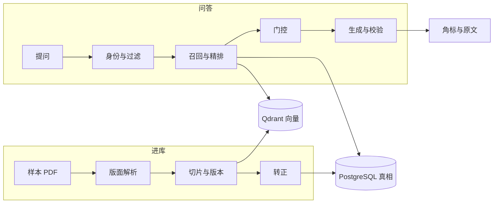

真正在模块之间流动的只有四个对象：文档、版本、切片、证据包。前三个落库，第四个只活在一次问答里。把这四个东西的字段定死，剩下的就只是"谁在什么时候读写它"。第六个交接点之后，系统就不再产生新对象，只产生答案和审计。


读这份文档有几个约定。每章末尾都有一段"交给下一步什么"，那是模块的出口，也是排查线上问题时最先要看的地方。阈值和条数只在第二章和第三章各定义一次，后面直接引用，不再重复解释。能说人话的地方不出现英文，绕不开的名词统一收在附录 E。

## 2 四个对象

系统的所有契约都建立在这四个对象上。它们的字段一旦定死，模块之间的接口就只剩"传哪个对象、传哪几个字段"，不再需要每次重新商量。

### 2.1 文档

文档是"这份材料"的抽象，不是文件本身。它的编号叫 `doc_key`，由文件所在路径与标题归一化而来：去掉版本号、日期、序号后缀，只保留主体名。这样做是为了让"2024 版差旅管理办法"和"2025 版差旅管理办法"落在同一个文档编号下，才谈得上覆盖。

为什么不用文件名：改个名就断开了，历史全丢；为什么不用内容哈希：改一个字就变成另一份文档，版本永远连不起来。这两条都试过，都会把"同一份文档的演进"拆成互不相干的碎片。

一个文档一行记录，页数在解析完成后回填。文档本身不存正文，正文永远挂在版本下的切片上——一份文档有多个版本，正文只属于某一个版本。

### 2.2 版本

一次解析产出一个版本，版本号由文档编号加内容指纹的短码组成。指纹是文件字节的哈希；同一文档同一内容只允许有一个版本，这条由数据库唯一约束兜底，不靠应用层自觉。

版本有四种状态：待转正、生效、已下线、已清除。另外两个终态是跳过与失败——跳过表示这份内容之前已经进来过，失败表示解析没走完。状态只能由摄取任务和翻牌事务改，别的地方一律只读。这条规矩的理由很简单：版本状态决定了"哪些切片能被检索到"，任何模块都能改它，就等于谁都能让已废止的条款复活。

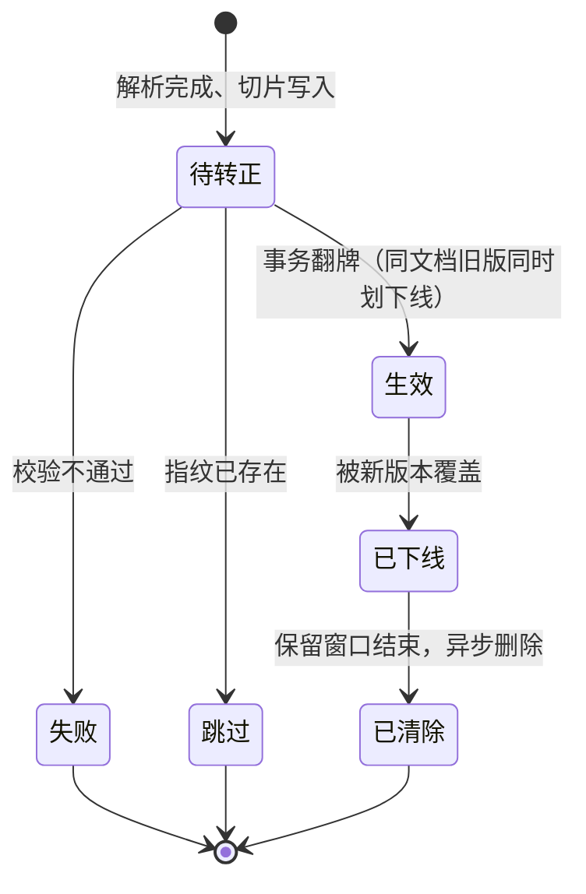

### 2.3 切片

切片是检索与引用的最小单元，分两级。子片 256 到 512 字、重叠 64 字，被检索命中；父片 1024 到 2048 字或整章，被送进模型作答。子片记 `parent_id` 指向父片，父片这个字段为空。

每个切片带六项随行信息，缺一项都会在后面某个环节出问题：页码（引用要跳页）、坐标（前端要画框）、类型（正文、表格、图，决定取哪一列做文本）、业务时间与可信度（时间过滤只认显式时间）、权限（部门与角色列表）、版本号（检索入口做兜底校验）。

切片本身不维护自己的状态。它显示"是否可检索"时，一律看所属版本的状态。这么定是为了避免两处状态打架：如果切片单独标记了"已下线"，而版本又翻回来了，就会出现版本生效但切片不可见的鬼情况。

### 2.4 证据包

证据包不是表，是这次问答临时组装的数组，问答结束就丢，不落库。它只在两个地方存在：生成模型的输入，以及审计里的一份快照。

每条证据有编号，从 1 开始，和答案里的角标一一对应。编号是这次问答内的局部编号，不是切片编号——用户看到的角标是序号，系统内部用的是 `chunk_id`，两者靠这张映射对上。

每条证据至少带这些：切片编号、文档编号与标题、页码、坐标、按类型取好的文本（正文取原文，表格取转成文本的那一版，图取转译结果）、三路分数（语义、关键词、精排）以及它来自哪一路。分数要一起带上，是因为判定看精排分，排查问题时却要看另两路为什么没把它排上来。

| 对象 | 一行代表 | 谁写 | 谁读 | 落库 |
|---|---|---|---|---|
| 文档 | 一份材料的抽象 | 摄取任务 | 检索、前端 | 是 |
| 版本 | 一次解析的产物 | 摄取任务、翻牌事务 | 检索、审计 | 是 |
| 切片 | 一段可检索的正文 | 摄取任务 | 检索、生成、前端 | 是 |
| 证据包 | 一次问答的取材 | 检索 | 生成、校验、审计 | 否 |

字段的完整定义在附录 A，这里只给形状。三条规矩贯穿全书：派生字段可以随时重建、证据包不进库、检索只认生效版本。

### 2.5 一句话说清四个对象的关系

一份文档有若干版本，每个版本有自己的切片，切片按父子两级组织；一次提问从某个生效版本里取出一批切片，组装成证据包，用完即弃。四个对象之外，系统不再创造别的东西——答案、角标、审计都是这四个对象的投影。

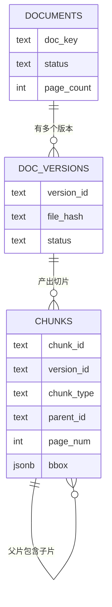

### 2.6 为什么这样

把对象减到四个，是这份设计里最省事的一刀。早期的方案里还有"任务""索引条目""引用记录"这些中间对象，结果是每加一个模块就要多一套契约。现在任务只是版本的一个状态，索引条目就是切片本身，引用记录是证据包的一份快照——同一样东西不再有第二个名字。

代价是切片表比较宽（二十多个字段），写的时候一次要写全。换来的是检索时不用联表：过滤、排序、取文本都在一张表上完成，这对 30 毫秒的预算是必要的。

**交给下一步什么**：第三、四章负责生产前三个对象，第五到第十章只读写它们，不再新增对象类型。任何一章如果需要新对象，先在第二章加，再动别处。

## 3 离线一：从 PDF 到切片

这一章只管一件事：把一份 PDF 变成一组带坐标、带时间、带权限的切片。产出物要满足三个条件，缺一条后面就没法用——能定位（页码与坐标对得上原页）、能过滤（权限与时间在切片上就有）、能重建（派生字段丢了可以从存档重算）。

### 3.1 入口：扫描样本目录

摄取不是"上传接口"，是扫目录。原因有二：本期文件只在本机，没有上传的必要；扫目录天然幂等，重复跑不会多出一份。

触发规则：每轮扫描按文件修改时间与内容指纹判断，指纹没变就跳过，变了就产生新版本。同一时刻只允许一个扫描任务在跑，用一次性的数据库锁实现，第二个任务进来直接返回"正在运行"，不排队。

| 情况 | 判定 | 动作 |
|---|---|---|
| 指纹未变 | `file_hash` 与库里最新版一致 | 跳过，不产生任务 |
| 指纹变了 | 同一 `doc_key` 出现新指纹 | 建版本，状态待转正 |
| 新文档 | `doc_key` 不存在 | 建文档 + 建版本 |
| 文件读不到 | 权限或路径问题 | 记失败，不动已有版本 |
| 扫描进行中 | 锁被占用 | 返回 409，不重复启动 |


### 3.2 版面：四类区域与坐标

一页纸被切成四类：正文、表格、图、页眉页脚。前三类进库，页眉页脚丢掉。判断页眉页脚不靠位置靠重复：同一段文字在一半以上的页面出现，就判为页眉页脚，删掉。这条规则会误删"每页都出现的条款编号"，所以只删长度小于 40 字且不含数字单位的行。

坐标用归一化，横纵都除以页宽页高，落在 0 到 1 之间。四个边界要处理：页面旋转的，先按旋转角把坐标转回正；双栏排版的，阅读顺序按栏而不是按行；扫描页没有文字层的，先做识别再算坐标；页面尺寸异常的（超大图纸），坐标照样归一化，不额外裁剪。

| 边界 | 处理 | 后果 |
|---|---|---|
| 页面旋转 90/180 度 | 按旋转角变换坐标后再归一化 | 不处理则高亮框位置全错 |
| 双栏 | 按栏切分阅读顺序 | 不处理则一句话被拆成两栏拼起来 |
| 扫描页 | 识别后按文本框位置算坐标 | 无坐标则无法溯源 |
| 无表格线但有对齐列 | 按列间距聚类成表 | 漏判则整表进正文，检索不到 |
| 页眉页脚识别失败 | 保留但标低置信 | 检索时噪声变多，不致命 |

### 3.3 表格：一份存档、两份派生

表格在库里存三份东西，分工必须分清，否则后面会打架：

- `table_html`：保真存档。合并单元格、跨行表头、合计行原样保留，前端渲染与人工核对都看它。
- `table_md`：派生文本。喂模型、做向量编码、建词法索引都用它。因为标签会占 token 也污染语义。
- `table_cells`：单元格矩阵，行号、列号、值、是否表头。校验阶段对齐数字用它，比在 HTML 里找子串可靠。

转换规则写死，不交给模型：合并单元格按"左上角为值、其余格复制该值"展开；空单元格填 `-`；表头行照留，Markdown 不支持合并表头，展开成重复列名。三条规则都会改变"看起来的样子"，所以 HTML 存档不能丢。

| 边界 | 处理 | 备注 |
|---|---|---|
| 跨页续表 | 按表号合并；合不了标"续表" | 合并失败时切片里注明，别硬拼 |
| 无表头 | 首行当表头，标 `header_inferred` | 校验时不拿首行当字段名 |
| 嵌套表 | 拍平成外层表，内层表另存一条切片 | 硬塞进一格会丢结构 |
| 单行单列表格 | 转成一句文本 | 这种"表格"其实是标签 |
| 单元格内换行 | 合并为空格，保留原顺序 | 换行会让 md 表格断行 |

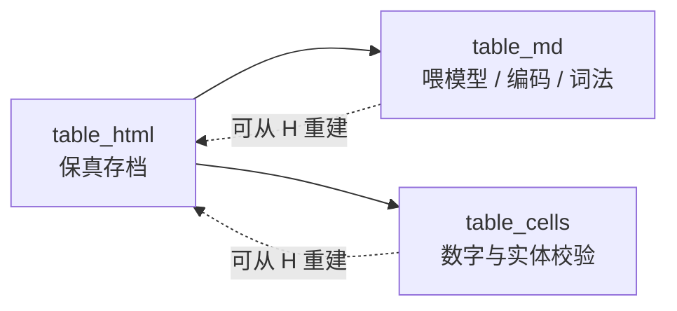

### 3.4 图表：裁图、转译、对账

图表走三步。先裁原图，按至少 200 DPI 以无损 WebP 存到 `figures/{chunk_id}.webp`；再交模型转译，统计图抽成"轴名、单位、类别、数值"的表，结构图抽成节点与关系两张表；最后对账——转译出来的每个数值都要落在轴刻度范围内，并且能与图例、标签对上，对不上就判这次转译失败，这条图不入库。用无损而不用有损，是因为刻度、小字和细线被压缩后会读错数，对账拦不住源头失真。

对账这一步是硬要求，不是优化。模型读图最常见的错是把 47% 读成 74%，或者把两条曲线搞反；没有对账，这种错会一路带到答案里，而校验阶段只看"数字在不在证据里"，证据本身错了就拦不住。

| 边界 | 处理 | 后果 |
|---|---|---|
| 图例缺失 | 转译标 `legend_missing`，置信下调 | 多条曲线时分不清谁是谁 |
| 多曲线交叉 | 逐条列出，注明"按颜色/标记区分" | 只给一条会漏 |
| 饼图百分比 | 求和必须落在 99 到 101 之间 | 和不拢说明读错 |
| 坐标轴无单位 | 单位字段写 null，不猜 | 猜出来的单位会进答案 |
| 图太小 (< 200 DPI 仍有压缩) | 放大后重裁，仍不行则标失败 | 糊图读出来的数不可信 |

### 3.5 切片：父子与随行信息

切片按父子两级组织。子片负责被检索命中，长度 256 到 512 字，相邻子片重叠 64 字，避免一句话被切断后两边都检索不到。父片负责被送进模型，长度 1024 到 2048 字或整章，按章节标题切，不按字数硬切。

每个子片带六项随行信息：页码、坐标、类型、业务时间与可信度、权限、版本号。六项缺一项，后面就有一处功能不可用——缺页码不能跳转，缺坐标不能高亮，缺类型会拿错文本，缺时间会混进过期条款，缺权限会越权，缺版本号则无法在检索入口做兜底校验。

| 边界 | 处理 |
|---|---|
| 超长表格（整表超过 2048 字） | 整表单独成片，不切；标 `may_exceed` |
| 目录、封面、修订记录 | 跳过，不进库 |
| 超短段落（< 80 字） | 与相邻段落合并后再切 |
| 一章超过 2048 字 | 按小节标题再切一层父片 |
| 表格与正文混排 | 表格单独成片，正文照常切 |

### 3.6 这一章交给下一步什么

产出的是"待转正"的版本与切片：状态为待转正，正文、坐标、权限、时间都已带上，向量还没算完也算完但尚未可见。第四章负责把它们翻成唯一生效版本；第五到第十章只读不写。

| 字段 | 示例 | 谁读 |
|---|---|---|
| `version_id` | `lv_2025_a91f` | 翻牌、检索兜底 |
| `chunk_type` | `table` | 取文本时选列 |
| `bbox` | `[[0.12,0.34,0.88,0.51]]` | 前端画框 |
| `effective_date` | `20250301` | 时间过滤 |
| `allowed_depts` | `["fin","hr"]` | 前置过滤 |

**交给下一步什么**：一个待转正的版本，以及它名下所有带随行信息的切片。下一章不重新解析，只做三件事——翻牌、同步、回收。

## 4 离线二：转正、同步与回收

这一章解决"什么时候新版本才能被看见，以及旧版本什么时候消失"。这里的每一个动作都影响线上检索，所以规则写得比别处死。

### 4.1 翻牌：一个事务里改三处

翻牌要做三件事，必须一起成功或一起失败：把同一文档的旧版本划为已下线、把新版本划为生效、把新版本名下的切片状态同步为生效。三处写在同一个事务里，任何一个失败就整体回滚，新版本退回待转正。

并发上一份文档不能同时翻两次。用数据库咨询锁按 `doc_key` 串行化，第二个翻牌请求直接等锁，不并发写。这条不是洁癖：两份同时生效会在检索里产生"同一句话两个版本都命中"的结果，引用都不知道该指哪一页。

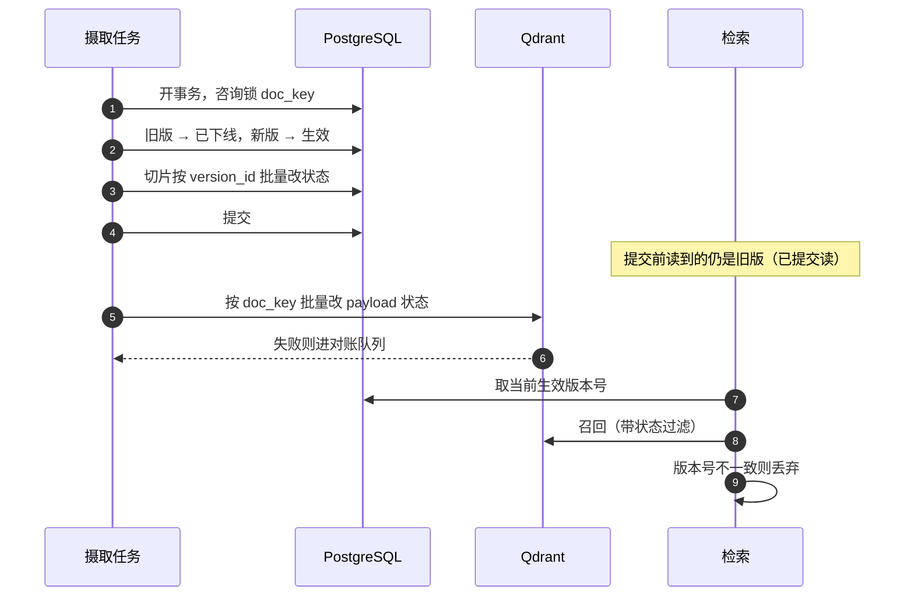

### 4.2 同步与对账

向量库里的状态是副本，允许落后，但要有上限：翻牌后一分钟内必须同步完。同步按 `doc_key` 一次性改整个集合里的状态字段，不逐条改——逐条改在几十万点上会跑很久。

同步失败重试三次，仍失败就把这条差异写进对账队列。对账任务每小时跑一次，比对两边的版本号与状态，发现不一致以数据库为准覆盖向量库，并记一条漂移日志。漂移本身不可怕，漂移没人数才可怕。

| 情况 | 处理 | 用户感知 |
|---|---|---|
| 同步在一分钟内完成 | 正常 | 无 |
| 同步失败重试中 | 检索入口的版本校验会挡住旧片 | 可能少召回几条 |
| 对账发现漂移 | 以库为准覆盖 | 无 |
| 向量库长时间不可用 | 检索整体降级为"暂不可用" | 明确提示，不返回半套结果 |

### 4.3 回收

旧版本先标已下线，保留 24 小时，再删。保留窗口不是流程洁癖，是给回滚留的门：新版解析错了，窗口内还能把旧版翻回来，超过窗口就只能重跑。

删除是级联的：切片行、向量点、切片图一起清；样本原件不删，它是测试资产。删除任务异步跑，失败重试，连续失败三次转人工清单，不在线上卡着。

### 4.4 边界情况

| 情况 | 处理 |
|---|---|
| 新版解析到一半进程崩了 | 任务超时判失败，待转正切片清理，旧版继续服务 |
| 同一内容重复入库 | 唯一约束拦截，返回已存在，不建新版本 |
| 翻牌后发现问题要回滚 | 24 小时内把旧版翻回生效，新版划下线 |
| 两份文档 `doc_key` 撞车 | 建文档时校验，撞车即拒绝入库，不改编号规则 |
| 删除时向量库不可用 | 先删库行，向量点进待删清单，恢复后补删 |

### 4.5 这一章交给下一步什么

交给在线链路的是"一个确定的生效版本 + 一份可检索的切片集合"。在线链路从此不再关心版本是怎么来的，只关心"当前生效的是哪个版本号"，并在召回后用它做一次校验。

**交给下一步什么**：从第五章开始进入在线链路，第一个动作是认人——把登录凭证换成一份身份快照，再换成一组过滤条件。

## 5 在线一：身份与过滤条件

在线链路的第一个动作不是理解问题，是认人。因为"能不能看"决定了"能不能搜"，顺序反了就得在召回之后再删结果，那既浪费算力又泄露存在。

### 5.1 身份快照

身份不在本系统维护，从登录凭证里解出来，落地成一份快照：用户标识、部门列表、角色列表、是否管理员。四个字段之外不再扩展——每多一个字段，就要在过滤、审计、前端三处同步改。

取值示例：`{"user_id": "u_1024", "depts": ["fin", "corp"], "roles": ["staff", "approver"], "admin": false}`。部门与角色都是数组，因为一个人本来就可能属于多个；用单值会在调岗时出问题。

缺失时的处理要写死，不能"看着办"：凭证无效返回 401，凭证有效但没有部门则视为空集，只能看公开文档；管理员可以跨部门，但审计里必须记录"以管理员身份访问"。这三种情况都会出现，尤其是新入职还没分配部门的人。

### 5.2 过滤表达式

过滤是一个布尔表达式，三个分支取或：公开文档、部门命中、角色命中。部门命中指两个集合有交集，不是包含；角色同理。这条要写清，否则实现的人容易写成"用户部门必须在文档部门列表里"，多部门的人就漏了。

时间条件是第二组，只有问句里出现时间限定才加：取业务日期在区间内的切片，且只认显式时间（`date_confidence = explicit`）。不问时间就不加时间条件，但必须限定"当前生效版本"，否则会混进已废止的旧条款。

版本条件是第三组，永远存在：切片所属版本等于该文档的当前生效版本。它不写在过滤表达式里，而是召回后逐条校验——放进过滤条件会让查询计划退化，放在校验里只多一次主键查询。

| 边界 | 处理 | 示例 |
|---|---|---|
| 用户无部门 | 只匹配公开文档 | `depts: []` → 只命中 `is_public` |
| 多部门 | 任一命中即可 | `["fin","corp"]` 命中任一即通过 |
| 角色与部门都为空 | 同上，只匹配公开 | 新入职常见 |
| 管理员 | 跳过部门与角色，但仍校验版本 | 审计记 `admin_access` |
| 时间条件缺年份 | 补当前年份，并在回答里注明假设 | "三月" → 2026-03 |
| 财年与自然年混用 | 以企业财年配置为准，默认自然年 | 需在配置里写明 |

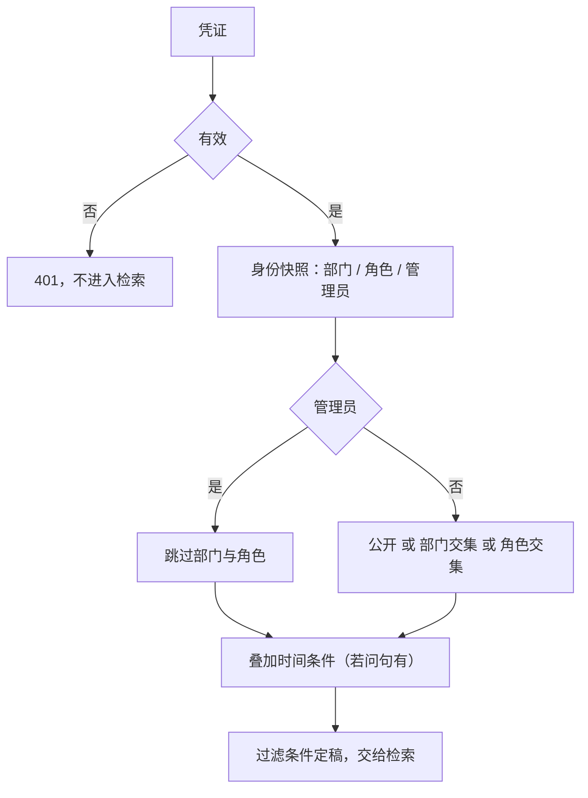

### 5.3 时间语义归一

用户说的时间大多不是绝对日期，得先换算，换算规则固定成表，不做语义猜测。

| 用户说法 | 归一结果 | 说明 |
|---|---|---|
| 去年 | 2025-01-01 至 2025-12-31 | 以系统时钟为准 |
| 上个月 | 上月一日至月末 | 月底边界按日历 |
| 最新版 | 不加时间条件，只取当前生效版本 | 与时间过滤互斥 |
| 前年制度 | 2024 全年 | 同"去年" |
| 三月的标准 | 2026-03，且注明假设 | 缺年份补当前年 |

边界三条：跨年表述（"去年十二月"）按自然年拆；财年与自然年不一致时以配置为准；无法换算的时间词（"最近""前段时间"）不加条件，但在答案里说明"未限定时间"。

### 5.4 这一章交给下一步什么

交出一个结构化对象，不是一句自然语言：

| 字段 | 示例 | 用途 |
|---|---|---|
| `question_raw` | `差旅住宿标准是多少` | 审计原文 |
| `depts` / `roles` | `["fin"]` / `["staff"]` | 过滤 |
| `time_range` | `null` 或 `[20250301, 20251231]` | 过滤 |
| `require_active` | `true` | 版本条件 |

**交给下一步什么**：一份身份与条件；下一章在它的基础上改问句、补时间、判跳数，但不许改权限。

## 6 在线二：问题理解

这一章解决"把用户随口说的话，变成一次能执行的检索"。做三件事：换时间说法、消指代与扩同义、判断这次要不要多步。三件事都不许改权限。

### 6.1 指代消解

多轮对话里最常见的是"那它呢""这个流程要几天"。规则是：上文出现过文档或实体，就用最近的指代对象替换；没出现过就不替换，直接按原话检索，宁可查不到也不猜。

| 情况 | 处理 | 示例 |
|---|---|---|
| 指代上一轮结果 | 替换为具体文档名与条款号 | "那它呢" → "差旅管理办法第 12 条" |
| 指代不清（多个候选） | 不替换，触发澄清 | "这个" 指两份文档 → 给选项 |
| 上一轮是拒答 | 不继承任何实体 | 拒答后追问按新问题处理 |
| 否定句 | 保留否定，改写时不反转 | "不含住宿的报销" 不得改成 "住宿报销" |

### 6.2 改写与扩展

改写只做三件事：同义词扩展、缩写展开、口语转书面。不许做的三件：不放宽条件（"上海以外"不能扩成"上海"）、不引入库外概念、不改数字。

改写的产物不参与事实认定，只用于检索。这句话要写进代码注释里，否则迟早有人拿改写后的句子去生成。

| 改写 | 允许 | 不允许 |
|---|---|---|
| 同义 | "住宿费" ↔ "住宿标准" | 把"上限"改成"标准" |
| 缩写 | "差标" → "差旅标准" | 展开成库里没有的全称 |
| 口语 | "报销能报多少" → "报销额度" | 补上没说的条件 |

### 6.3 单跳与多跳的判定

判定不看问句长短，看"答案能不能在一份文档的一段话里找齐"。

| 特征 | 判定 | 例子 |
|---|---|---|
| 单一实体、单一属性 | 单跳 | 住宿标准是多少 |
| 含"分别""各自""对比" | 多跳 | 各部门的差标分别是多少 |
| 需要跨文档拼接 | 多跳 | A 制度说的流程在 B 系统对应哪一步 |
| 含因果或前置条件 | 多跳 | 报销需要哪些前置审批 |
| 明显超出库范围 | 直接拒答，不检索 | 明天天气 |

判定为多跳不等于一定跑多跳，进入第八章后每一跳还要独立过门槛；判定为单跳也不排除第二次检索（澄清之后会重查一次）。

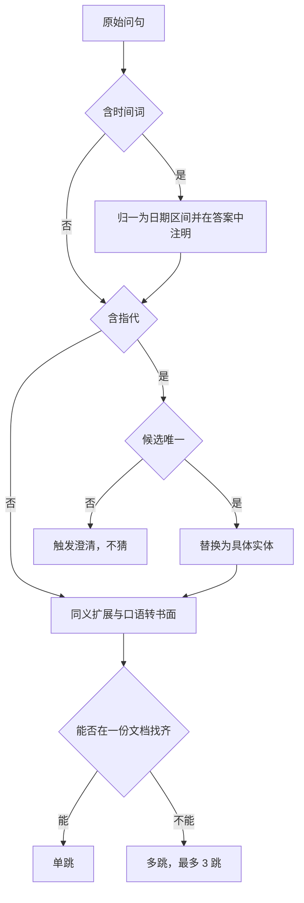

### 6.4 这一章交给下一步什么

| 字段 | 示例 | 说明 |
|---|---|---|
| `query` | `住宿费 限额 标准` | 用于检索，不是给用户看的 |
| `entities` | `["差旅","住宿费"]` | 供澄清与覆盖检查 |
| `time_range` | `[20250101,20251231]` | 已归一 |
| `mode` | `single` / `multi` | 预判，可被检索结果推翻 |
| `rewrite_trace` | `住宿标准→住宿费限额` | 审计用，不进提示词 |

**交给下一步什么**：一句可检索的问句、一组实体、一个时间窗和一个跳数预判。下一章据此取数，并有权把 `mode` 改回单跳——如果第一跳就找齐了证据。

## 7 在线三：检索

这一章把"条件"变成"候选"。三个动作：两路取数、按名次合并、精排截断；最后加一道版本校验，把不该出现的切片挡在打分之前。

### 7.1 两路取数

语义一路取 30 条，关键词一路取 30 条，都带过滤条件。为什么是 30 而不是 50：精排是逐对打分，候选越多越慢，30 条在单机 CPU 上能把精排压在几百毫秒内；再翻一倍，首字时间就会破预算。

关键词这一路走数据库三元组匹配，不依赖分词词典。它对编号、型号、条款号、专名有效，对长句和同义改写基本无效——这正是它存在的理由：补语义的短板，不跟语义抢活。

| 边界 | 处理 | 后果 |
|---|---|---|
| 查询少于 3 个字 | 关键词路跳过，只走语义 | 三元组匹配无意义 |
| 纯数字、纯编号 | 关键词路加权，语义路照取 | 语义对编号不敏感 |
| 英文缩写（如"差标"） | 先按 6.2 展开再取 | 不展开几乎命中不到 |
| 一路为空 | 另一路照常进精排 | 不硬凑数量 |
| 两路命中同一切片 | 合并时只留一条，记两个名次 | 重复会挤掉别的候选 |

### 7.2 按名次融合

合并用名次相加，不用分数加权。理由很直接：两路的分数不在一个尺度上，硬凑权重等于人为造一个参数，每次调语料都要重调。名次是可比的——排第一就是排第一。

并列时的处理要定死：名次和相同，先看语义路的名次，再看精排前是否来自同一父片。同一父片最多保留两条子片，因为父子切片的内容高度重叠，全留下会把精排预算浪费在重复信息上。

| 情况 | 处理 |
|---|---|
| 两路名次和相同 | 语义名次靠前者优先 |
| 同父片的第 3 条及以后 | 丢弃，留前两条 |
| 一条只在一路出现 | 另一路名次记为 31 |
| 切片文本为表格 | 不特殊处理，与正文同排队 |

### 7.3 精排与截断

精排把问句和每条候选成对送进模型，逐条打分，取前 5 到 8 条。5 是下限，8 是上限：少于 5 条，证据容易不全；多于 8 条，上下文变长后模型反而容易挑错重点。

| 边界 | 处理 | 用户感知 |
|---|---|---|
| 候选不足 5 条 | 有多少用多少，不补 | 可能落进低置信 |
| 精排超时（> 800 毫秒） | 退回按名次取前 8，置信降一档 | 答案更保守，审计记 `degrade=rerank_timeout` |
| 精排模型不可用 | 同上，并置一条告警 | 同上 |
| 最高分与其他差距极大 | 只取最高分那一条 | 证据更聚焦 |

### 7.4 版本兜底

进精排前，用候选切片所属版本号回查该文档当前生效版本。不一致就丢弃，不进打分。这一步只花一次主键查询，但能挡住翻牌同步那一分钟的漏网——那段时间向量库里还是旧状态。

为什么不做进过滤条件：把"生效版本号"放进过滤，会让向量库的过滤选择性变差，查询会退化。放在校验里逐条剔除，代价小得多。


### 7.5 参数与预算

| 参数 | 取值 | 说明 |
|---|---|---|
| 每路取数 | 30 | 两路共 60，去重后约 40–50 |
| 精排候选 | 全部去重结果 | 上限 50，超了按名次截 |
| 进证据包 | 5–8 | 复杂问题取上限 |
| 召回耗时 | 95% 在 30 毫秒内 | 含过滤 |
| 精排耗时 | 单条数十毫秒 | 与候选数线性相关 |

### 7.6 这一章交给下一步什么

交出一组候选，每条带三路分数与出处：

| 字段 | 示例 |
|---|---|
| `chunk_id` | `ch_9f2c31` |
| `dense_rank` / `lexical_rank` | `3` / `未命中` |
| `fused_rank` | `5` |
| `rerank_score` | `0.62` |
| `text` | 按类型取好的文本 |
| `bbox` / `page_num` | `[[0.1,0.2,0.9,0.3]]` / `47` |

**交给下一步什么**：5 到 8 条带分数的候选。下一章决定这些够不够、要不要问清楚、要不要再找一轮。

## 8 在线四：门控与编排

这一章是整套系统里最"像决策"的一章：拿到几条候选，判断够不够，不够时是拒、是问、还是继续找。三个动作的顺序不能换：先看够不够，再看清不清，最后才谈要不要多跳。

### 8.1 三段门控

判断只看精排后的最高分，分三段处置。中间那一档的存在，是因为"有一点像"和"完全没有"在用户那里的感受完全不同：前者该告诉他"可能有这几份"，后者只能告诉他"库里没有"。

| 区间 | 判定 | 动作 | 用户可见 |
|---|---|---|---|
| < 0.20 | 无相关 | 直接返回拒答，不调模型 | "未找到可验证依据" |
| 0.20 至 0.40 | 弱相关 | 拒答 + 有权限的疑似文档清单（≤3 份） | 拒答 + 可点文档 |
| >= 0.40 | 有支撑 | 进入歧义与覆盖检查 | 答案或澄清 |

除最高分还有两个辅助条件，只在最高分刚过线时用：有效证据条数（复杂问题要求 ≥2 条分属不同段落）、问题关键实体是否在证据里出现（出现不了说明答非所问）。

| 边界 | 处理 |
|---|---|
| 最高分在 0.38–0.42 之间 | 按辅助条件决定，不单独靠分数 |
| 多条同分且来自不同文档 | 进澄清，不让模型自己选 |
| 最高分高但只有一条证据 | 单事实问题放行；多实体问题拒答 |
| 分数刚好低于 0.20 但关键词强命中 | 仍拒答，关键词命中不构成证据 |

### 8.2 澄清

澄清只在两种情况下触发：条件确实缺失（没说部门、没说年份），或者候选来自两份以上文档且分数接近（差小于 0.05）。

选项不是凭空编的，只能从检索到的事实里取：用文档标题 + 章节名，最多四个，每个选项带一个可回填的参数（文档编号或时间范围）。用户点选后，把参数并进条件，重新检索一次，不再追问第二次——问两次就是审问。

| 情况 | 处理 |
|---|---|
| 用户不选，直接追问 | 按原问题再检索一次，仍不清就拒答 |
| 选项超过四个 | 只给最相关的四个，其余收进"更多" |
| 澄清后仍多份冲突 | 拒答，说明"库内存在多份不一致的资料" |

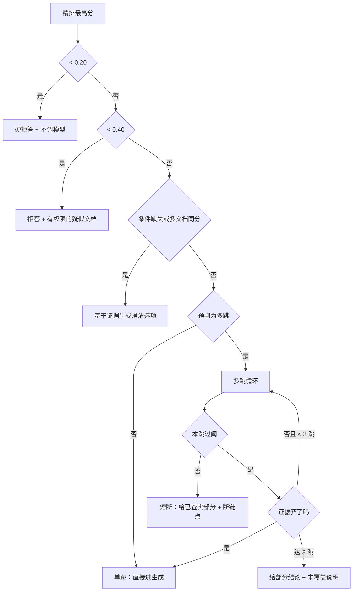

### 8.3 多跳

多跳不是"多查几次"，是"带着已查实的事实去查下一件事"。每一跳做四件事：根据缺口拆子问题、带黑板检索、判本跳是否过阈、把确定事实写回黑板。

黑板只放确定事实：每条事实带切片编号、页码、跳次和一句原文摘录。不放候选、不放分数、不放模型推测——黑板一旦掺了推测，后面每一跳都会在错的前提上继续。

停止条件三条，谁先满足谁生效：证据齐了、跳数到 `Max Hops = 3`、本跳不过阈（断链）。断链时交出去的是"已经查实的部分 + 断在哪一步"，不是一句"查不到"。

| 边界 | 处理 |
|---|---|
| 第一跳就断链 | 直接拒答，不进多跳 |
| 某一跳查到的是旧版本 | 版本校验拦住，按断链处理 |
| 子问题与已查实事实冲突 | 停止，输出冲突说明，不强行统一 |
| 三跳后仍缺一部分 | 输出已答部分 + 明确列出未覆盖的问题 |

### 8.4 这一章交给下一步什么

交出一个判定对象，五种取值之一，后面的处理完全不同：

| `verdict` | 含义 | 带什么给下一步 |
|---|---|---|
| `pass` | 证据足够，直接作答 | 证据包（5–8 条） |
| `clarify` | 需要用户补条件 | 选项数组 + 临时条件 |
| `reject_none` | 库里没有 | 拒答原因码 |
| `reject_low` | 有一点像但撑不住 | 有权限的疑似文档 ≤3 |
| `partial` | 多跳收敛但未覆盖全部 | 已查实事实 + 未覆盖清单 |

**交给下一步什么**：一个判定，加一份证据包或一份拒答材料。下一章只对 `pass` 和 `partial` 生效，其余直接走到输出。

## 9 在线五：生成

这一章只做一件事：把证据包变成一段可校验的草稿。注意用词——是"草稿"，不是答案。答案要等下一章校验通过才算数。

### 9.1 证据包怎么组装

组装规则五条，按顺序执行：

1. 取文本按类型走：正文取原文，表格取转成文本的那一版（不取 HTML），图取转译表。
2. 同一父片的多条子片合并成一条证据，页码取子片里最靠前的一页。不合并的话，五行证据其实是同一段话，模型会重复引用。
3. 总长度封顶 6000 字，超了按精排分从低往高丢，不截断单条证据。
4. 编号从 1 开始按分数降序，用户看到的角标就是这个顺序。
5. 每条证据带一行来源标记：文档标题、页码、切片编号，供模型引用时抄。

为什么不直接塞 HTML：标签占 token，还会让模型把属性名当内容；转成文本后同样的信息能省三成长度。


### 9.2 提示词契约

提示词分三段：角色与约束、证据包、输出格式。三段都固定，不随问题变。

约束只有三句：只用证据回答；每个事实句结尾标 `[n]`；证据不足就返回 `unknown`。解码参数固定 `Temperature = 0`，不留随机余地。输出只有四个字段：状态、答案、引用编号数组、逐条主张（每条主张带自己的引用）。要求逐条主张，是因为第 10 章要按句校验，没拆开就没法查。

| 模型返回形态 | 处理 |
|---|---|
| 正常 JSON | 进入校验 |
| 非 JSON 或带代码块标记 | 宽松解析一次；仍失败则降级 |
| 缺 `status` 或 `citations` | 降级，不重试 |
| `status=answered` 但答案为空 | 视为失败，降级 |
| 引用编号超出证据范围 | 校验第一道即拒答 |

### 9.3 生成的边界

| 情况 | 处理 | 理由 |
|---|---|---|
| 部分可答（三条主张只有两条有引用） | 整条拒答，不保留能答的部分 | 半对半错的答案比拒答更难被发现 |
| 两份证据互相矛盾 | 拒答，说明"库内资料不一致" | 模型不该替用户裁决 |
| 证据超长被截 | 在答案里说明"仅依据前 N 条" | 避免用户以为查了全部 |
| 问题要求预测或建议 | 拒答 | 证据里没有未来 |

### 9.4 这一章交给下一步什么

交出一份草稿，它还不能给用户看：

| 字段 | 示例 | 说明 |
|---|---|---|
| `status` | `answered` | 或 `unknown` |
| `answer` | `每人每天 500 元[1]` | 未校验 |
| `claims` | `[{"text":"500 元","citations":[1]}]` | 逐条主张，校验单位 |
| `citations` | `[1]` | 用到的证据编号 |

**交给下一步什么**：一份带引用的草稿和它用到的证据原文。下一章逐条核对，核不过就整条撤掉。

## 10 在线六：校验与输出

这一章是最后一道闸。前九章里任何一个环节偷懒，都会在这里暴露；反过来说，这里放过的错误，就再没有机会拦住了。

### 10.1 五道校验

五道按成本从低到高排，任何一道不过就停，不必跑完。

第一道查引用编号是否真实存在：草稿里的每个 `[n]` 必须落在证据编号范围内，`n` 不能重复定义，也不能指向不存在的证据。这一道是纯字符串比对，几乎不花时间。

第二道查每个主张是否至少有一个引用。按 `claims` 逐条看，没有引用的主张直接判失败——"没有引用"通常不是忘了标，而是模型自己补了一句。

第三道查数字与专名能否在被引证据里定位。数字包括金额、比例、日期、期限；专名包括部门名、系统名、条款号。定位失败有两种原因：模型算错了，或者证据里写的是另一种表述（"五百万"对"5,000,000"），后者靠归一化解决，前者只能拒。

第四道是模型判别：把问题、被引证据原文、草稿三样交给判别器，只要"支持"或"不支持"。判别器不看其他证据、不看上下文，避免它自己开始推理。

第五道查内部一致性：草稿里同一件事不能出现两个数。这一道能用规则做（同实体同单位取不同值即冲突），不必再调一次模型。

| 道次 | 规则 | 不过时 | 边界 |
|---|---|---|---|
| 一 | 引用编号存在且在范围内 | 拒答 | 编号解析失败按不存在处理 |
| 二 | 每条主张至少一个引用 | 拒答 | 主张为空也算失败 |
| 三 | 数字与专名可在被引证据定位 | 拒答 | 归一化后仍找不到即失败 |
| 四 | 判别器判"支持" | 拒答 | 超时/格式错按不支持 |
| 五 | 同实体同单位无两个值 | 拒答 | 单位不同的先归一 |

### 10.2 数字对齐怎么算

抽取用固定规则，不靠模型：阿拉伯数字连写、中文数字（五百万、三成）、带单位的组合（500 元、30 个工作日）、百分比与区间。抽出来后做三步归一：中文数字转阿拉伯、单位统一（万元折算成元）、去掉千分位与全角符号。

比对在被引证据的数字集合里做，不要求字符串相等，要求数值相等且单位一致。"500 元"与"每人每天 500 元"算对上；"500 元"与"500 元/月"算对不上——单位不同就是不同的数。

| 证据写法 | 草稿写法 | 判定 |
|---|---|---|
| 5,000,000 元 | 五百万元 | 对上（归一后相等） |
| 30 个工作日 | 30 天 | 不对（单位不同） |
| 80% | 八成 | 对上 |
| 2025-03-01 | 2025 年 3 月 1 日 | 对上 |

### 10.3 三档降级

校验不过不等于给用户一句"出错了"。按情况分三档，措辞不同，因为用户接下来要做的事不同。

| 档位 | 触发 | 给用户什么 |
|---|---|---|
| 只给原文 | 数字或判别不过 | 相关原文片段 + 页码，明确"未形成结论" |
| 部分结论 | 多跳未覆盖全部 | 已查实部分 + 未覆盖清单 |
| 系统异常 | 模型不可用、超时 | 一句"稍后重试"，不暴露内部细节 |

### 10.4 事件流与前端状态

前端拿到的是六类事件，顺序固定：先进度，再逐字，再引用，最后收尾。拒答路径只有进度与收尾两类，没有逐字——前端不能假设一定有正文。

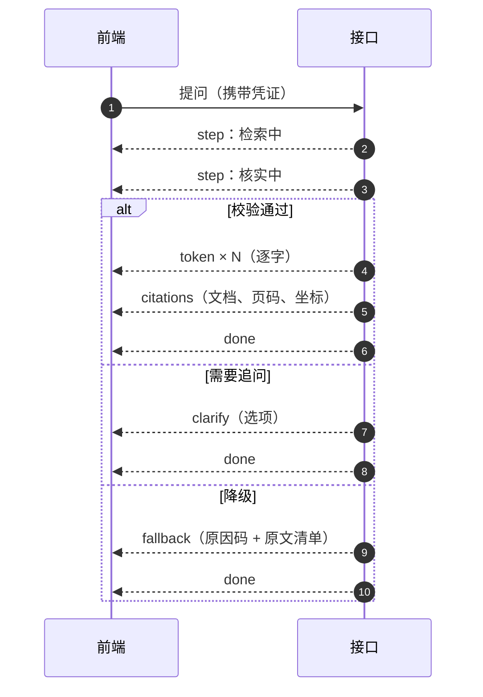

前端状态机只有五个态：空闲、检索中、逐字中、结束、失败。`done` 之后才允许点角标；`fallback` 之后角标指向原文但不给结论；连接中断则显示"已中断，可重试"，不保留半截答案。

### 10.5 这一章交给下一步什么

交出去的已经是最终结果，不再有下游：

| 输出 | 内容 |
|---|---|
| 答案 | 通过校验的文本，或三档降级之一 |
| 引用 | 编号、文档、页码、坐标、片段 |
| 审计 | 问题、证据、判定、耗时、模型版本 |

**交给下一步什么**：没有下一步。剩下两章是横切规则与验收，不产生新对象。

## 11 横切：权限、审计与错误

前三章之外还有三件事不属于任何一步，却会影响每一步：谁能看、留下什么、坏了怎么报。这三件事写在这里，不在各章重复。

### 11.1 三道闸

权限不是一处判断，是三处。第一处在检索前，把没权限的切片挡在候选之外；第二处在取文件前，再核一次——因为前端传来的文档编号是用户可控的；第三处是审计，事后能还原谁在什么时候看了什么。

只做第一处是不够的：如果只过滤检索，用户仍可能通过构造文档编号直接请求原文。只做第二处更不够：先召回再过滤，好证据会被没权限的文档挤掉，候选池还会暴露"库里有这份东西"。

越权时的处理要克制：统一返回 403，不区分"不存在"与"没权限"，也不在提示里透露文档标题。审计里可以记细节，给运维查。

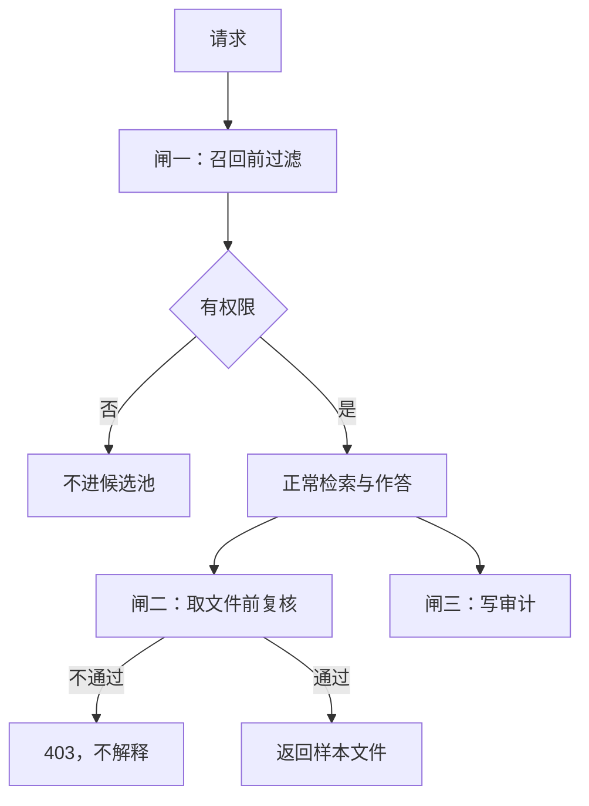

### 11.2 审计

一次问答一条记录，字段不多但都要能用：问题原文、命中的切片编号、最高分与分布、门控判定、草稿、最终输出、降级原因、跳次、耗时、模型版本、身份快照。

示例：`{"q":"住宿标准","hits":["ch_9f2c31","ch_7b01"],"top1":0.62,"verdict":"pass","gate2":"supported","hops":0,"latency_ms":1840,"model":"gw-qwen-max"}`。

保留一年，按合规要求可调。审计里只存切片编号与分数摘要，不存完整原文——原文在库里本来就有，重复存会让审计表变成第二份正文。

### 11.3 错误分类

错误要分类，因为用户看到的文案不同，运维要不要告警也不同。

| 码 | 含义 | 用户文案 | 告警 |
|---|---|---|---|
| `auth_invalid` | 凭证无效 | 请重新登录 | 否 |
| `forbidden` | 无权限 | 无权查看 | 是（连续出现） |
| `no_evidence` | 无相关证据 | 未找到可验证依据 | 否 |
| `low_confidence` | 证据不足 | 现有资料不足以下结论 | 否 |
| `unverifiable` | 校验不过 | 本次不作结论，附原文 | 是（高于阈值） |
| `model_timeout` | 模型超时 | 稍后重试 | 是 |
| `index_stale` | 版本未同步 | 稍后重试 | 是 |
| `internal` | 其他异常 | 稍后重试 | 是 |

### 11.4 限额

限额写死，防止一个请求把整台机器拖垮：

| 项 | 上限 | 超限处理 |
|---|---|---|
| 单问题长度 | 500 字 | 截断并提示 |
| 单次问答耗时 | 30 秒 | 中断，返回超时 |
| 并发问答 | 按机器定，默认 8 | 排队，超时则拒 |
| 多跳 | `Max Hops = 3` | 到顶输出部分结论 |
| 单文档切片数 | 20,000 | 超出拒绝入库，人工处理 |

## 12 验收与未决

最后一章回答两个问题：怎么证明它做成了，以及哪些事现在还没定。

### 12.1 评测集

五十题，四类分工，每类抓一种失败：基础与表格二十题，抓"答案在库里但检索不到"；图表十题，抓"转译读错数"；时间与多跳五题，抓"时间没归对、跳没收敛"；陷阱十五题，抓"没证据也硬答"。

判分口径要统一：答对得满分，拒答得一半，硬答错误得零分；可答题拒答得零分。这样调参的人不会为了覆盖率去降阈值。

### 12.2 四条红线

- 陷阱题拒答率 100%：放过去一道，这套系统就不该上线。
- 数值准确率不低于 96%：金额、比例、日期错一个都是事故。
- 角标可点回率不低于 98%：点不回去，溯源就是假的。
- 忠实度优先于覆盖率：覆盖率掉了可以接受，忠实度掉了不行。

阈值不拍脑袋，用波谷法：把可答与不可答的分数分布画在一起，取低谷区间，通常落在 0.38–0.42。这个区间随语料漂移，所以要能配置下发、能回滚。

### 12.3 门禁与回滚

发布前跑一遍评测集，四条红线任一不达标就不发。参数、提示词、模型名三者都版本化，回滚以版本为单位，不做局部回滚——局部回滚最容易出现"阈值回退了但提示词没回退"的组合态。

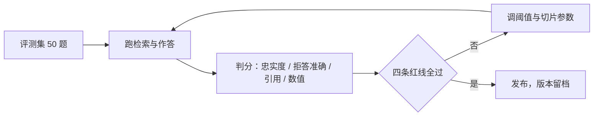

### 12.4 还没定的事

下面这些不是漏了，是现在定就是猜。每一条都写明什么时候必须定，到点没有结论就卡住评审，不许"以后再说"。

| 事项 | 现在怎么做 | 什么时候必须定 |
|---|---|---|
| 向量库 | 单节点 Qdrant | 子片超过 1000 万，或多租户隔离 |
| 队列 | 数据库任务表轮询 | 并发任务上到几十 |
| 读图模型 | 一个商业多模态接口 | 出域审批与配额确定 |
| 生成模型 | 企业兼容网关 | 上下文长度影响切片大小时 |
| 关键词通道 | 数据库三元组 | 评测显示长句召回明显掉队 |
| 文件服务 | 不做，只用样本 | 接入第一份真实文档 |
| 身份字段 | 部门与角色两个列表 | 对接目录服务 |
| 备份 | 库与向量分开备 | 上线前必须定同点策略 |

容量上按全量 10,000 份、约 40–60 万子片规划：向量约 2.3 GB，正文约 0.5 GB，词法索引 1 到 1.5 GB，样本与切片图 60 GB 上下。瓶颈会先出现在编码与精排的算力，不在存储。

**没有下一步**：这份文档到这儿结束。任何改动先改第二章的对象，再改对应章节，最后同步附录 A 与附录 G。

## 附录 A 字段字典

以下是全量字段，正文只写用到的列。口径跟正文不一致时，以此处为准。

### A.1 documents

| 字段 | 类型 | 必填 | 口径 | 示例 |
|---|---|---:|---|---|
| `doc_key` | text | 是 | 文件路径与标题归一化后的稳定标识 | `policy/travel-cn` |
| `filename` | text | 是 | 原始文件名，仅展示 | `差旅管理办法-2025版.pdf` |
| `page_count` | int | 否 | 解析后回填 | `53` |
| `status` | text | 是 | queued / parsed / active / failed | `active` |
| `created_at` | timestamptz | 是 | 首次入库，不随覆盖变化 | `2026-11-20T10:03:00Z` |

### A.2 doc_versions

| 字段 | 类型 | 必填 | 口径 | 示例 |
|---|---|---:|---|---|
| `version_id` | text | 是 | `doc_key` + 内容指纹短码 | `policy/travel-cn#a91f` |
| `doc_key` | text | 是 | 所属文档 | `policy/travel-cn` |
| `file_hash` | text | 是 | 文件字节 SHA-256 | `3b1c...` |
| `status` | text | 是 | pending / active / deprecated / purged / failed / skipped | `active` |
| `activated_at` | timestamptz | 否 | 事务翻牌时间 | `2026-11-20T10:06:12Z` |
| `superseded_by` | text | 否 | 被哪个版本取代 | `policy/travel-cn#c0ab` |

### A.3 chunks

| 字段 | 类型 | 必填 | 口径 | 示例 |
|---|---|---:|---|---|
| `chunk_id` | text | 是 | 全局唯一；向量库同名 | `ch_9f2c31` |
| `doc_key` | text | 是 | 所属文档 | `policy/travel-cn` |
| `version_id` | text | 是 | 所属版本 | `policy/travel-cn#a91f` |
| `chunk_type` | text | 是 | text / table / figure | `table` |
| `parent_id` | text | 否 | 子片指父片；父片为空 | `ch_p_001` |
| `page_num` | int | 是 | 从 1 开始 | `47` |
| `bbox` | jsonb | 是 | 归一化矩形数组 `[[x0,y0,x1,y1], ...]` | `[[0.12,0.34,0.88,0.51]]` |
| `image_path` | text | 否 | 图切片相对路径（无损 WebP） | `figures/ch_9f2c31.webp` |
| `content_text` | text | 是 | 用于检索与引用的文本 | `差旅住宿标准：每人每天 500 元` |
| `table_html` | text | 否 | 表格保真存档 | `<table>...` |
| `table_md` | text | 否 | 表格派生文本，可重建 | `| 城市 | 标准 |` |
| `effective_date` | int | 否 | YYYYMMDD，显式日期才写 | `20250301` |
| `effective_year` | int | 否 | 由日期派生 | `2025` |
| `date_confidence` | text | 是 | explicit / inferred | `explicit` |
| `is_public` | bool | 是 | 公开则跳过部门与角色 | `false` |
| `allowed_depts` | text[] | 是 | 空数组表示不按部门放行 | `["fin","hr"]` |
| `allowed_roles` | text[] | 是 | 空数组表示不按角色放行 | `["staff"]` |
| `embedding_dense` | vector(1024) | 否 | 归一化后写入 | `[...]` |
| `token_count` | int | 否 | 按字符近似 | `312` |

### A.4 qa_log

| 字段 | 类型 | 必填 | 口径 | 示例 |
|---|---|---:|---|---|
| `question` | text | 是 | 原问 | `差旅住宿标准是多少` |
| `retrieved_ids` | text[] | 是 | 进精排的切片编号 | `["ch_9f2c31"]` |
| `score_snapshot` | jsonb | 是 | 各路最高分与分布 | `{"top1":0.62}` |
| `gate1_verdict` | text | 是 | pass / reject_none / reject_low / clarify | `pass` |
| `gate2_verdict` | text | 否 | supported / not_supported / skipped | `supported` |
| `hop_count` | int | 是 | 0 表示单跳 | `0` |
| `answer` | text | 否 | 最终给用户的文本 | `...` |
| `citations` | jsonb | 否 | 角标到证据的映射 | `[{"n":1,"chunk_id":"ch_9f2c31"}]` |
| `reject_reason` | text | 否 | 机器可读原因码 | `low_confidence` |
| `latency_ms` | int | 是 | 端到端 | `1840` |
| `model` | text | 否 | 生成模型版本 | `gw-qwen-max` |

## 附录 B 表与索引

这里给建表形状，字段口径见附录 A。

```sql
CREATE EXTENSION IF NOT EXISTS vector;

CREATE TABLE documents (
  doc_key text PRIMARY KEY,
  filename text NOT NULL,
  page_count int,
  status text NOT NULL DEFAULT 'queued',
  created_at timestamptz NOT NULL DEFAULT now()
);

CREATE TABLE doc_versions (
  version_id text PRIMARY KEY,
  doc_key text NOT NULL REFERENCES documents(doc_key),
  file_hash text NOT NULL,
  status text NOT NULL DEFAULT 'pending',
  activated_at timestamptz,
  superseded_by text,
  UNIQUE (doc_key, file_hash)
);
CREATE UNIQUE INDEX ux_active_version ON doc_versions(doc_key)
  WHERE status = 'active';

CREATE TABLE chunks (
  chunk_id text PRIMARY KEY,
  doc_key text NOT NULL,
  version_id text NOT NULL REFERENCES doc_versions(version_id),
  chunk_type text NOT NULL CHECK (chunk_type IN ('text','table','figure')),
  parent_id text,
  page_num int NOT NULL CHECK (page_num >= 1),
  bbox jsonb NOT NULL,
  image_path text,
  content_text text NOT NULL,
  table_html text,
  table_md text,
  effective_date int,
  effective_year int,
  date_confidence text NOT NULL DEFAULT 'inferred',
  is_public boolean NOT NULL DEFAULT false,
  allowed_depts text[] NOT NULL DEFAULT '{}',
  allowed_roles text[] NOT NULL DEFAULT '{}',
  embedding_dense vector(1024),
  token_count int,
  created_at timestamptz NOT NULL DEFAULT now()
);

CREATE INDEX ix_chunks_doc_status ON chunks(doc_key, version_id);
CREATE INDEX ix_chunks_year ON chunks(effective_year) WHERE effective_year IS NOT NULL;
CREATE INDEX ix_chunks_date ON chunks(effective_date) WHERE effective_date IS NOT NULL;
CREATE INDEX ix_chunks_depts ON chunks USING gin(allowed_depts);
CREATE INDEX ix_chunks_roles ON chunks USING gin(allowed_roles);

CREATE TABLE ingest_jobs (
  job_id bigserial PRIMARY KEY,
  doc_key text NOT NULL,
  version_id text,
  status text NOT NULL DEFAULT 'queued',
  error text,
  retry_count int NOT NULL DEFAULT 0,
  started_at timestamptz,
  finished_at timestamptz,
  created_at timestamptz NOT NULL DEFAULT now()
);

CREATE TABLE qa_log (
  id bigserial PRIMARY KEY,
  question text NOT NULL,
  retrieved_ids text[] NOT NULL DEFAULT '{}',
  score_snapshot jsonb NOT NULL DEFAULT '{}'::jsonb,
  gate1_verdict text NOT NULL,
  gate2_verdict text,
  hop_count int NOT NULL DEFAULT 0,
  answer text,
  citations jsonb,
  reject_reason text,
  latency_ms int NOT NULL,
  model text,
  created_at timestamptz NOT NULL DEFAULT now()
);
```

索引按查询形状建：`ux_active_version` 保证同一文档只有一个生效版本；`ix_chunks_depts/roles` 用 GIN 支撑"有交集"判断；年份和日期是部分索引，只给有值的行建。

向量库集合只存切片编号、向量和过滤字段（`doc_key`、`version_id`、`is_public`、`allowed_depts`、`allowed_roles`、`effective_year`）。正文不进向量库，避免第二份真相。

文件目录只两个，随项目走：`samples/{doc_key}.pdf` 原件，`figures/{chunk_id}.webp` 图表切片（无损 WebP）。一律相对路径。

备份只备数据库与向量快照，文件随仓库。两处快照必须同点，否则恢复出来会出现"库里有切片、向量库里没点"的空洞；同点的做法是先停写、打快照、再放开，不做不停机热备——单机试点阶段停几分钟没关系。

迁移的顺序也固定：先加字段（可空或带默认），再回填，再加非空约束与索引。反过来会把线上写入卡死。字段删减只在两次发布之间做，不在同一次里删——先不读不写，下一版再物理删。


## 附录 C 接口与事件

接口按"最少能跑通一条链路"设计。开发期不做上传，样本从目录扫；生产接入真实文件时再补上传与鉴权，但契约形状不变。

### C.1 接口清单

| 方法 | 路径 | 作用 | 请求要点 | 返回要点 | 失败 |
|---|---|---|---|---|---|
| POST | `/api/v1/ingest/scan` | 扫描 samples/ | 无 body | `added/changed/skipped/failed` 计数 | 409 任务进行中 |
| GET | `/api/v1/documents/{doc_key}` | 查入库状态 | 路径参数 | 状态、页数、当前生效版本、最近错误 | 404 |
| POST | `/api/v1/qa/stream` | 问答（SSE） | `question`、可选 `scope`、可选 `time_range` | 事件流，见 C.2 | 401/503 |
| GET | `/api/v1/samples/{doc_key}.pdf` | 开发期样本直出 | 路径参数 | 文件流，支持 Range | 404/403 |
| GET | `/healthz` | 健康检查 | 无 | PG/Qdrant 连通性 | 503 |

`/qa/stream` 请求示例：

```json
{
  "question": "2025年差旅住宿标准是多少",
  "scope": {"doc_keys": ["policy/travel-cn"]},
  "time_range": {"from": 20250101, "to": 20251231}
}
```

`scope` 为空表示在用户有权限的全部生效文档里查。`time_range` 为空表示不加时间条件，但版本条件始终存在。

### C.2 SSE 事件

事件顺序：`step`（可多次）→ `token`（可多次）或 `clarify`/`fallback` → `citations`（可选）→ `done`。前端不得假设一定有 `token`。

| 事件 | 何时发 | 载荷字段 | 说明 |
|---|---|---|---|
| `step` | 进入阶段或跳次 | `hop`, `phase`, `elapsed_ms` | phase 如 retrieval/rerank/generate/verify |
| `clarify` | 需要用户选条件 | `question`, `options[]` | options 含 label 与回填参数 |
| `token` | 生成中 | `delta` | 增量文本 |
| `citations` | 生成结束 | `items[]` | 每项见下 |
| `fallback` | 降级或拒答 | `code`, `message`, `docs[]` | docs 只含有权限文档 |
| `done` | 收尾 | `latency_ms`, `hop_count`, `verdict` | 总是最后一条 |

`citations.items[]` 示例：

```json
{
  "n": 1,
  "doc_key": "policy/travel-cn",
  "doc_name": "差旅管理办法-2025版",
  "page_num": 47,
  "bbox": [[0.12, 0.34, 0.88, 0.51]],
  "snippet": "住宿费标准：每人每天 500 元",
  "chunk_id": "ch_9f2c31"
}
```

前端画框用归一化坐标：`left=x0*viewport.width`，其余同理。坐标缺失时展示页码与片段，不静默失败。

## 附录 D 提示词

提示词是约束，不是创作指导。三条不可弱化：只用证据、无证据说不知道、每句带引用。改动只能加约束，不能删约束。

### D.1 受限生成

```text
你是企业知识库问答助手，只能依据【证据包】回答。
规则：
1) 只使用证据包内容，禁止外部知识、常识补全、推断。
2) 每个事实句末标注引用编号 [n]，编号必须在证据包内。
3) 证据不足时 status=unknown，answer 明确说明未找到可验证依据。
4) 不得输出证据中不存在的数字、日期、金额、名称、因果关系。
5) 只输出 JSON：{"status":"answered|unknown","answer":"...","citations":[1],"claims":[{"text":"...","citations":[1]}]}
```

### D.2 统计图转译

```text
读取图中坐标轴名称、单位、刻度，以及每个数据点的类别与数值。
多条曲线逐条列出并注明图例。
无法确定的数值写 null，不要估算。
输出 Markdown 表格，不解释。
```

### D.3 结构图转译

```text
列出图中节点（名称、类型：系统/模块/外部服务）。
列出连线（起点、终点、方向、连线文字）。
看不清的节点写“无法识别”，不要补全。
输出两段：节点表、关系表。
```

### D.4 忠实性判别

```text
判断【答案】是否完全由【证据】支持。
SUPPORTED：每个事实都能从证据直接得到或明确蕴含，且无证据外信息。
NOT_SUPPORTED：包含证据未支持的事实、推断、数字，或与证据矛盾。
只输出 JSON：{"verdict":"SUPPORTED|NOT_SUPPORTED","reason":"..."}
```

失败路径统一：模型返回非 JSON、字段缺失、编号越界，一律按校验不过处理，走降级，不重试三次以上。

补充规则：生成与判别都用 `Temperature = 0`；转译提示词禁止估算，无法确定写 `null`；判别器只吃“问题+被引证据+答案”，不吃整库上下文，避免它自己脑补。任何提示词变更都要跑评测集，四条红线不过不发版。

示例（应该被拒答的输出）：

```json
{"status":"answered","answer":"根据经验，这类费用一般是 400 元[1]","citations":[1]}
```

拒答原因：证据里没有“400 元”，且“根据经验”属于证据外推断。正确输出应为 `status=unknown` 并说明未找到可验证依据。这个例子也提醒一件事：格式合法不代表内容合法，校验必须看内容。

对多跳场景，提示词额外要求模型只汇总已查实事实；断链时输出“已查实部分 + 断链点”，禁止补全缺失环节。凡是模型自己“顺手补一句”的地方，都是幻觉的入口。

## 附录 E 术语表

| 中文说法 | 英文 | 一句话解释 | 首次出现 |
|---|---|---|---|
| 前置过滤 | pre-filtering | 先按权限、时间、生效状态筛，再检索 | 第 5 章 |
| 两路召回 | hybrid retrieval | 语义与关键词各取一批再合并 | 第 7 章 |
| 名次融合 | RRF | 只看排名相加，不看分数 | 第 7 章 |
| 精排 | rerank | 问句与候选逐对打分 | 第 7 章 |
| 证据充足性 | evidence sufficiency | 分数与证据够不够支撑结论 | 第 8 章 |
| 忠实性判别 | NLI | 判答案是否被证据支持 | 第 10 章 |
| 父子切片 | parent-child chunk | 子片检索，父片作答 | 第 3 章 |
| 待转正 | pending | 写完但未生效的版本 | 第 4 章 |
| 相对坐标 | normalized bbox | 0 到 1 的页面位置 | 第 3 章 |
| 断链熔断 | hop circuit break | 多跳某跳不过阈值就停 | 第 8 章 |
| 降级 | fallback | 不给结论，只给原文 | 第 10 章 |
| 波谷法 | valley calibration | 在可答与不可答分布低谷取阈值 | 第 12 章 |

## 附录 F 需求追踪矩阵

本矩阵把两份基准文档的要求映射到本文章节，确保"细化"而不是"另起炉灶"。

### F.1 架构图集（architecture-2.md）

| 架构图集章节 | 关键要求 | 本文落点 | 验证方式 |
|---|---|---|---|
| §1 约束矩阵 | 外部 VLM/LLM、本地轻量解析、doc_key+hash、RBAC、三道防线、BBox 溯源 | 1,3,4,5,8,10,11 | 约束表 + 状态机 + 门控表 |
| §2 分层架构 | 前端溯源、网关路由、LangGraph 编排、摄取链路、混合存储、模型网关 | 1,2,5,6,7,8,9,10,11 | 模块表 + 时序图 |
| §3 离线流水线 | 增量扫描、版本状态机、MinerU、VLM 转译、双路编码、原子切换、GC | 3,4,附录 B | 流程图 + 事务说明 |
| §4 在线链路 | Pre-Filter 混合检索、Rerank 门控、歧义澄清、多跳 Max=3、NLI | 5,6,7,8,10 | 决策树 + 校验表 |
| §5 端到端时序 | SSE step/clarify/token/citations/fallback/done、BBox 高亮 | 10,附录 C | 时序图 + 事件表 |
| §6 版本状态机 | SCANNING/SKIPPED/PARSING/PENDING/ACTIVE/DEPRECATED/PURGED/FAILED | 3,4 | 状态图 + 边界表 |
| §7 部署拓扑 | 私有云、出向网关、预签名/Range、可观测 | 11,12,附录 C | 部署与错误表 |

### F.2 概要设计（v1.1）

| 概要设计章节 | 关键要求 | 本文落点 | 验证方式 |
|---|---|---|---|
| 1-2 目标与原则 | Fail-Closed、证据优先、先筛后答、分层拒答、宁缺毋滥 | 1,5,8,10 | 硬线 + 门控分段 |
| 3 总体架构 | 离线/在线/审计闭环 | 1,2,11 | 全景图 + 审计字段 |
| 4 离线摄取 | 版面解析、OCR 兜底、表格 HTML、父子切片、幂等与状态机 | 3,4 | 边界表 + 状态机 |
| 5 在线问答 | Pre-Filter、两路召回、RRF、精排、门控 1/2、证据包、受限生成 | 5,6,7,8,9,10 | 规则表 + 事件流 |
| 6 防幻觉机制 | 0.20/0.40 门控、波谷标定、NLI 异常 Fail-Closed | 8,10,12 | 红线与阈值表 |
| 7 数据模型 | documents/doc_versions/chunks/ingest_jobs/qa_log、引用可追溯 | 2,附录 A,B | 字段字典 + DDL |
| 8 技术栈 | PG+Qdrant、BGE-M3、BGE-Reranker、FastAPI、前端溯源 | 2,4,7,12 | 选型约束 |
| 9-12 评测运维演进 | 黄金集、红线、可观测、备份、风险路线 | 11,12 | 验收与未决表 |

## 附录 G 概设变更登记

概设已就地改为 v1.1，本附录登记与两份基准文档对齐时的关键替换，避免"两份文档说两套话"。

| 位置 | 原口径 | 新口径 | 原因 |
|---|---|---|---|
| 头部约束 | 纯 CPU、单租户无权限、不做表格多模态 | 私有化、本地解析与精排+外部模型、严格权限、表格图表纳入 | 对齐架构图集目标态 |
| 非目标 | 排除 ACL/表格/多模态 | 改为不做自由发挥、目测估数、未授权可见、跨版本混答 | 目标态能力纳入范围 |
| 架构图 | 单库、无前置过滤 | 两库、前置过滤、多跳与澄清 | 对齐零幻觉与权限约束 |
| 解析与切片 | 文本提取 + 单层切片 | 版面解析、表格 HTML、图表转译、父子切片 | 对齐多模态与溯源 |
| 检索门控 | 单阈值 | 0.20/0.40 三段 + 波谷标定 | 对齐分层拒答 |
| 存储 | pgvector 单库 | PostgreSQL 真相 + Qdrant 向量；文件本期为样本目录 | 落地取舍（用户确认） |
| 版本状态 | queued/parsed/indexed | pending/active/deprecated/purged + skipped/failed | 对齐原子版本切换 |

本期明确不做的（不是遗漏）：MinIO/对象存储服务、Elasticsearch 独立部署、生产上传签名链路。触发条件写在第 12 章。
