# 详细设计

> 版本：v3.0 ｜ 日期：2026-11-27 ｜ 状态：与主线实现对齐
> 基线：PostgreSQL 存真相、Qdrant 存可重建副本；稠密与稀疏两路召回在 Qdrant 内完成；检索前过滤；图表经模型转译并数值对账；多跳上限 3；生成输出结构化事实，答案由系统渲染
> 上游：同目录 [`架构图集.md`](./架构图集.md)、[`概要设计.md`](./概要设计.md)
> 结构哨兵：仓库根 `doc_lint.py`（12 章 + 7 附录，每章至少一张图）

## 1 这份文档在讲什么

这套系统的特别之处不在"能回答"，而在"该不回答的时候一定不回答"。所有取舍都围着这一点转：宁可让用户多问一句，也不让一句没有出处的话出现在屏幕上。所以十二章里，讲拒答、降级与失败出口的篇幅，和讲作答的篇幅差不多。

三类读者关心的东西不一样。后端关心契约——谁给谁什么字段；前端关心事件——什么时候会收到什么；评审关心取舍——为什么是这样而不是那样。契约在每章的输入输出表里，事件在第十章与附录 C，取舍在每章末尾一段。

全文顺序：先定数据形状（第二章），再讲数据怎么进来（第三、四章），然后跟着一次提问走六步（第五到第十章），最后是横切规则与验收（第十一、十二章）。一次典型提问是：员工问"海光信息2026三季报的营业收入是多少"，凭证带着部门和角色进来；系统把问句归一、补上报告期；按主体与报告期先筛文档，再按权限、时间、生效状态过滤；语义与关键词各取三十条；精排最高分 0.62，落在放行段；生成只返回一条事实（文本 + 切片编号）；五道校验把"营业收入"和原文数字对齐；系统把事实渲染成"……[1]"；前端点击角标跳到对应页并高亮那一行。

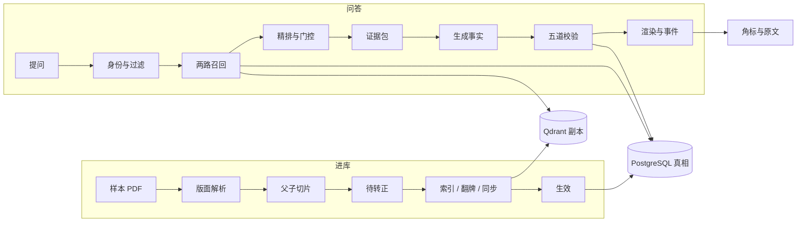

系统在模块之间只传五个对象：文档、版本、切片、事实、证据包。前四个落库，第五个只活在一次问答里。把这五个的字段定死，剩下的只是"谁在什么时候读写它"。


读这份文档有几个约定。每章末尾的"交给下一步什么"是模块出口，也是排查线上问题时最先看的地方。阈值与条数在第二、三、七章各定义一次，后面引用不重复解释。能说人话的地方不出现英文，绕不开的名词收在附录 E。正文与代码冲突时，以代码为准，并把冲突登记进附录 G——文档说假话比不写更糟。

这一版相对上一版的变化集中在四处：生成契约从"模型写整段答案 + 引用数组"改为"模型只写事实 + 证据编号，答案由系统渲染"；时间从单一业务日期改为报告期、发布日期、生效日期三层；新增时序事实表与跨期证据补充；检索前的文档选择改为结构化硬过滤，无命中即失败关闭。四处变化都已在实现里落地，不是规划。

## 2 五个对象

系统的所有契约都建立在这五个对象上。字段一旦定死，模块之间的接口就只剩"传哪个对象、传哪几个字段"，不再每次重新商量。

### 2.1 文档

文档是"这份材料"的抽象，不是文件本身。编号叫 `doc_key`，由文件相对路径与标题归一化而来：去扩展名、去版本号与日期后缀，中文转拼音，机构名单独成段。这样"2024 版差旅管理办法"和"2025 版差旅管理办法"落在同一个编号下，才谈得上覆盖。为什么不用文件名原样：改个名就断开，历史全丢；为什么不用内容哈希：改一个字就变成另一份文档，版本永远连不起来。

除编号外，文档层还承载**报告期元数据**：主体、报告类型、报告期起止、发布日期。这五个字段是结构化文档选择与跨期比较的依据，权威来源是文档本身（封面、报告标题、披露页），不从文件名猜，也不允许把预测目标年份写进报告期。文档不存正文，正文永远挂在版本下的切片上。

### 2.2 版本

一次解析产出一个版本，版本号是 `doc_key` 加内容指纹的 12 位短码（如 `han-wu-ji-2026-ban-nian-bao#3f9c1a02b7de`）。12 位而不是 4 位：版本号是主键，4 位十六进制只有六万多种取值，一个文档攒几十个版本就会撞主键。指纹是文件字节的 SHA-256；同一文档同一内容只允许一个版本，由唯一约束兜底，不靠应用层自觉。

版本有四种业务状态：待转正、生效、已下线、已清除；另有跳过与失败两个终态。状态只能由摄取任务与翻牌事务改，别处一律只读。理由很直接：版本状态决定"哪些切片能被检索到"，任何模块都能改它，就等于谁都能让已废止的条款复活。另有两个时间戳必须分开：生效时间用于展示与审计，下线时间用于回收窗口计时；拿生效时间算下线时长，会把"生效三十天才被取代"的版本在翻牌瞬间判成已过期，直接删掉仍可回滚的版本。

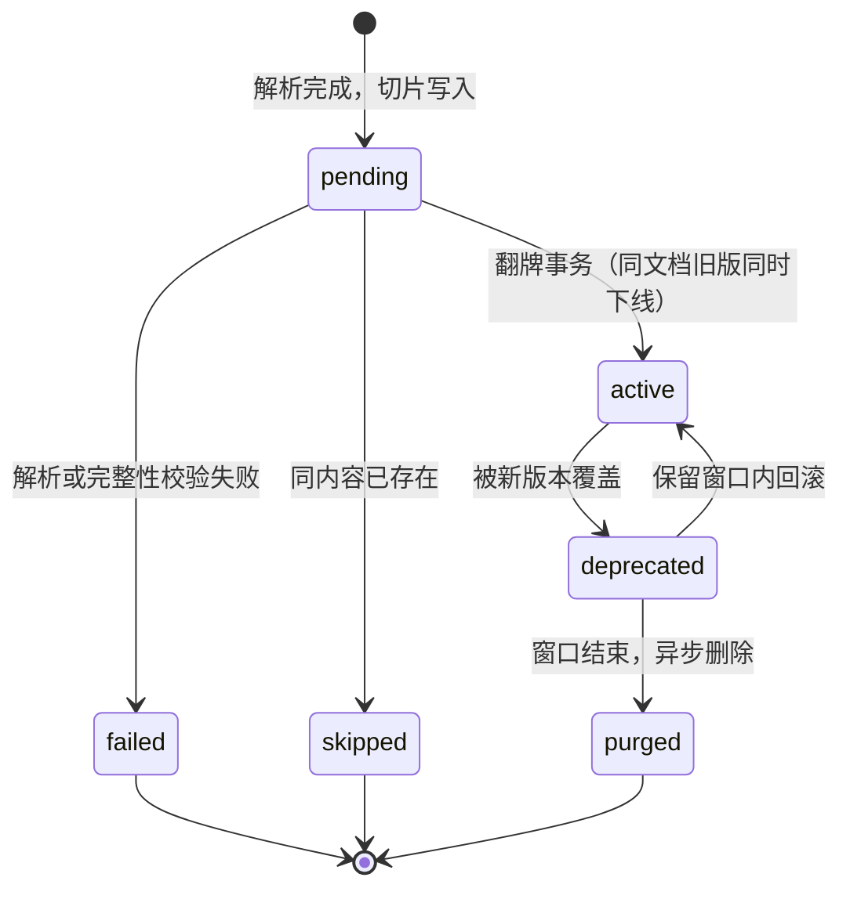

### 2.3 切片

切片是检索与引用的最小单元，分两级。子片 256 到 512 字、重叠 64 字，被检索命中；父片 1024 到 2048 字或整章，被送进模型作答。子片记 `parent_id` 指向父片，父片这个字段为空。切片编号按阅读顺序一次分配：正文 `#c{页码}{序号}`、表格 `#t{页码}{序号}`、图 `#f{页码}{序号}`，同一文件重跑得到同一批编号，比对两次解析结果时才看得出"有没有变"。

每个切片带六项随行信息：页码（引用要跳页）、坐标（前端要画框）、类型（正文、表格、图，决定取哪一列文本）、报告期与置信度（时间过滤只认显式时间）、权限（部门与角色列表）、版本号（检索入口做兜底校验）。六项缺一项，后面就有一处功能不可用：缺页码不能跳转，缺坐标不能高亮，缺类型会拿错文本，缺时间会混进过期条款，缺权限会越权，缺版本号无法做兜底校验。

表格切片额外带三份内容：HTML 保真存档、Markdown 派生文本、单元格矩阵。图切片额外带原图路径与转译文本。切片不维护自己的"是否可检索"，一律看所属版本状态——两处状态迟早打架，例如版本翻回来了而切片还标着已下线。

### 2.4 事实

事实是时序知识图谱的基本单元，一行代表"某个主体、某个指标、某个报告期、一个值"。它只从结构化表格抽取：行首是指标名、列名能映射到期间，才生成事实。字段包括主体、指标、值、单位、期间起止、粒度、来源切片、来源文档、角色（原文披露或派生）、置信度与抽取来源。每条事实必须能回到原文；没有来源的派生值不入图。事实表与切片是外键关系，切片被回收时事实级联删除。

### 2.5 证据包

证据包不是表，是这次问答临时组装的数组，问答结束就丢，不落库。它只存在两个地方：生成模型的输入，以及审计里的一份快照。每条证据有局部编号，从 1 开始，和答案角标一一对应；编号是本次问答内的序号，系统内部用切片编号，两者靠一张映射对上。

每条证据至少带：切片编号、文档编号与标题、页码、坐标、按类型取好的文本、三路分数（语义、关键词、精排）与来源路。分数一起带上，是因为判定看精排分，排查问题时却要看另两路为什么没把它排上来。

| 对象 | 一行代表 | 谁写 | 谁读 | 落库 |
|---|---|---|---|---|
| 文档 | 一份材料的抽象 | 摄取 | 检索、前端 | 是 |
| 版本 | 一次解析的产物 | 摄取、翻牌 | 检索、审计 | 是 |
| 切片 | 一段可检索的正文/表格/图 | 摄取 | 检索、生成、前端 | 是 |
| 事实 | 主体 + 指标 + 期间 + 值 | 摄取回填 | 时序查询、证据包 | 是 |
| 证据包 | 一次问答的取材 | 检索 | 生成、校验、审计 | 否 |

### 2.6 为什么这样

把对象压到五个，是这份设计里最省事的一刀。早期方案里还有"任务""索引条目""引用记录"，结果是每加一个模块就多一套契约。现在任务只是版本的一个状态，索引条目就是切片，引用记录是证据包快照；新增的"事实"不是又一个中间对象，而是切片里已经存在的数值关系的显式化——它同样必须回到切片，所以没有破坏"一切可溯源"这条线。

代价是切片表很宽（二十多个字段），写入时要一次写全。换来的是检索时不用联表：过滤、排序、取文本都在一张表上完成，这对 30 毫秒预算是必要的。表格矩阵与来源标记放进切片而不是另开表，也是同一个理由：它们与切片一对一、总是一起读。

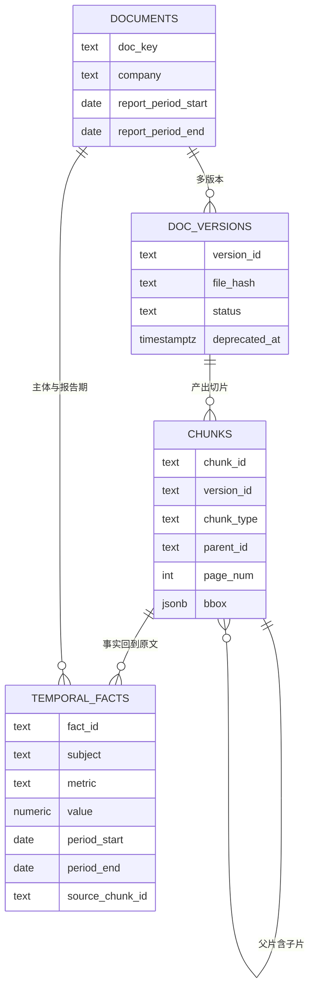

**交给下一步什么**：第三、四章负责生产前四个对象，第五到第十章只读写它们，不再新增对象类型。任何一章如果需要新对象，先在第二章加，再动别处。

## 3 离线一：从 PDF 到切片

这一章只管一件事：把一份 PDF 变成一组带坐标、带时间、带权限的切片。产出物要满足三个条件，缺一条后面就没法用——能定位（页码与坐标对得上原页）、能过滤（权限与时间在切片上就有）、能重建（派生字段丢了可以从存档重算）。

### 3.1 入口：扫描样本目录

摄取不是上传接口，是扫目录。原因有二：本期文件只在本机，没有上传的必要；扫目录天然幂等，重复跑不会多出一份。

触发规则：每轮扫描按内容指纹判断，指纹没变就跳过，变了就产生新版本。同一时刻只允许一个扫描任务在跑，用一次性数据库锁实现，第二个任务进来直接返回"正在运行"，不排队——扫描是运维动作，排队只会在几秒后跑一轮没人要的结果。下划线开头的目录整棵跳过，用来放损坏件、扫描件与暂不处理的文档。

| 情况 | 判定 | 动作 |
|---|---|---|
| 指纹未变 | 与库里最新版一致 | 跳过，不产生任务 |
| 指纹变了 | 同文档出现新指纹 | 建版本，状态待转正 |
| 新文档 | 文档编号不存在 | 建文档 + 建版本 |
| 文件读不到 | 权限或路径问题 | 记失败，不动已有版本 |
| 扫描进行中 | 锁被占用 | 返回 409，不重复启动 |
| 文件名无法转写 | 拼音依赖缺失或路径越界 | 显式报错，不生成猜测编号 |

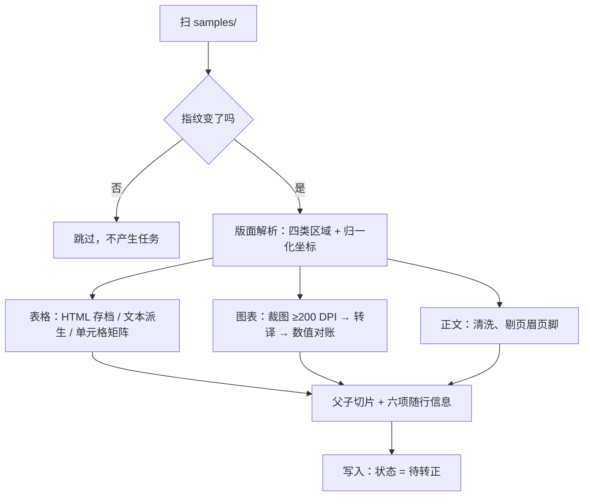

### 3.2 版面：四类区域与坐标

一页纸被切成四类：正文、表格、图、页眉页脚。前三类进库，页眉页脚丢掉。判断页眉页脚不靠位置靠重复：同一段文字在一半以上页面出现，就判为页眉页脚；再限定"长度小于 40 字且不含数字单位"，避免误删每页都出现的条款编号。

坐标统一用归一化：横纵都除以页宽页高，落在 0 到 1 之间，原点是页面左上角，且是**显示空间**——旋转页先按旋转角转回正，再算坐标。四个边界必须处理：页面旋转 90 或 180 度，不处理则高亮框全错；双栏排版，阅读顺序按栏而不是按行，否则一句话会被拆成两栏拼起来；扫描页没有文字层，先识别再按文本框位置算坐标；页面尺寸异常（超大图纸），坐标照样归一化，不额外裁剪。

字体宽度缺失是 PDF 里常见的畸形：没有 `/Widths` 时字符宽度全为 0，按坐标聚类会挤成一列。这里的处理是按字符类别做确定性估宽（中日韩全角、拉丁窄字符、标点三档），再进入行聚类；估宽只影响换行位置，不影响文字内容，也不引入语义判断。

| 边界 | 处理 | 后果 |
|---|---|---|
| 页面旋转 90/180 度 | 按旋转角变换坐标后再归一化 | 不处理则高亮框位置全错 |
| 双栏 | 按栏切分阅读顺序 | 不处理则一句话被拼错 |
| 扫描页 | 识别后按文本框位置算坐标 | 无坐标则无法溯源 |
| 宽度表缺失 | 按字符类别确定性估宽 | 不处理则整页文字挤成一列 |
| 无表格线但对齐列 | 按列间距聚类成表 | 漏判则整表进正文，检索不到 |
| 页眉页脚识别失败 | 保留但标低置信 | 检索噪声变多，不致命 |

### 3.3 表格：一份存档、两份派生

表格在库里存三份东西，分工必须分清：`table_html` 是保真存档，合并单元格、跨行表头、合计行原样保留，前端渲染与人工核对都看它；`table_md` 是派生文本，喂模型、做向量编码都用它，因为标签占 token 也污染语义；`table_cells` 是单元格矩阵，行号、列号、值、是否表头、跨行跨列，校验阶段对齐数字用它，比在 HTML 里找子串可靠。

转换规则写死，不交给模型：合并单元格按"左上角为值、其余格复制该值"展开；空单元格填空标记；表头行照留，Markdown 不支持合并表头时展开成重复列名。三条规则都会改变"看起来的样子"，所以 HTML 存档不能丢。整表超过 2048 字时单独成片，不切分，标 `may_exceed`；跨页续表按表号合并，合不了就在切片里注明，不硬拼。

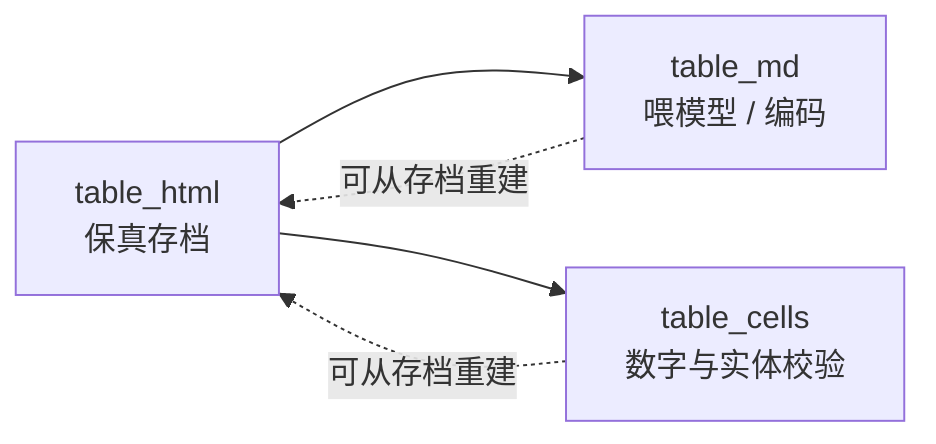

### 3.4 图表：裁图、转译、对账

图表走三步。先裁原图，按至少 200 DPI 以无损 WebP 存到 `figures/{chunk_id}.webp`；再交模型转译，统计图抽成"轴名、单位、类别、数值"的表，结构图抽成节点与关系两张表；最后对账——转译出来的每个数值都要落在轴刻度范围内，并且能与图例、标签对上，对不上就判这次转译失败，这条图不入库，记进解析报告的图失败列表。

对账是硬要求，不是优化。模型读图最常见的错是把 47% 读成 74%，或者把两条曲线搞反；没有对账，这种错会一路带到答案里，而校验阶段只看"数字在不在证据里"，证据本身错了就拦不住。用无损不用有损，是因为刻度、小字、细线被压缩后会读错数，对账拦不住源头失真。

| 边界 | 处理 | 后果 |
|---|---|---|
| 图例缺失 | 转译标 `legend_missing`，置信下调 | 多条曲线时分不清谁是谁 |
| 多曲线交叉 | 逐条列出，注明按颜色或标记区分 | 只给一条会漏 |
| 饼图百分比 | 求和必须落在 99 到 101 之间 | 和不拢说明读错 |
| 坐标轴无单位 | 单位字段写空，不猜 | 猜出来的单位会进答案 |
| 图太小 | 放大后重裁，仍不行则标失败 | 糊图读出来的数不可信 |

### 3.5 切片：父子与随行信息

切片按父子两级组织。子片负责被检索命中，长度 256 到 512 字，相邻子片重叠 64 字，避免一句话被切断后两边都检索不到。父片负责被送进模型，长度 1024 到 2048 字或整章，按章节标题切，不按字数硬切。

六项随行信息在切片生成时一次补齐，缺一项就在 `require_complete()` 处抛错，不允许"先入库，以后再补"。权限从样本路径规则来，绝不传空权限或"全部公开"当默认值：空权限会被完整性校验挡下，全部公开等于把投研报告对公司放行，两者都不是"开发期图省事"能接受的默认值。

| 边界 | 处理 |
|---|---|
| 超长表格（整表超过 2048 字） | 整表单独成片，不切，标 `may_exceed` |
| 目录、封面、修订记录 | 跳过，不进库 |
| 超短段落（少于 80 字） | 与相邻段落合并后再切 |
| 一章超过 2048 字 | 按小节标题再切一层父片 |
| 表格与正文混排 | 表格单独成片，正文照常切 |

### 3.6 这一章交给下一步什么

产出的是待转正的版本与切片：正文、坐标、权限、时间都已带上，向量尚未写入，因而不可见。第四章负责把它们翻成唯一生效版本；第五到第十章只读不写。

| 字段 | 示例 | 谁读 |
|---|---|---|
| `version_id` | `han-wu-ji-2026-ban-nian-bao#3f9c1a02b7de` | 翻牌、检索兜底 |
| `chunk_type` | `table` | 取文本时选列 |
| `bbox` | `[[0.12,0.34,0.88,0.51]]` | 前端画框 |
| `report_period_start` | `2026-01-01` | 文档选择、时间过滤 |
| `allowed_depts` | `["fin","hr"]` | 前置过滤 |

**交给下一步什么**：一个待转正版本，以及它名下所有带随行信息的切片。每条子片入库时生成两份向量：bge-small-zh-v1.5 稠密向量用于语义召回，BM25 稀疏向量用于关键词召回；两者写入同一个 Qdrant 点，payload 带相同过滤字段；稀疏向量可从 PostgreSQL 正文全量重建，不作为真相。下一章不重新解析，只做三件事——翻牌、同步、回收。

## 4 离线二：转正、同步与回收

这一章解决"什么时候新版本才能被看见，以及旧版本什么时候消失"。这里的每个动作都影响线上检索，所以规则写得比别处死。

### 4.1 翻牌：一个事务里改三处

翻牌要做三件事，必须一起成功或一起失败：把同一文档的旧版本划为已下线（写下线时间与被谁取代）、把新版本划为生效（写生效时间）、把新版本名下的切片状态同步为生效。三处写在同一个事务里，任何一个失败就整体回滚，新版本退回待转正。

并发上一份文档不能同时翻两次。用数据库事务级咨询锁按文档编号串行化，第二个翻牌请求等锁；扫描、翻牌、回收共用同一个锁 key 派生函数，表达式漂移会让两把锁互不相干。这条不是洁癖：两份同时生效会在检索里产生"同一句话两个版本都命中"，引用都不知道该指哪一页。

空版本拒绝翻牌（返回 422）。放过去等于旧版下线 + 新版无片 = 服务翻空，而且没有任何报错。

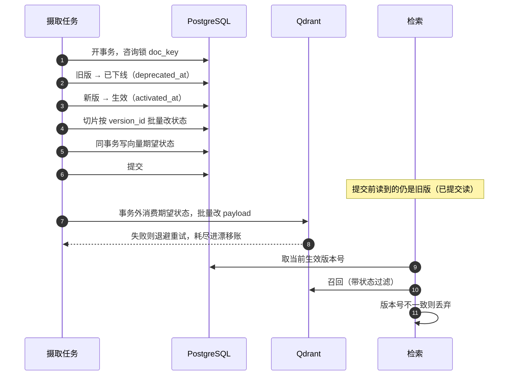

### 4.2 同步与对账

向量库里的状态是副本，允许落后，但要有上限：翻牌后一分钟内必须同步完。同步按版本一次性改整个集合里的状态字段，不逐条改——逐条改在几十万点上会跑很久。

同步失败重试，总尝试 4 次（首次 + 3 次），退避按 1 秒、2 秒、4 秒，封顶到基础间隔的 8 倍。为什么不是"失败重试三次 + 指数退避到十分钟"：这与"一分钟内必须同步完"不能并存。重试耗尽后写一条漂移记录，把失败变成可被数出来的东西。

同步成功的判据不是"接口返回完成"，而是**回读两边的状态分布必须一致**：点总数与目标状态的点数要对上。实测过过滤条件一条都不匹配时，向量库仍返回完成；只信返回码会留下静默漂移。

对账任务定期跑，不看历史只看现在：比对两边的状态与版本号，发现不一致以数据库为准覆盖向量库，并记一条漂移日志。四类差异修，一类只记：缺点的补写、状态不符的改状态、孤立点的删除、同步未完成的补同步；"切片挂错版本"只记录不修——切片挂错版本被复合外键挡着，真发生了说明有人绕过约束写库，那是数据事故，不该由对账悄悄抹平。

| 情况 | 处理 | 用户感知 |
|---|---|---|
| 同步在一分钟内完成 | 正常 | 无 |
| 同步失败重试中 | 检索入口的版本校验会挡住旧片 | 可能少召回几条 |
| 对账发现漂移 | 以库为准覆盖，记漂移账 | 无 |
| 向量库长时间不可用 | 检索整体降级为"暂不可用" | 明确提示，不返回半套结果 |

### 4.3 回收

旧版本先标已下线，保留 24 小时，再删。保留窗口不是流程洁癖，是给回滚留的门：新版解析错了，窗口内还能把旧版翻回来；超过窗口只能重跑。窗口起点是下线时间，不是生效时间。

删除是级联的：切片行、向量点、切片图一起清；样本原件不删，它是测试资产。顺序是先写"点应删除"的期望状态，再删切片与版本行，点由同步器补删。反过来先删库行再写期望状态，一旦崩在中间就会留下永久孤儿点——库里已经没有任何版本行能说明该删哪些点。

删除任务异步跑，失败重试，连续失败转人工清单，不在线上卡着。下线时间为空的历史行，回收时先补当前时间并跳过本轮：未知下线时间就从此刻开始计时，绝不"立刻删"。

### 4.4 边界情况

| 情况 | 处理 |
|---|---|
| 新版解析到一半进程崩了 | 任务超时判失败，待转正切片清理，旧版继续服务 |
| 同一内容重复入库 | 唯一约束拦截，返回已存在，不建新版本 |
| 翻牌后发现问题要回滚 | 24 小时内把旧版翻回生效，新版划下线 |
| 两份文档编号撞车 | 建文档时校验，撞车即拒绝入库，不改编号规则 |
| 删除时向量库不可用 | 先删库行，向量点进待删清单，恢复后补删 |
| 同一版本已有未结束任务 | 部分唯一索引拦截，不重复解析 |

### 4.5 落地登记

本章的实现比"应该"多了几处硬规定，理由都来自实测：

| 议题 | 文档口径 | 落地做法 | 为什么 |
|---|---|---|---|
| 翻牌与同步的边界 | 翻牌后调向量库 | 翻牌事务只写期望状态，向量调用在事务外 | 向量库没有事务：塞进事务会被网络抖动回滚掉一次正确的翻牌 |
| 同步重试 | 失败重试三次 | 总尝试 4 次，退避封顶 | 与"一分钟内同步完"并存 |
| 同步成功判据 | 未写 | 回读两边状态分布一致 | 空过滤也返回完成 |
| 中文关键词切分 | 依赖服务端分词 | 入库与查询两侧都做中文 bigram + 拉丁整词 | 实测整句中文只切出 1 个词，命中率显著下降 |
| 回收窗口起点 | 保留 24 小时 | 用下线时间，不建在生效时间上 | 生效时间会把仍可回滚的版本判成过期 |
| 回收顺序 | 向量库不可用时先删库行 | 先写删除期望状态，再删库行 | 反过来会留下永久孤儿点 |
| 对账修复范围 | 以数据库为准 | 修四类，版本挂错只记不修 | 绕过约束写库是数据事故，不该静默抹平 |
| 空版本翻牌 | 未写 | 拒绝，422 | 旧版下线 + 新版无片 = 服务翻空 |

**交给下一步什么**：从第五章开始进入在线链路，第一个动作是认人——把登录凭证换成一份身份快照，再换成一组过滤条件。
## 5 在线一：身份与过滤条件

在线链路的第一个动作不是理解问题，是认人。因为"能不能看"决定了"能不能搜"，顺序反了就得在召回之后再删结果，那既浪费算力又泄露存在。

### 5.1 身份快照

身份不在本系统维护，从登录凭证里解出来，落地成一份快照：用户标识、部门列表、角色列表、是否管理员。四个字段之外不再扩展——每多一个字段，就要在过滤、审计、前端三处同步改。

取值示例：`{"user_id": "u_1024", "depts": ["fin", "corp"], "roles": ["staff", "approver"], "admin": false}`。部门与角色都是数组，因为一个人本来就可能属于多个；用单值会在调岗时出问题。

缺失时的处理写死，不能"看着办"：凭证无效返回 401；凭证有效但没有部门视为空集，只能看公开文档；管理员可以跨部门，但审计必须记"以管理员身份访问"。这三种情况都会出现，尤其是新入职还没分配部门的人。开发期用固定凭证模式（`AUTH_MODE=fixed_jwt`），生产接企业身份源；两条路径产出的快照形状完全一致，过滤层不区分来源。

### 5.2 过滤表达式

过滤是一个布尔表达式，三个分支取或：公开文档、部门命中、角色命中。部门命中指两个集合有交集，不是包含；角色同理。这条要写清，否则实现的人容易写成"用户部门必须在文档部门列表里"，多部门的人就漏。

时间条件是第二组，只在有显式时间限定时加：季度、半年、年这类粒度按报告期与请求窗口重叠匹配，不认推断时间；历史切片尚未回填报告期时，走"生效日期 + 显式置信度"的兼容分支，回填完成后应删除这条分支。不问时间就不加时间条件，但版本条件永远存在。文档范围是第三组：请求给了 `scope.doc_keys` 就作为硬过滤；给了空数组等于不限定，不生成恒假条件——否则一次 scope 拼错的请求会表现成"库里没有"，而不是"请求有问题"。

版本条件不写在过滤表达式里，而是召回后逐条校验。放进过滤条件会让查询计划退化；放在校验里只多一次主键查询。这个取舍在第七章展开。

实现上只有一份条件对象，渲染成两条取数路径：向量库的 payload 过滤与 PostgreSQL 的 WHERE。两边的判断全部来自同一个分支函数，不允许各写一套——"语义路带了权限、关键词路漏了"是这类系统最典型的裂缝，日志里一切正常，没权限的文档从另一条路漏进候选池。

| 边界 | 处理 | 示例 |
|---|---|---|
| 用户无部门 | 只匹配公开文档 | `depts: []` → 只命中 `is_public` |
| 多部门 | 任一命中即可 | `["fin","corp"]` 命中任一即通过 |
| 角色与部门都为空 | 同上，只匹配公开 | 新入职常见 |
| 管理员 | 跳过部门与角色，仍校验版本 | 审计记管理员访问 |
| 文档范围为空数组 | 视为不限定，不生成恒假条件 | 前端清空范围后重问 |
| 时间条件只有年份 | 按自然年或配置财年闭区间 | 财年需在配置写明 |

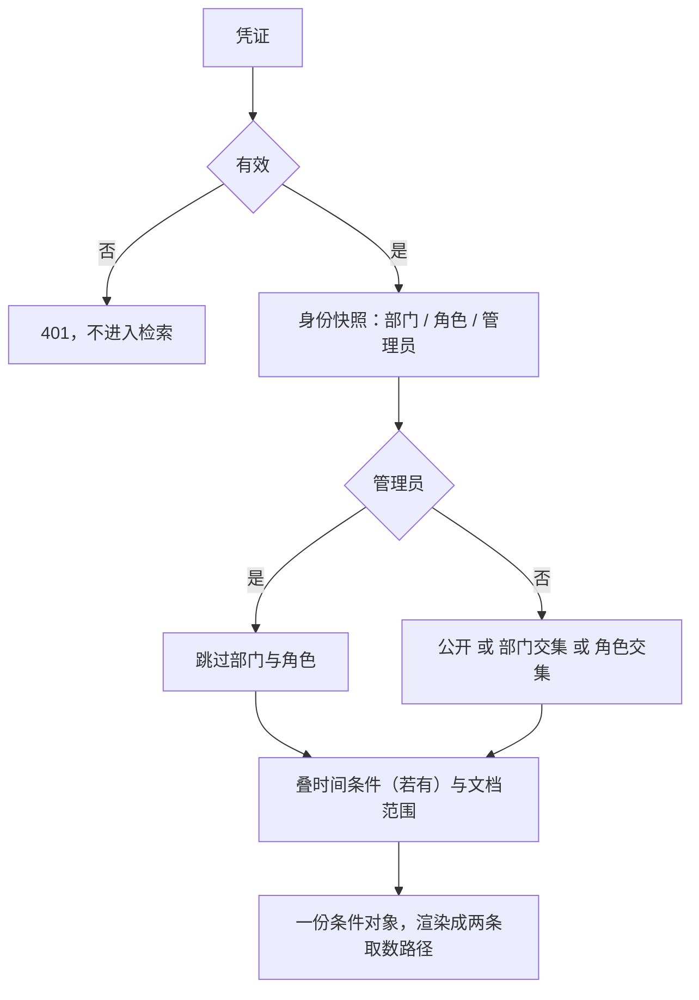

### 5.3 时间三层与归一

时间不是一个日期，是三层：报告期（这份材料覆盖哪一段）、发布日期（哪天对外披露）、生效日期（制度类文档从哪天开始适用）。三层必须分开存、分开用。旧版设计只有"业务日期"一个字段，结果是"2026 三季报"既可能被当成 2026-10-30 的发布日，也可能被当成 2026-01-01 至 2026-09-30 的报告期，时间过滤与跨期比较全错。

时间归一**只解析显式时间**，不猜相对时间、模糊时间或"最新版"。

| 用户说法 | 归一结果 | 说明 |
|---|---|---|
| 2026Q3 / 2026年第三季度 / Q3 2026 | 2026-07-01 至 2026-09-30 | 财报季度语法 |
| 2026H1 / 2026年上半年 / H1 2026 | 2026-01-01 至 2026-06-30 | 财报半年语法 |
| 2025-03-15 / 2025年3月15日 | 单日闭区间 | 显式日期 |
| 2025年3月 / 2025-03 | 当月闭区间 | 显式年月 |
| 2025年 / FY2025 | 自然年或配置财年 | 显式年份 |
| 去年 / 上个月 / 最近 / 最新版 | 不加过滤条件 | 不猜；审计注明未限定时间 |

边界三条：年份区间（`2025-2027年`）不硬套单年闭区间，按区间处理；无法解析的时间词不加过滤条件，并在答案与审计里说明；"最新版"属于版本选择，不属于时间解析。解析结果分成"文档有效时间"与"答案目标时间"两组，目标时间绝不进入文档过滤——把"预测 2030 年"当成文档期，会把 2030 年的预测文档也筛进来，或者把真实的当期文档筛掉。

### 5.4 文档选择：先按元数据硬过滤

当问句带明确时间且用户没给文档范围时，先做结构化文档选择：按主体、报告类型、报告期重叠三个条件筛文档。主体来自文档元数据；报告类型取年报、半年报、季报、其他；报告期用区间重叠，不用单点相等。三个条件都来自结构化字段，不从问句关键词猜。

无命中时两条路：问句点名了库内文档，就按点名的文档检索——用户已经用自然语言指明了范围，这不算放宽；否则 **Fail-Closed**，直接回"文档选择无命中"，不回退全库。这条是硬规定：全库回退会把一次时间理解错误伪装成"库里没有相关证据"，也会让"预测年份"这类问题混进真实文档。零候选后再去掉时间条件重试，属于工程宪法明令禁止的"放宽检索范围恢复结果"。

### 5.5 时序知识图谱

时间归一解决"问题指哪一期"，时序图谱解决"这一期和别期怎么比较"。两者分开，后者不反过来改检索过滤条件。

图的基本单元不是切片，而是**事实边**：主体 —[指标, 报告期]→ 值。每条边带单位、来源切片、文档编号、角色（原文披露或派生）、置信度与抽取来源。

| 字段 | 口径 |
|---|---|
| `subject` | 公司或机构，来自文档元数据 |
| `metric` | 指标名，如营业收入、研发投入合计；别名由应用层归一 |
| `period_start/end` | 该值覆盖的报告期，不是发布日期 |
| `value/unit` | 原始单位下的数值，不在这一层换算 |
| `source_chunk_id` | 必须能回到原文；没有来源的派生值不入图 |
| `role` | `reported` 原文披露；`derived` 由计算工具产生 |

**写入**：只从结构化表格切片提取"行首指标 + 列名可映射期间"的数值；变化幅度列不单独生成事实；上年同期列生成上一自然年同口径期间的事实；报告期来自文档元数据，不从文件名猜。事实编号由切片编号、指标与期间派生，重复回填幂等。

**读取**：跨期问题先按期取事实，再由计算工具做差额、百分比与增速差；图只提供序列与比较，不负责生成结论。证据仍回填来源切片，没有原文来源的事实不得进入答案。

**在线链路**：问题解析出主体、指标、报告期后，命中图则把当期与上年同期事实追加到证据包；同一来源切片的多期事实合并成一条证据，避免同一张表出现多个角标。图补充失败只记日志，不击穿原检索链路；未命中图仍走原链路，不做全库回退。

**禁止**：把预测目标年份写入报告期；把文档发布日期当报告期；单位不同强行比较；无来源事实参与生成；用关键词临时猜主体或指标。

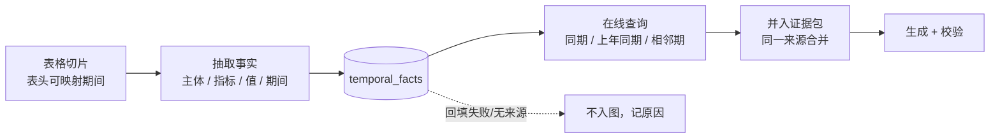

### 5.6 这一章交给下一步什么

交出一个结构化对象，不是一句自然语言：

| 字段 | 示例 | 用途 |
|---|---|---|
| `question_raw` | `海光信息2026三季报的营业收入是多少` | 审计原文 |
| `depts` / `roles` | `["fin"]` / `["staff"]` | 过滤 |
| `document_ranges` | `2026-07-01 至 2026-09-30` | 文档选择与时间过滤 |
| `target_times` | 空或预测目标 | 只用于回答口径提示，不进过滤 |
| `require_active` | `true` | 版本条件 |

**交给下一步什么**：一份身份与条件；下一章在它的基础上改问句、补时间、判跳数，但不许改权限，也不许把目标时间混进文档过滤。

## 6 在线二：问题理解

这一章解决"把用户随口说的话，变成一次能执行的检索"。做三件事：消指代与扩同义、判跳数、判越界。三件事都不许改权限。

### 6.1 指代消解

多轮对话里最常见的是"那它呢""这个流程要几天"。规则是：上文出现过文档或实体，就用最近的指代对象替换；没出现过就不替换，直接按原话检索，宁可查不到也不猜。

| 情况 | 处理 | 示例 |
|---|---|---|
| 指代上一轮结果 | 替换为具体文档名与条款号 | "那它呢" → "差旅管理办法第 12 条" |
| 指代不清（多个候选） | 不替换，触发澄清 | "这个" 指两份文档 → 给选项 |
| 上一轮是拒答 | 不继承任何实体 | 拒答后追问按新问题处理 |
| 否定句 | 保留否定，改写时不反转 | "不含住宿的报销" 不得改成 "住宿报销" |

指代不清时不检索，直接返回澄清。理由：任何检索结果都是"按原句瞎猜"的产物，而澄清的成本只是一次点选。

### 6.2 改写与扩展

改写只做三件事：同义词扩展、缩写展开、口语转书面。不许做的三件：不放宽条件（"上海以外"不能扩成"上海"）、不引入库外概念、不改数字。改写产物不参与事实认定，只用于检索；这句话要写进代码注释，否则迟早有人拿改写后的句子去生成。

| 改写 | 允许 | 不允许 |
|---|---|---|
| 同义 | "住宿费" 与 "住宿标准" 互认 | 把"上限"改成"标准" |
| 缩写 | "差标" → "差旅标准" | 展开成库里没有的全称 |
| 口语 | "报销能报多少" → "报销额度" | 补上没说的条件 |

### 6.3 单跳、多跳与复合问

判定不看问句长短，看"答案能不能在一份文档的一段话里找齐"。

| 特征 | 判定 | 例子 |
|---|---|---|
| 单一实体、单一属性 | 单跳 | 住宿标准是多少 |
| 含"分别""各自""对比" | 多跳 | 各部门的差标分别是多少 |
| 需要跨文档拼接 | 多跳 | A 制度说的流程在 B 系统对应哪一步 |
| 含因果或前置条件 | 多跳 | 报销需要哪些前置审批 |
| 明显超出库范围 | 直接拒答，不检索 | 明天天气 |

复合问的处理要单独说明：当前**不做推测性拆分**。没有可靠的中文句法分析器时，按"的""同比""分别"这些词切分只会产生错误子问题，而错误子问题会带来错误的检索与错误的证据。当前契约是一句用户问题等于一个检索单元；需要多子问题时，由上层规划器显式生成，每个子问题必须带主体、指标与时间，不提供任何推测性回退。跨实体比较问题因此走"同一问句、多实体证据"的路径：门控要求至少两段不同证据，实体覆盖检查逐项核对。

判定为多跳不等于一定跑多跳，进入第八章后每一跳还要独立过门槛；判定为单跳也不排除第二次检索（澄清之后会重查一次）。

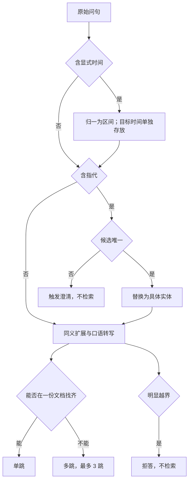

### 6.4 这一章交给下一步什么

| 字段 | 示例 | 说明 |
|---|---|---|
| `query` | `住宿费 限额 标准` | 用于检索，不是给用户看的 |
| `entities` | `["差旅","住宿费"]` | 供澄清与覆盖检查 |
| `time_range` | `[20250101,20251231]` | 已归一，只含文档有效时间 |
| `mode` | `single` / `multi` | 预判，可被检索结果推翻 |
| `out_of_scope` | `false` | 明显越界时不进入检索 |

**交给下一步什么**：一句可检索的问句、一组实体、一个时间窗和一个跳数预判。下一章据此取数，并有权把 `mode` 改回单跳——如果第一跳就找齐了证据。

## 7 在线三：检索

这一章把"条件"变成"候选"。四个动作：两路取数、按名次合并、精排截断，最后加一道版本校验。两路都在向量库里跑——一路稠密语义，一路 BM25 稀疏关键词——共用同一套过滤条件，这样权限、时间、生效版本不会出现"一路漏了、另一路没漏"的裂缝。

### 7.1 两路取数

语义一路取 30 条，关键词一路取 30 条，都带同一套过滤条件，一次批量请求拿回两路结果。为什么是 30 而不是 50：精排是逐对打分，候选越多越慢；30 条在单机 CPU 上能把精排压在预算内，再翻一倍首字时间就会破。

**语义路**：bge-small-zh-v1.5 生成 512 维稠密向量，走余弦相似度。它擅长换个说法也能认出来，比如"住宿费限额"能命中"差旅住宿标准"；弱项是编号、型号、条款号这类字面精确匹配。

**关键词路**：BM25 稀疏向量，索引侧开启 IDF 修正。它擅长编号、型号、条款号、人名、专有名词这类字面命中；弱项是同义改写。中文必须预处理：向量库服务端只按空白与标点切词，整句中文只切出一个词，实测命中率只有四分之一；入库与查询两侧都做中文 bigram 加拉丁整词之后，命中率升到四分之三。这是"口径必须在两侧一致"的典型例子——只改查询侧，索引侧的稀疏向量仍是整句一个词，两边根本对不上。

稀疏向量是派生索引，可随时从 PostgreSQL 正文全量重建，不作为真相。查询侧走批量接口而不是原生融合查询，原因有二：批量接口能一次拿回两路，少一次往返；原生融合不支持"查询侧预分词"，会把中文又切坏。两种方式结果等价时优先原生，这条在这里不成立。

| 边界 | 处理 | 后果 |
|---|---|---|
| 查询极短（1 到 2 个字） | 两路照跑，由精排兜底 | 短词关键词路可能过泛 |
| 纯数字、纯编号 | 两路都取，名次合并 | 语义对编号不敏感 |
| 英文缩写 | 先展开再取 | 不展开几乎命中不到 |
| 一路为空 | 另一路照常进精排 | 不硬凑数量 |
| 两路命中同一切片 | 合并只留一条，记两个名次 | 重复会挤掉别的候选 |
| 关键词路中文切分差 | 两侧同口径预处理；仍差则回退纯语义，记审计 | 中文关键词质量依赖分词 |

### 7.2 按名次融合

合并用名次相加，不用分数加权。理由很直接：余弦分数与 BM25 分数不在一个尺度上，硬凑权重等于人为造一个参数，每次换语料都要重调。名次是可比的——排第一就是排第一。

并列时的处理定死：名次和相同，先看语义路名次；同一父片最多保留两条子片，因为父子切片内容高度重叠，全留下会把精排预算浪费在重复信息上。只在一路出现的候选，另一路名次按 31 计，保证"两路都靠前"的候选一定排在"只有一路第一"之前。

### 7.3 精排与截断

精排把问句和每条候选成对送进模型，逐条打分，取前 5 到 10 条。5 是下限，10 是上限：少于 5 条证据容易不全；多于 10 条上下文变长，模型反而容易挑错重点。默认取 5 到 10，复杂问题取上限。

输入长度要截断：每条候选送去打分前截到 400 字。理由不是省算力，而是中文长表格会让精排服务在长输入上抖动，实测 44 条候选两批打分需要 12 秒预算——把预算写成 800 毫秒是自欺，线上会不停降级。当前预算 12000 毫秒、候选上限 50、单条 400 字，三个值一起构成"能在预算内跑完"的口径。

| 边界 | 处理 | 用户感知 |
|---|---|---|
| 候选不足 5 条 | 有多少用多少，不补 | 可能落进低置信 |
| 精排超时 | 退回按名次取前 N，置信降一档 | 答案更保守，审计记降级原因 |
| 精排模型不可用 | 同上，并置告警 | 同上 |
| 最高分与其他差距极大 | 只取最高分那一条 | 证据更聚焦 |
| 单条候选极长 | 截到 400 字再打分 | 长表格不再拖垮预算 |

### 7.4 版本兜底

进精排前，用候选切片所属版本号回查该文档当前生效版本。不一致就丢弃，不进打分。这一步只花一次主键查询，但能挡住翻牌同步那一分钟的漏网——那段时间向量库里还是旧状态。

为什么不做进过滤条件：把"生效版本号"放进过滤，会让向量库的过滤选择性变差，查询退化；放在校验里逐条剔除，代价小得多。顺序也不能反：先版本兜底再精排，否则我们花预算给一批注定要丢的候选打分。


### 7.5 参数与预算

| 参数 | 取值 | 说明 |
|---|---|---|
| 每路取数 | 30 | 稠密 30 + 稀疏 30，去重后约 40 到 50 |
| 精排候选 | 全部去重结果 | 上限 50，超了按名次截 |
| 进证据包 | 5 到 10 | 复杂问题取上限 |
| 单条打分长度 | 400 字 | 超出截断 |
| 精排预算 | 12000 毫秒 | 超时按名次兜底并降档 |
| 召回耗时 | 95% 在 30 毫秒内 | 含过滤与两路取数 |

### 7.6 这一章交给下一步什么

交出一组候选，每条带三路分数与出处：

| 字段 | 示例 |
|---|---|
| `chunk_id` | `han-wu-ji-2026-ban-nian-bao#3f9c1a02b7de#c047001` |
| `dense_rank` / `sparse_rank` | `3` / `未命中` |
| `fused_rank` | `5` |
| `rerank_score` | `0.62` |
| `text` | 按类型取好的文本 |
| `bbox` / `page_num` | `[[0.1,0.2,0.9,0.3]]` / `47` |

**交给下一步什么**：5 到 10 条带分数的候选。下一章决定这些够不够、要不要问清楚、要不要再找一轮。

## 8 在线四：门控与编排

这一章是整套系统里最像"决策"的一章：拿到几条候选，判断够不够，不够时是拒、是问、还是继续找。三个动作的顺序不能换：先看够不够，再看清不清，最后才谈要不要多跳。

### 8.1 三段门控

判断只看精排后的最高分，分三段处置。中间那一档的存在，是因为"有一点像"和"完全没有"在用户那里的感受完全不同：前者该告诉他"可能有这几份"，后者只能告诉他"库里没有"。

| 区间 | 判定 | 动作 | 用户可见 |
|---|---|---|---|
| 低于 0.20 | 无相关 | 直接拒答，不调模型 | 未找到可验证依据 |
| 0.20 至 0.40 | 弱相关 | 拒答 + 有权限的疑似文档清单（最多 3 份） | 拒答 + 可点文档 |
| 0.40 及以上 | 有支撑 | 进入歧义与覆盖检查 | 答案或澄清 |

除最高分还有两个辅助条件，只在最高分落进临界带时用：有效证据段数（多实体问题要求至少 2 条分属不同段落）、问题关键实体是否在证据里出现（出现不了说明答非所问）。

临界带由配置给，默认 0.38 到 0.42。带内的判定逻辑是**替代**而不是补充：辅助条件满足就按过线处理，不满足直接落低置信。早先的写法是"判完辅助条件再继续看是否到 0.40"，结果 0.39 会因为没到 0.40 被拒，辅助条件等于白判。

| 边界 | 处理 |
|---|---|
| 最高分在 0.38 到 0.42 之间 | 按辅助条件决定，不单独靠分数 |
| 多条同分且来自不同文档 | 进澄清，不让模型自己选 |
| 最高分高但只有一条证据 | 单事实问题放行；多实体问题拒答 |
| 分数刚好低于 0.20 但关键词强命中 | 仍拒答，关键词命中不构成证据 |
| 精排整段降级、无分数 | 按名次兜底后的最高分判，并标降级 |

### 8.2 澄清

澄清只在两种情况下触发：条件确实缺失（没说部门、没说年份），或者候选来自两份以上文档且分数接近（差小于 0.05）。选项不是凭空编的，只能从检索到的事实里取：文档标题加章节名，最多四个，每个选项带一个可回填的参数（文档编号或时间范围）。用户点选后，把参数并进条件，重新检索一次，不再追问第二次——问两次就是审问。

| 情况 | 处理 |
|---|---|
| 用户不选，直接追问 | 按原问题再检索一次，仍不清就拒答 |
| 选项超过四个 | 只给最相关的四个 |
| 澄清后仍多份冲突 | 拒答，说明库内存在多份不一致资料 |
| 精排降级 | 不触发澄清，按保守档收口 |

### 8.3 多跳

多跳不是"多查几次"，是"带着已查实的事实去查下一件事"。每一跳做四件事：根据缺口拆子问题、带黑板检索、判本跳是否过阈、把确定事实写回黑板。

黑板只放确定事实：每条事实带切片编号、页码、跳次和一句原文摘录。不放候选、不放分数、不放模型推测——黑板一旦掺了推测，后面每一跳都会在错的前提上继续。多跳模块本身不生成文本，它只搬运已定分的事实条目，所以"推测"在结构上就进不来。

停止条件三条，谁先满足谁生效：证据齐了、跳数到 `Max Hops = 3`、本跳不过阈（断链）。断链时交出去的是"已经查实的部分 + 断在哪一步"，不是一句"查不到"。第一跳就断链直接拒答，不给部分结论：一跳都没查实，"已查实的部分"是空集，给空集加断链说明与一句"查不到"没有区别，反而让用户以为系统查了很多地方。

| 边界 | 处理 |
|---|---|
| 第一跳就断链 | 直接拒答，不进多跳 |
| 某一跳查到的是旧版本 | 版本校验拦住，按断链处理 |
| 子问题与已查实事实冲突 | 停止，输出冲突说明，不强行统一 |
| 三跳后仍缺一部分 | 输出已答部分 + 明确列出未覆盖的问题 |

### 8.4 这一章交给下一步什么

交出一个判定对象，五种取值之一，后面的处理完全不同：

| `verdict` | 含义 | 带什么给下一步 |
|---|---|---|
| `pass` | 证据足够，直接作答 | 证据包（5 到 10 条） |
| `clarify` | 需要用户补条件 | 选项数组 + 临时条件 |
| `reject_none` | 库里没有 | 拒答原因码 |
| `reject_low` | 有一点像但撑不住 | 有权限的疑似文档，最多 3 份 |
| `partial` | 多跳收敛但未覆盖全部 | 已查实事实 + 未覆盖清单 |

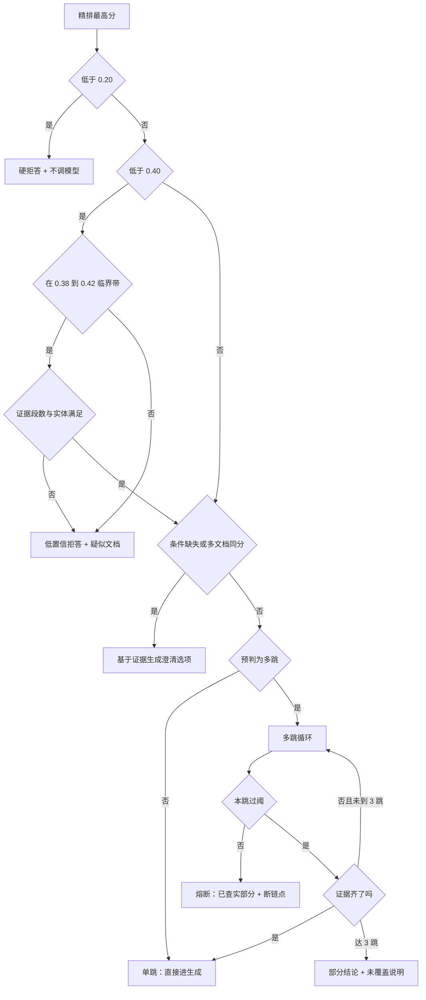

**交给下一步什么**：一个判定，加一份证据包或一份拒答材料。下一章只对 `pass` 和 `partial` 生效，其余直接走到输出。
## 9 在线五：生成

这一章只做一件事：把证据包变成一份可校验的草稿。注意用词——是"草稿"，不是答案。答案要等下一章校验通过才算数。

### 9.1 证据包怎么组装

组装规则五条，按顺序执行：

1. 取文本按类型走：正文取原文，表格取派生文本（不取 HTML），图取转译表。
2. 同一父片的多条子片合并成一条证据，页码取子片里最靠前的一页。不合并的话，五行证据其实是同一段话，模型会重复引用，角标会变成五个指向同一处的编号。
3. 总长度封顶 6000 字，超了按精排分从低往高丢，不截断单条证据。
4. 编号从 1 开始按分数降序，用户看到的角标就是这个顺序。
5. 每条证据带一行来源标记：文档标题、页码、切片编号，供模型抄来源。

为什么不直接塞 HTML：标签占 token，还会让模型把属性名当内容；转成文本后同样的信息能省三成长度。为什么超长时整条丢而不是截断：截断后的证据会出现"半句话"，模型会把半句话补全，而补全的部分没有任何出处。

时序图谱补充进来的证据走同一条组装路径：同一来源切片的多期事实合并为一条，编号参与统一排序。补充证据与检索证据在结构上没有区别，校验时也不区分来源——只要进了证据包，就必须能回到原文。


### 9.2 提示词契约

提示词分三段：角色与约束、证据包、输出格式。三段都固定，不随问题变。

约束只有三句：只用证据回答；每条事实必须带证据编号；证据不足就返回 `unknown`。解码参数固定 `Temperature = 0`，不做成配置项——这个系统里任何随机性都只可能让答案变得更不可复核。输出只有两个顶层字段：状态与事实数组；每条事实四个字段：文本、证据编号数组，以及可选的类型、名称、表达式、结果（用于派生计算）。

要求模型逐条给事实，而不是写整段答案，有三个直接收益：校验按事实逐条做，不必再切句；角标编号由系统按证据包映射生成，模型没有机会编造编号；答案文本由系统拼接，措辞里的"根据资料""一般来说"这类无出处表述不会进最终输出。代价是模型必须把一句话拆成事实，提示词里要给出正例，否则它会退化成"一条事实包打天下"。

| 模型返回形态 | 处理 |
|---|---|
| 正常 JSON，`status` 与 `facts` 齐全 | 进入校验 |
| 非 JSON 或带代码块标记 | 宽松解析一次；仍失败则降级 |
| 缺 `status` 或 `facts` | 降级，不重试 |
| `status=answered` 但事实为空 | 视为失败，降级 |
| 事实的证据编号不在证据包内 | 第一道校验即降级 |

宽松解析的规则要写死：先拨掉首尾代码块围栏；仍失败则取第一个左花括号到最后一个右花括号；再失败就降级。不补默认值——补一个空的证据数组会让"没有引用"那一道校验失去对象，而模型其实就是没给引用，那必须被拒答。解析时是否动过文本要进审计：模型总在包围栏，是一个可观测的提示词退化信号。

### 9.3 生成的边界

| 情况 | 处理 | 理由 |
|---|---|---|
| 部分可答（三条事实只有两条有引用） | 整条拒答，不保留能答的部分 | 半对半错的答案比拒答更难被发现 |
| 两份证据互相矛盾 | 拒答，说明库内资料不一致 | 模型不该替用户裁决 |
| 证据超长被截 | 在答案里说明"仅依据前 N 条" | 避免用户以为查了全部 |
| 问题要求预测或建议 | 拒答 | 证据里没有未来 |
| 模型给出证据外的数字 | 第三道校验拦下 | 格式合法不代表内容合法 |

系统陈述与模型事实必须分开。未覆盖清单、证据超长说明、补年份假设都是系统说的话，它们不需要引用；写进被校验正文会让第二道校验判它们失败，所以它们作为事件流的尾巴单独发出，不参与五道校验。

### 9.4 这一章交给下一步什么

交出一份草稿，它还不能给用户看：

| 字段 | 示例 | 说明 |
|---|---|---|
| `status` | `answered` | 或 `unknown` |
| `facts[].text` | `营业收入为 12.34 亿元` | 未校验，不得直接展示 |
| `facts[].evidence_ids` | `["...#c012003"]` | 切片编号，不是角标序号 |
| `facts[].kind` | `fact` / `calc` | 派生计算事实标 `calc` |
| `facts[].expression` | `12.34 - 9.87` | 仅派生事实有 |
| `facts[].result` | `2.47` | 必须与计算工具结果一致 |

**交给下一步什么**：一份带切片编号的事实草稿，以及它引用的证据原文。下一章逐条核对，核不过就整条撤掉。

## 10 在线六：校验与输出

这一章是最后一道闸。前九章里任何一个环节偷懒，都会在这里暴露；反过来说，这里放过的错误，就再没有机会拦住了。

### 10.1 五道校验

五道按成本从低到高排，任何一道不过就停，不必跑完。

第一道查证据编号是否真实存在：每条事实的每个编号必须落在证据包的切片编号集合里，且能映射到编号。这一道是纯集合比对，几乎不花时间。映射不到就降级——注意这里不是"过滤掉坏的引用继续答"，因为一条事实少了来源，它的内容就不可复核。

第二道查每条事实是否至少有一个证据。没有证据的事实直接判失败——"没有引用"通常不是忘了标，而是模型自己补了一句。

第三道查数字与专名能否在被引证据里定位。数字包括金额、比例、日期、期限；专名包括部门名、系统名、条款号。定位失败有两种原因：模型算错了，或者证据里写的是另一种表述（"五百万"对"5,000,000"），后者靠归一化解决，前者只能拒。派生事实还要过计算工具：表达式只允许数字、括号与四则运算，结果必须与事实里的结果数值一致；工具不接受自然语言公式，也不猜公式。

第四道是模型判别：把问题、被引证据原文、事实三样交给判别器，只要"支持"或"不支持"。判别器不看其他证据、不看上下文，避免它自己开始推理。超时、格式错、字段缺，一律按不支持处理，不放行未经验证的内容。

第五道查内部一致性：同一实体同一单位不能出现两个数。这一道能用规则做，不必再调模型。金额单位不同的先归一，归一后仍冲突就判失败。

| 道次 | 规则 | 不过时 | 边界 |
|---|---|---|---|
| 一 | 证据编号存在且在证据包内 | 降级 | 映射失败按不存在处理 |
| 二 | 每条事实至少一个证据 | 降级 | 事实为空也算失败 |
| 三 | 数字与专名可在被引证据定位；派生值计算复核 | 降级 | 归一化后仍找不到即失败 |
| 四 | 判别器判支持 | 降级 | 超时或格式错按不支持 |
| 五 | 同实体同单位无两个值 | 降级 | 单位不同的先归一 |

### 10.2 数字对齐怎么算

抽取用固定规则，不靠模型：阿拉伯数字连写、中文数字（五百万、三成）、带单位的组合（500 元、30 个工作日）、百分比与区间。抽出来后做三步归一：中文数字转阿拉伯、单位统一、去掉千分位与全角符号。

比对在被引证据的数字集合里做，不要求字符串相等，要求数值相等且单位一致。"500 元"与"每人每天 500 元"算对上；"500 元"与"500 元/月"算对不上——单位不同就是不同的数。

| 证据写法 | 草稿写法 | 判定 |
|---|---|---|
| 5,000,000 元 | 五百万元 | 对上（归一后相等） |
| 30 个工作日 | 30 天 | 不对（单位不同） |
| 80% | 八成 | 对上 |
| 2025-03-01 | 2025 年 3 月 1 日 | 对上 |
| 45.46% 减 37.90% | 7.56 个百分点 | 派生值，必须由计算工具算出 |

派生计算的语义要写清：百分比符号只表示量纲，不参与数值换算；两个百分比相减得到的是百分点，不是百分比。计算工具只做四则运算，不做同比、环比等业务公式——业务公式由事实抽取阶段生成表达式，工具只负责算得对。

### 10.3 三档降级

校验不过不等于给用户一句"出错了"。按情况分三档，措辞不同，因为用户接下来要做的事不同。

| 档位 | 触发 | 给用户什么 |
|---|---|---|
| 只给原文 | 数字或判别不过 | 相关原文片段 + 页码，明确"未形成结论" |
| 部分结论 | 多跳未覆盖全部 | 已查实部分 + 未覆盖清单 |
| 系统异常 | 模型不可用、超时、内部异常 | 一句"稍后重试"，不暴露内部细节 |

系统档不推原文：那一次我们连"证据是否相关"都没验证完，把原文推给用户等于用噪声掩盖故障。只给原文档才推原文——那时证据已经过门控且被精排选出来了。

### 10.4 事件流与前端状态

前端拿到的是六类事件，顺序固定：先进度，再逐字或澄清或降级，再引用，最后收尾。拒答路径只有进度与收尾两类，没有逐字——前端不能假设一定有正文。

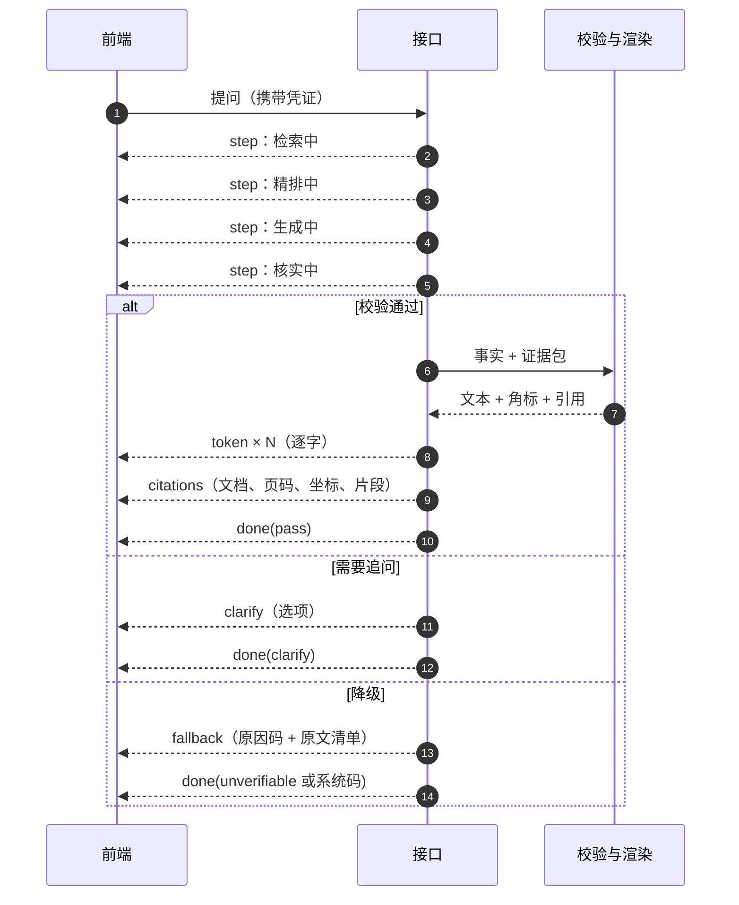

前端状态机只有五个态：空闲、检索中、逐字中、结束、失败。`done` 之后才允许点角标；降级之后角标指向原文但不给结论；连接中断显示"已中断，可重试"，不保留半截答案。`done` 之后到达的任何事件一律丢弃——`done` 的承诺是"这条流结束了"。

### 10.5 技术栈约定：React + RxJS / FastAPI + RxPY

这一节不是选型介绍，是两条纪律。违反它的代码在评审时应当被拦下，因为它破坏的不是风格，是"谁负责收尾"这条线。

**为什么两端都用流式抽象**。一次问答从进门到收尾，本质是一条带生命周期的事件流：有多个阶段、可被打断、可能中途降级、必须以完成事件收尾。用回调表达，收尾责任散落在每个回调里；用流表达，收尾责任集中在一个地方。后者才能被测试，也才能在"用户连点三次提问"时不留下三条同时在跑的连接。

**前端：订阅只有一个出口**。四条规则，缺一条就算泄漏风险：组件不订阅，所有订阅只允许出现在 `useChat` 这一个 hook 里；一条流一个订阅对象，每次提问新建一条流并取消上一条；卸载时用 `takeUntil` 加 `finalize`，在收尾里中止底层请求并把残留的逐字缓冲冲刷掉；状态经 `useSyncExternalStore` 桥出去，不用 `useState` 加手动订阅——后者在并发渲染下会让同一帧读到两个版本的状态。

**后端：RxPY 只包一层**。只有 `qa` 路由里把编排产出包装成流的地方用 RxPY。解析、切片、向量化是批处理，检索、门控、多跳有明确返回值，数据库访问是同步 psycopg——这些都不进流。流对象的生命周期由一个 `disposable` 统管：客户端断开、完成、异常三条路径都经过同一个 `dispose()`，里面把工作线程收干净并释放结果队列；不强行中止工作线程，因为它正在用数据库连接，强行中断会留下半借出连接。

| 语义 | 前端 | 后端 |
|---|---|---|
| 建立一条流 | 新建 Observable | 自定义 Observable 包装队列 |
| 打断 | 取消订阅 → 中止请求 | `dispose()` → 通知停下 → 收线程 |
| 完成信号 | `done` 事件 | `done` 事件，必须最后一条 |
| 错误分类 | 中止错误与业务错误分开 | 取消与业务异常分开 |
| 卸载清理 | `takeUntil` + `finalize` | `disposable.dispose()` |

两端共享的不是库，是这张表。库可以换，表不能改——改了就等于改了事件契约。

| 验收判据 | 怎么验 |
|---|---|
| 组件里没有订阅 | 搜 `web/src/components/` 无订阅调用 |
| 换问题不留双连接 | 连发两次提问，网络面板只有一条活跃流 |
| 卸载不泄漏 | 提问中断开组件，服务端在一秒内看到连接关闭 |
| 后端收尾唯一 | `qa` 路由里 `dispose()` 只在 `finally` 出现一次 |
| 完成后无事件 | 单测：完成后推一个 token，断言被丢弃 |

### 10.6 这一章交给下一步什么

交出去的已经是最终结果，不再有下游：

| 输出 | 内容 |
|---|---|
| 答案 | 通过校验的文本，或三档降级之一 |
| 引用 | 编号、文档、页码、坐标、片段 |
| 审计 | 问题、证据、判定、耗时、模型版本 |

**交给下一步什么**：没有下一步。剩下两章是横切规则与验收，不产生新对象。

## 11 横切：权限、审计与错误

前三章之外还有三件事不属于任何一步，却会影响每一步：谁能看、留下什么、坏了怎么报。这三件事写在这里，不在各章重复。

### 11.1 三道闸

权限不是一处判断，是三处。第一处在检索前，把没权限的切片挡在候选之外；第二处在取文件前，再核一次——因为前端传来的文档编号是用户可控的；第三处是审计，事后能还原谁在什么时候看了什么。

只做第一处不够：如果只过滤检索，用户仍可能通过构造文档编号直接请求原文。只做第二处更不够：先召回再过滤，好证据会被没权限的文档挤掉，候选池还会暴露"库里有这份东西"。第三处不是权限判断，但没有它，前两处出了事也无人能查。

越权时的处理要克制：统一返回 403，不区分"不存在"与"没权限"，也不在提示里透露文档标题。审计里可以记细节，给运维查。取文件接口支持 Range，前端按页加载；只允许取样本目录内的路径，路径穿越在入口就被拒绝。

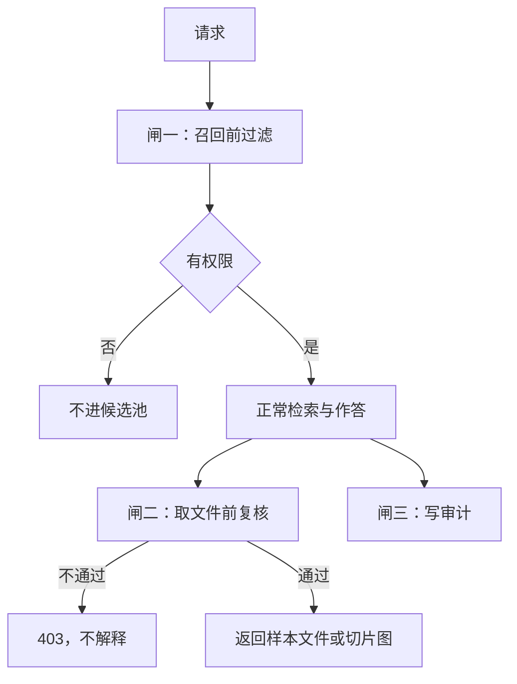

### 11.2 审计

一次问答一条记录，字段不多但都要能用：问题原文、命中的切片编号、最高分与分布、门控判定、草稿事实、最终输出、降级原因、跳次、耗时、模型版本、身份快照。

示例：`{"q":"营业收入是多少","hits":["...#c012003"],"top1":0.62,"gate1":"pass","gate2":"supported","hops":0,"latency_ms":1840,"model":"gw-qwen-max"}`。保留一年，按合规要求可调。审计里只存切片编号与分数摘要，不存完整原文——原文在库里本来就有，重复存会让审计表变成第二份正文，两边还会不一致。

审计写失败不能把一次成功的回答变成失败：调用方拿到"写入失败"的结果，自己决定是否告警；审计模块只记日志、绝不抛异常，但失败一定是错误级——静默吞掉等于"审计缺失且无人知道"。身份快照是必填：没有用户标识的审计回答不了"谁在什么时候看了什么"，第三道闸等于没做。

另有一条本地链路追踪，一行一事件写仓库 `logs/` 下的追加文件。它与审计是两件事：追踪用于开发期看"检索取了多少候选、丢了多少、每步多少毫秒"，可以随时关掉；审计是合规记录，不因开发方便而改口径。两者不共用表，也不互相替代。

### 11.3 错误分类

错误要分类，因为用户看到的文案不同，运维要不要告警也不同。

| 码 | 含义 | 用户文案 | 告警 |
|---|---|---|---|
| `auth_invalid` | 凭证无效 | 请重新登录 | 否 |
| `forbidden` | 无权限 | 无权查看 | 是（连续出现） |
| `no_evidence` | 无相关证据 | 未找到可验证依据 | 否 |
| `low_confidence` | 证据不足 | 现有资料不足以下结论 | 否 |
| `unverifiable` | 校验不过 | 本次不作结论，附原文 | 是（高于阈值） |
| `model_timeout` | 模型超时 | 稍后重试 | 是 |
| `index_stale` | 版本未同步 | 稍后重试 | 是 |
| `internal` | 其他异常 | 稍后重试 | 是 |

文案与告警口径必须同源：用户文案从错误码表取，不在路由里另写一套。前端只按状态码与白名单错误码映射固定文案，服务端响应体里的堆栈、SQL、路径一律不进界面。

### 11.4 限额

限额写死，防止一个请求把整台机器拖垮：

| 项 | 上限 | 超限处理 |
|---|---|---|
| 单问题长度 | 500 字 | 截断，原长度记审计 |
| 多跳 | `Max Hops = 3` | 到顶输出部分结论 |
| 单次证据包 | 6000 字 | 按分数淘汰整条证据 |
| 精排候选 | 50 条 | 按融合名次截断 |
| 精排预算 | 12000 毫秒 | 超时按名次兜底并降档 |

端到端总预算（`QA_BUDGET_S`）与并发上限（`QA_MAX_CONCURRENCY`）在配置里已有字段并出现在健康检查的配置指纹中，但编排层与入口尚未据此强制中断或排队。这两项是已知的未实现项，登记在第 12.4 节，不在这里写成"已生效"。

## 12 验收与未决

最后一章回答两个问题：怎么证明它做成了，以及哪些事现在还没定。

### 12.1 评测集

三十题，四类分工，每类抓一种失败：单文档事实与理解二十题，抓"答案在库里但检索不到"；跨文档比较与时序六题，抓"跨期没归对、比较多实体漏证据"；陷阱四题，抓"没证据也硬答"。每题带期望终态、目标文档、关键证据锚点与禁用措辞；陷阱题另有判别力闸——应答题中必须至少一题拿到证据，否则"全部拒答"会伪装成满分。

判分口径要统一：答对得满分，拒答得一半，硬答错误得零分；可答题拒答得零分。这样调参的人不会为了覆盖率去降阈值。评测脚本按题目逐条走真实接口，不直接调内部函数——绕过接口的评测测不出发事件、收尾与鉴权的问题。

### 12.2 四条红线

- 陷阱题拒答率 100%：放过去一道，这套系统就不该上线。
- 数值准确率不低于 96%：金额、比例、日期错一个都是事故。
- 角标可点回率不低于 98%：点不回去，溯源就是假的。
- 忠实度优先于覆盖率：覆盖率掉了可以接受，忠实度掉了不行。

阈值不拍脑袋，用波谷法：把可答与不可答的分数分布画在一起，取低谷区间，通常落在 0.38–0.42。这个区间随语料漂移，所以要能配置下发、能回滚。

最近一次二十题应答题子集的实测：数值准确率 12/12、角标可点回 20/20、已答题忠实度 13/13，覆盖率 65%；该次运行不含陷阱题，陷阱拒答率不可测，因此整轮不得作为发布依据。报告里"不可测"必须与"通过"分开写，否则门禁会把"没测"读成"达标"。

### 12.3 门禁与回滚

发布前跑一遍全量评测集，四条红线任一不达标就不发。评测器退出码分四种：全过、不达标、存在不可测项、评测器自身失败。第二种与第四种显然不能发；第三种同样不能发——"有不可测项"意味着这次结果证明不了什么，把它当成通过是门禁最常见的自欺。

参数、提示词、模型名三者都版本化，回滚以版本为单位，不做局部回滚——局部回滚最容易出现"阈值回退了但提示词没回退"的组合态。配置指纹在健康检查里可查，换阈值、换模型，一条命令就能看出跑的是哪套值。

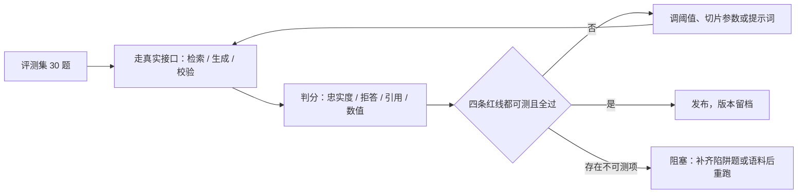

### 12.4 还没定的事

下面这些不是漏了，是现在定就是猜。每一条都写明什么时候必须定，到点没有结论就卡住评审，不许"以后再说"。

| 事项 | 现在怎么做 | 什么时候必须定 |
|---|---|---|
| 向量库扩容 | 单节点 Qdrant | 子片超过 1000 万，或多租户隔离 |
| 任务队列 | 数据库任务表轮询 | 并发任务上到几十 |
| 读图模型 | 一个外部多模态接口 | 出域审批与配额确定 |
| 生成模型 | 企业兼容网关 | 上下文长度影响切片大小时 |
| 复合问规划器 | 不拆分，一问一单元 | 跨文档比较题占比上升且证据段数不够时 |
| 端到端超时 | 各段超时与模型超时兜底，未在编排层硬中断 | 出现单请求拖住工作线程，或首字延迟投诉 |
| 问答并发闸 | 配置有上限，入口未强制排队 | 多用户同时使用，或出现请求堆积 |
| 旁路解析入库 | 单文件产物人工确认 | 复杂版式文档占比超过两成 |
| 文件服务 | 不做，只取样本 | 接入第一份真实文档 |
| 身份字段 | 部门与角色两个列表 | 对接目录服务 |
| 备份 | 库与向量分开备 | 上线前必须定同点策略 |

容量上按全量 1 万份、约 40–60 万子片规划：稠密向量 512 维约 1.2GB，正文约 0.5GB，稀疏索引随向量库数据增长，样本与切片图 60GB 上下。瓶颈会先出现在编码与精排的算力，不在存储。全量迁移时先扩容编码与精排，再考虑向量库分片——反过来的顺序会把一次算力不足误判成存储瓶颈。

**没有下一步**：这份文档到这儿结束。任何改动先改第二章的对象，再改对应章节，最后同步附录 A 与附录 G。
## 附录 A 字段字典

以下是全量字段，正文只写用到的列。口径跟正文不一致时，以此处为准。键用英文（机器稳定），口径用中文写清（人能核对）。

### A.1 documents

| 字段 | 类型 | 必填 | 口径 | 示例 |
|---|---|---:|---|---|
| `doc_key` | text | 是 | 文件路径与标题归一化后的稳定标识；中文转拼音，机构名单独成段 | `han-wu-ji-2026-ban-nian-bao` |
| `filename` | text | 是 | 原始文件名，仅展示 | `寒武纪2026半年报.pdf` |
| `company` | text | 否 | 文档主体公司或机构；结构化值，不靠名称后缀猜 | `寒武纪` |
| `report_type` | text | 否 | annual / interim / quarterly / other | `interim` |
| `report_period_start` | date | 否 | 报告覆盖期开始；不是预测目标年份 | `2026-01-01` |
| `report_period_end` | date | 否 | 报告覆盖期结束 | `2026-06-30` |
| `publication_date` | date | 否 | 对外披露日；与报告期分开 | `2026-08-28` |
| `page_count` | int | 否 | 解析后回填 | `186` |
| `status` | text | 是 | queued / parsed / active / failed | `active` |
| `created_at` | timestamptz | 是 | 首次入库，不随覆盖变化 | `2026-11-20T10:03:00Z` |

### A.2 doc_versions

| 字段 | 类型 | 必填 | 口径 | 示例 |
|---|---|---:|---|---|
| `version_id` | text | 是 | `doc_key` + 文件内容指纹前 12 位 | `han-wu-ji-2026-ban-nian-bao#3f9c1a02b7de` |
| `doc_key` | text | 是 | 所属文档 | 同上 |
| `file_hash` | text | 是 | 文件字节 SHA-256，64 位小写十六进制 | `3f9c1a02...` |
| `status` | text | 是 | pending / active / deprecated / purged / failed / skipped | `active` |
| `activated_at` | timestamptz | 否 | 事务翻牌时间；生效状态必须带 | `2026-11-20T10:06:12Z` |
| `deprecated_at` | timestamptz | 否 | 划为下线的时刻；回收窗口从这里起算 | `2026-11-25T09:12:00Z` |
| `superseded_by` | text | 否 | 被哪个版本取代 | `...#8ab0c1d2e3f4` |
| `created_at` | timestamptz | 是 | 行创建时间 | `2026-11-20T10:06:12Z` |

### A.3 chunks

| 字段 | 类型 | 必填 | 口径 | 示例 |
|---|---|---:|---|---|
| `chunk_id` | text | 是 | 全局唯一；向量库 payload 同名 | `...#c047001` |
| `doc_key` | text | 是 | 所属文档 | 同上 |
| `version_id` | text | 是 | 所属版本；与 doc_key 构成复合外键 | 同上 |
| `chunk_type` | text | 是 | text / table / figure | `table` |
| `parent_id` | text | 否 | 子片指父片；父片为空 | `...#p047` |
| `page_num` | int | 是 | 从 1 开始 | `47` |
| `bbox` | jsonb | 是 | 归一化矩形数组，页面显示空间，左上原点 | `[[0.12,0.34,0.88,0.51]]` |
| `image_path` | text | 否 | 图切片相对路径，无损 WebP | `figures/...#f047001.webp` |
| `content_text` | text | 是 | 用于检索与引用的文本；表格取派生文本 | `营业收入 12.34 亿元` |
| `table_html` | text | 否 | 表格保真存档 | `<table>...` |
| `table_md` | text | 否 | 表格派生文本，可重建 | `| 项目 | 本期 |` |
| `table_cells` | jsonb | 否 | 单元格矩阵，元素含行号、列号、值、表头、跨行跨列 | `[{"row":0,"col":0,...}]` |
| `notes` | text[] | 是 | 来源与派生标记：ocr、mixed、续表、超长 | `["source:ocr"]` |
| `effective_date` | int | 否 | YYYYMMDD；兼容列，只有显式日期才写 | `20250301` |
| `effective_year` | int | 否 | 由日期派生 | `2025` |
| `date_confidence` | text | 是 | explicit / inferred | `explicit` |
| `report_period_start` | date | 否 | 从文档层继承 | `2026-01-01` |
| `report_period_end` | date | 否 | 从文档层继承 | `2026-06-30` |
| `publication_date` | date | 否 | 从文档层继承 | `2026-08-28` |
| `period_granularity` | text | 否 | day / month / quarter / half_year / year / range | `half_year` |
| `period_confidence` | text | 是 | explicit / inferred / filename / unknown | `explicit` |
| `is_public` | bool | 是 | 公开则跳过部门与角色 | `false` |
| `allowed_depts` | text[] | 是 | 空数组表示不按部门放行 | `["fin","hr"]` |
| `allowed_roles` | text[] | 是 | 空数组表示不按角色放行 | `["staff"]` |
| `embedding_dense` | vector(512) | 否 | 归一化后写入；检索实际走向量库 | `[...]` |
| `token_count` | int | 否 | 按字符近似 | `312` |
| `status` | text | 是 | pending / active / deprecated / purged；翻牌时按版本批量改 | `active` |

### A.4 temporal_facts

| 字段 | 类型 | 必填 | 口径 | 示例 |
|---|---|---:|---|---|
| `fact_id` | text | 是 | 稳定事实编号；同一切片/指标/期间回填幂等 | `tf_3f9c1a02_营收_2026H1` |
| `subject` | text | 是 | 主体，来自文档元数据 | `寒武纪` |
| `metric` | text | 是 | 指标规范名；同义词归一在应用层 | `营业收入` |
| `value` | numeric | 是 | 按单位解释的数值；不在这一层换算 | `1234000000` |
| `unit` | text | 是 | 原始单位 | `元` |
| `period_start` | date | 是 | 覆盖期开始；本期或上年同期由列名决定 | `2026-01-01` |
| `period_end` | date | 是 | 覆盖期结束；不是发布日期 | `2026-06-30` |
| `period_granularity` | text | 是 | day / month / quarter / half_year / year / range | `half_year` |
| `source_chunk_id` | text | 是 | 原文切片；外键，切片回收级联删除 | `...#t032001` |
| `doc_key` | text | 是 | 来源文档 | 同上 |
| `role` | text | 是 | reported 原文披露 / derived 工具计算 | `reported` |
| `confidence` | text | 是 | explicit / inferred / filename / unknown | `explicit` |
| `provenance` | jsonb | 是 | 列名、原文摘要、抽取器版本等审计信息 | `{"column":"本期金额"}` |
| `created_at` | timestamptz | 是 | 行创建时间 | `2026-11-27T08:00:00Z` |

### A.5 ingest_jobs

| 字段 | 类型 | 必填 | 口径 | 示例 |
|---|---|---:|---|---|
| `job_id` | bigserial | 是 | 任务主键 | `1024` |
| `doc_key` | text | 是 | 所属文档 | 同上 |
| `version_id` | text | 否 | 所属版本；未结束任务按版本唯一 | 同上 |
| `status` | text | 是 | queued / running / succeeded / failed / canceled | `running` |
| `error` | text | 否 | 失败原因；失败状态必须带 | `parse: page 12 timeout` |
| `retry_count` | int | 是 | 重试次数；running 回 queued 时加一 | `1` |
| `started_at` | timestamptz | 否 | 开始时间；运行状态必须带 | `2026-11-27T08:00:00Z` |
| `finished_at` | timestamptz | 否 | 结束时间；终态必须带 | `2026-11-27T08:03:00Z` |
| `created_at` | timestamptz | 是 | 入队时间 | 同上 |

### A.6 vector_sync_tasks 与 vector_drift_log

| 表 | 字段 | 类型 | 口径 |
|---|---|---|---|
| 同步账 | `version_id` | text | 主键；一个版本一行期望状态，重放幂等 |
| 同步账 | `doc_key` | text | 所属文档 |
| 同步账 | `desired_status` | text | active / deprecated / purged |
| 同步账 | `synced_status` | text | 上次成功写入的状态，只作审计 |
| 同步账 | `status` | text | pending / done / failed |
| 同步账 | `attempts` | int | 已尝试次数，上限 4 |
| 同步账 | `last_error` | text | 失败原因；失败必须带 |
| 同步账 | `next_attempt_at` | timestamptz | 下次允许尝试时间，退避用 |
| 同步账 | `synced_at` | timestamptz | 成功时间；完成状态必须带 |
| 漂移账 | `kind` | text | status_mismatch / version_mismatch / missing_point / orphan_point / sync_failed / sync_incomplete |
| 漂移账 | `pg_value` / `qdrant_value` | text | 两边各自的值，便于判断谁对 |
| 漂移账 | `fixed` / `fixed_at` / `fix_error` | bool / timestamptz / text | 是否已修、修复时间、修复失败原因 |
| 漂移账 | `dedupe_key` | text | 未修复的同一处漂移只留一行 |

### A.7 qa_log

| 字段 | 类型 | 必填 | 口径 | 示例 |
|---|---|---:|---|---|
| `user_id` | text | 是 | 身份快照；空串等于没有审计 | `u_1024` |
| `user_depts` | text[] | 是 | 部门列表 | `["fin"]` |
| `user_roles` | text[] | 是 | 角色列表 | `["staff"]` |
| `is_admin` | bool | 是 | 管理员跨部门访问必须可辨 | `false` |
| `question` | text | 是 | 原问，不改写 | `营业收入是多少` |
| `retrieved_ids` | text[] | 是 | 进精排的切片编号 | `["...#c047001"]` |
| `score_snapshot` | jsonb | 是 | 各路最高分、分布、未覆盖项 | `{"top1":0.62}` |
| `gate1_verdict` | text | 是 | pass / reject_none / reject_low / clarify | `pass` |
| `gate2_verdict` | text | 否 | supported / not_supported / skipped | `supported` |
| `hop_count` | int | 是 | 0 表示单跳 | `0` |
| `answer` | text | 否 | 最终给用户的文本 | `营业收入为……[1]` |
| `citations` | jsonb | 否 | 角标到证据的映射 | `[{"n":1,"chunk_id":"..."}]` |
| `reject_reason` | text | 否 | 机器可读原因码 | `low_confidence` |
| `latency_ms` | int | 是 | 端到端耗时 | `1840` |
| `model` | text | 否 | 生成模型版本 | `gw-qwen-max` |
| `created_at` | timestamptz | 是 | 写入时间 | `2026-11-27T08:01:00Z` |

## 附录 B 表与索引

这里给建表形状与索引口径，字段定义见附录 A。完整 DDL 在 `db/migrations/`，迁移入口只有一个脚本，不在应用启动时各跑一套。

```sql
CREATE TABLE documents (
  doc_key text PRIMARY KEY,
  filename text NOT NULL,
  company text,
  report_type text CHECK (report_type IS NULL OR report_type IN
    ('annual','interim','quarterly','other')),
  report_period_start date,
  report_period_end date,
  publication_date date,
  page_count int,
  status text NOT NULL DEFAULT 'queued',
  created_at timestamptz NOT NULL DEFAULT now(),
  CHECK (report_period_start IS NULL OR report_period_end IS NULL
         OR report_period_start <= report_period_end)
);

CREATE TABLE doc_versions (
  version_id text PRIMARY KEY,
  doc_key text NOT NULL REFERENCES documents(doc_key),
  file_hash text NOT NULL,
  status text NOT NULL DEFAULT 'pending',
  activated_at timestamptz,
  deprecated_at timestamptz,
  superseded_by text,
  created_at timestamptz NOT NULL DEFAULT now(),
  UNIQUE (doc_key, file_hash)
);
CREATE UNIQUE INDEX ux_active_version ON doc_versions(doc_key)
  WHERE status = 'active';
CREATE INDEX ix_doc_versions_deprecated_at ON doc_versions(deprecated_at)
  WHERE status = 'deprecated';

CREATE TABLE chunks (
  chunk_id text PRIMARY KEY,
  doc_key text NOT NULL,
  version_id text NOT NULL REFERENCES doc_versions(version_id),
  chunk_type text NOT NULL CHECK (chunk_type IN ('text','table','figure')),
  parent_id text,
  page_num int NOT NULL CHECK (page_num >= 1),
  bbox jsonb NOT NULL,
  image_path text,
  content_text text NOT NULL,
  table_html text,
  table_md text,
  table_cells jsonb,
  notes text[] NOT NULL DEFAULT '{}',
  effective_date int,
  effective_year int,
  date_confidence text NOT NULL DEFAULT 'inferred',
  report_period_start date,
  report_period_end date,
  publication_date date,
  period_granularity text,
  period_confidence text NOT NULL DEFAULT 'unknown',
  is_public boolean NOT NULL DEFAULT false,
  allowed_depts text[] NOT NULL DEFAULT '{}',
  allowed_roles text[] NOT NULL DEFAULT '{}',
  embedding_dense vector(512),
  token_count int,
  status text NOT NULL DEFAULT 'pending',
  created_at timestamptz NOT NULL DEFAULT now(),
  FOREIGN KEY (version_id, doc_key)
    REFERENCES doc_versions(version_id, doc_key)
);
```

索引按查询形状建：当前生效版本靠部分唯一索引保证；部门与角色用 GIN 支撑"有交集"；报告期、发布日期是部分索引，只给有值的行建；切片按 `(doc_key, version_id)` 建普通索引，翻牌时按版本批量改状态。`chunks (version_id, doc_key)` 的复合外键防止切片挂到别的文档版本下，这比应用层校验可靠。

`v_active_chunks` 视图是检索、重建与对账的唯一取数口径：版本与切片双生效，文档层的报告期元数据 JOIN 带出，不再要求每个切片重复存一份权威值。视图列变更时显式删除重建，不用 `CREATE OR REPLACE` 硬顶——列顺序变了会直接失败，失败比悄悄少一列好。

向量库集合只存切片编号、向量与过滤字段，正文不进向量库，避免第二份真相。集合形状：

```python
# collection: kb_chunks
vectors_config = {"dense": VectorParams(size=512, distance=Distance.COSINE)}
sparse_vectors_config = {"bm25": SparseVectorParams(modifier=Modifier.IDF)}
# payload 索引：doc_key, version_id, chunk_type, status,
#   is_public, allowed_depts, allowed_roles,
#   effective_date, effective_year,
#   report_period_start, report_period_end, publication_date,
#   date_confidence
# point id：Qdrant 只接受 uint64 或 UUID；chunk_id 两者都不是。
#   落地 id = uuid5(NAMESPACE, chunk_id)，确定性，重跑覆盖不重复；
#   payload.chunk_id 存真编号，回 PG 一律用它。
```

摄取时每个子片写同一个点：`id=uuid5(chunk_id)`，`vector={"dense": [...], "bm25": {"text": 预处理串, "model": "qdrant/bm25"}}`，payload 带全量过滤字段与页码、父片编号。查询时两路 prefetch 使用同一个 filter，批量接口一次拿回两路；融合在应用层做，因为查询侧必须使用与入库侧一致的中文预处理串。

文件目录只两个，随项目走：`samples/{doc_key}.pdf` 原件，`figures/{chunk_id}.webp` 图表切片。一律相对路径，禁止绝对路径入库——换机器就全断。备份只备数据库与向量快照，文件随仓库；两处快照必须同点，否则恢复出来会出现"库里有切片、向量库里没点"的空洞。同点的做法是先停写、打快照、再放开，不做不停机热备——单机试点停几分钟没关系。

迁移顺序固定：先加可空字段或带默认值的字段，再回填，再加非空约束与索引；字段删减只在两次发布之间做，先不读不写，下一版再物理删。反向操作会把线上写入卡死。

## 附录 C 接口与事件

接口按"最少能跑通一条链路"设计。开发期不做上传，样本从目录扫；生产接入真实文件时再补上传与签名，但契约形状不变。

### C.1 接口清单

| 方法 | 路径 | 作用 | 请求要点 | 返回要点 | 失败 |
|---|---|---|---|---|---|
| POST | `/api/v1/ingest/scan` | 扫描样本目录 | 无 body | 新增/变更/跳过/失败计数 | 409 扫描进行中 |
| GET | `/api/v1/documents/{doc_key}` | 查入库状态 | 路径参数，含斜杠需转义 | 状态、页数、当前生效版本、最近错误 | 404 |
| POST | `/api/v1/ingest/versions/{version_id}/promote` | 转正指定版本 | 路径参数 | 索引条数、翻牌结果、同步状态 | 404 / 409 / 422 |
| POST | `/api/v1/ingest/versions/{version_id}/rollback` | 回滚到指定版本 | 路径参数 | 翻牌结果、同步状态 | 404 / 409 |
| POST | `/api/v1/ingest/sync` | 消费向量期望状态 | 无 body | 同步条数、失败条数 | 503 |
| GET | `/api/v1/ingest/reconcile` | 对账 | 可选 dry-run | 差异列表与修复结果 | 409 |
| POST | `/api/v1/qa/stream` | 问答（SSE） | `question`、可选 `scope`、`time_range` | 事件流 | 401 / 403 / 503 |
| GET | `/api/v1/samples/{doc_key}.pdf` | 样本直出 | 路径参数，支持 Range | 文件流 | 404 / 403 |
| GET | `/api/v1/chunks/{chunk_id}/figure` | 图表切片 | 路径参数 | WebP | 404 / 403 |
| GET | `/healthz` | 健康检查 | 无 | PG/Qdrant 连通性 + 配置指纹 | 503 |
| GET | `/livez` | 存活检查 | 无 | 进程存活 | 200 |

问答请求示例：

```json
{
  "question": "海光信息2026三季报的营业收入是多少",
  "scope": {"doc_keys": ["hai-guang-xin-xi-2026-san-ji-bao"]},
  "time_range": {"from": 20260701, "to": 20260930}
}
```

`scope` 为空表示在用户有权限的全部生效文档里查；`time_range` 为空表示不加时间条件，但版本条件始终存在。请求体禁止未知字段（多余字段直接 422），避免前端拼错键名却被静默忽略。

### C.2 SSE 事件

事件顺序：`step`（可多次）→ `token`（可多次）或 `clarify` / `fallback` → `citations`（可选）→ `done`。前端不得假设一定有 `token`。

| 事件 | 何时发 | 载荷字段 | 说明 |
|---|---|---|---|
| `step` | 进入阶段或跳次 | `hop`, `phase`, `elapsed_ms` | phase 如 retrieval / rerank / generate / verify |
| `clarify` | 需要用户选条件 | `question`, `options[]` | options 含 label 与回填参数 |
| `token` | 校验通过后逐字发送 | `delta` | 增量文本；拒答路径没有 |
| `citations` | 生成结束且校验通过 | `items[]` | 每项见下 |
| `fallback` | 降级或拒答 | `code`, `message`, `docs[]` | docs 只含有权限文档 |
| `done` | 收尾 | `latency_ms`, `hop_count`, `verdict`, `code?`, `uncovered?` | 总是最后一条 |

`citations.items[]` 示例：

```json
{
  "n": 1,
  "doc_key": "hai-guang-xin-xi-2026-san-ji-bao",
  "doc_name": "海光信息2026三季报",
  "page_num": 47,
  "bbox": [[0.12, 0.34, 0.88, 0.51]],
  "snippet": "营业收入 12.34 亿元",
  "chunk_id": "hai-guang-xin-xi-2026-san-ji-bao#3f9c1a02b7de#c047001"
}
```

前端画框用归一化坐标：`left = x0 * viewport.width`，其余同理。坐标缺失时展示页码与片段，不静默失败。`done.verdict` 是门控五态加校验出口：`pass` / `clarify` / `reject_none` / `reject_low` / `partial` / `unverifiable`，系统异常直接用错误码（如 `model_timeout`、`internal`、`index_stale`）。

## 附录 D 提示词

提示词是约束，不是创作指导。三条不可弱化：只用证据、无证据说不知道、每条事实带来源。改动只能加约束，不能删约束。生产代码里的提示词只放 `api/prompts/`，不散落在业务模块。

### D.1 受限生成

```text
你是企业知识库问答助手，只能依据【证据包】回答。
规则：
1) 只使用证据包内容，禁止外部知识、常识补全、推断。
2) 每条事实必须带 evidence_ids，值是证据包里的切片编号；不得编造编号。
3) 一条事实只陈述一件可核对的事；不要把多句合成一条。
4) 证据不足时 status=unknown，facts 为空。
5) 不得输出证据中不存在的数字、日期、金额、名称、因果关系。
6) 只输出 JSON：
{"status":"answered|unknown","facts":[{"text":"...","evidence_ids":["..."]}]}
```

派生事实额外带 `kind=calc`、`expression`（只允许数字、括号、四则运算符）与 `result`；系统会用计算工具复核，结果不一致即判失败。

### D.2 统计图转译

```text
读取图中坐标轴名称、单位、刻度，以及每个数据点的类别与数值。
多条曲线逐条列出并注明图例。
无法确定的数值写 null，不要估算。
输出 Markdown 表格，不解释。
```

### D.3 结构图转译

```text
列出图中节点（名称、类型：系统/模块/外部服务）。
列出连线（起点、终点、方向、连线文字）。
看不清的节点写“无法识别”，不要补全。
输出两段：节点表、关系表。
```

### D.4 忠实性判别

```text
判断【事实】是否完全由【证据】支持。
SUPPORTED：事实中的每个数字、名称、关系都能从证据直接得到或明确蕴含，且无证据外信息。
NOT_SUPPORTED：包含证据未支持的内容、推断、数字，或与证据矛盾。
只输出 JSON：{"verdict":"SUPPORTED|NOT_SUPPORTED","reason":"..."}
```

### D.5 时间理解

时间解析以规则为主，模型只处理规则覆盖不到的显式表达，且必须返回结构化结果：区间起止、粒度、依据原文、置信度。模型不得把相对时间改写成绝对时间，不得把预测目标时间写进文档有效时间。解析失败返回空区间并注明原因，由上层决定是否不加时间条件——不允许"猜一个最可能的年份"。

失败路径统一：模型返回非 JSON、字段缺失、编号越界，一律按校验不过处理，走降级，不重试三次以上。生成与判别都用 `Temperature = 0`；转译提示词禁止估算，无法确定写空；判别器只吃"问题 + 被引证据 + 事实"，不吃整库上下文，避免它自己脑补。任何提示词变更都要跑评测集，四条红线不过不发版。

示例（应该被降级的输出）：

```json
{"status":"answered","facts":[{"text":"根据经验，这类费用一般是 400 元","evidence_ids":["...#c047001"]}]}
```

降级原因：证据里没有"400 元"，且"根据经验"属于证据外推断。格式合法不代表内容合法，校验必须看内容。

对多跳场景，提示词额外要求只汇总已查实事实；断链时输出"已查实部分 + 断链点"，禁止补全缺失环节。凡是模型自己"顺手补一句"的地方，都是幻觉的入口。

## 附录 E 术语表

| 中文说法 | 英文 | 一句话解释 | 首次出现 |
|---|---|---|---|
| 前置过滤 | pre-filtering | 先按权限、时间、生效状态筛，再检索 | 第 5 章 |
| 两路召回 | hybrid retrieval | 语义与关键词各取一批再合并 | 第 7 章 |
| 名次融合 | reciprocal rank fusion | 只看排名相加，不看分数 | 第 7 章 |
| 精排 | rerank | 问句与候选逐对打分 | 第 7 章 |
| 证据充足性 | evidence sufficiency | 分数与证据够不够支撑结论 | 第 8 章 |
| 忠实性判别 | entailment check | 判事实是否被证据支持 | 第 10 章 |
| 父子切片 | parent-child chunk | 子片检索，父片作答 | 第 3 章 |
| 待转正 | pending | 写完但未生效的版本 | 第 4 章 |
| 归一化坐标 | normalized bbox | 0 到 1 的页面位置，左上原点 | 第 3 章 |
| 断链熔断 | hop circuit break | 多跳某跳不过阈值就停 | 第 8 章 |
| 降级 | explicit degradation | 不给结论，只给原文或明确提示 | 第 10 章 |
| 波谷法 | valley calibration | 在可答与不可答分布低谷取阈值 | 第 12 章 |
| 事实边 | temporal fact | 主体 + 指标 + 期间 + 值 + 来源 | 第 5 章 |
| 期望状态 | desired state | 向量库"应该是什么样"，与 PG 同事务写 | 第 4 章 |
| 事件流 | observable | 可被打断、必须收尾的事件序列 | 第 10 章 |
| 收尾唯一 | single dispose | 取消、完成、异常三条路径共用一个出口 | 第 10 章 |

## 附录 F 需求追踪矩阵

本矩阵把两份上游文档的要求映射到本文章节，确保"细化"而不是"另起炉灶"。

### F.1 架构图集 v2.0

| 架构图集章节 | 关键要求 | 本文落点 | 验证方式 |
|---|---|---|---|
| §1 约束矩阵 | 本地解析、外部模型、两库、前置过滤、三层时间、五道校验 | 2,3,5,7,10 | 约束表 + 状态机 + 门控表 |
| §2 分层架构 | 前端、接入、在线编排、离线摄取、存储、模型服务 | 1,2,5,6,7,8,9,10,11 | 模块表 + 时序图 |
| §3 离线流水线 | 扫描判重、任务队列、版面解析、图表对账、父子切片、转正/同步/对账/回收 | 3,4,附录 B | 流程图 + 事务说明 |
| §4 在线链路 | 文档硬过滤、两路召回、精排、三段门控、澄清、多跳、时序补充、生成、校验 | 5,6,7,8,9,10 | 决策树 + 校验表 |
| §5 端到端时序 | 六类事件、角标回跳、审计落库 | 10,附录 C | 时序图 + 事件表 |
| §6 状态机 | 版本五态 + 任务五态；翻牌只写 PG | 4 | 状态图 + 边界表 |
| §7 数据模型 | 文档/版本/切片/事实/同步账 | 2,附录 A,B | 字段字典 + DDL |
| §8 部署拓扑 | 九服务、失败边界、出向网关 | 11,12,附录 C | 部署与错误表 |
| §9 失败出口 | 四类出口、八条不变量 | 2,11 | 失败契约表 |

### F.2 概要设计 v2.0

| 概要设计章节 | 关键要求 | 本文落点 | 验证方式 |
|---|---|---|---|
| 1 背景与目标 | 未知即拒答、证据可追溯、数值可信、不混版本 | 1,8,10,12 | 硬线 + 门控分段 |
| 2 原则与硬约束 | Fail-Closed、先筛后答、结构化优先、降级显式、八条不变量 | 2,5,11 | 失败出口 + 检查器 |
| 3 总体架构 | 分层、组件、三条数据流 | 1,2 | 全景图 + 对象表 |
| 4 离线摄取 | 双解析路径、九步主链、幂等并发 | 3,4 | 边界表 + 状态机 |
| 5 在线问答 | 身份、时间三层、文档选择、召回、门控、生成契约、五道校验、事件 | 5 到 10 | 规则表 + 事件流 |
| 6 时序图谱 | 事实边、只从表格抽、回填来源、在线补充不击穿 | 5,9 | 字段表 + 流程图 |
| 7 数据契约 | 五对象、引用格式、字段字典 | 2,附录 A | 对象表 + DDL |
| 8 技术栈与部署 | uv、FastAPI、psycopg、Qdrant、TEI、React/RxJS、RxPY 一处 | 4,7,10 | 选型约束 |
| 9 非功能 | 性能预算、容量、可用性、安全、可观测 | 10,11,12 | 限额与降级表 |
| 10 评测与门禁 | 30 题、四红线、波谷法、退出码 | 12 | 红线与门禁表 |
| 11 风险与演进 | 解析质量、分词、时间偏差、网关抖动 | 7,12 | 风险表与未决表 |

## 附录 G 落地登记与偏差

本附录登记与上一版文档相比的关键替换，以及实现时定下、正文来不及展开的口径。避免"两份文档说两套话"。

| 位置 | 原口径 | 新口径 | 原因 |
|---|---|---|---|
| 对象模型 | 四个对象：文档/版本/切片/证据包 | 五个：增加"事实" | 跨期比较需要显式的结构化事实，不能靠模型从两段文本推断 |
| 生成输出 | `status + answer + claims + citations` | `status + facts[text, evidence_ids]` | 答案与角标由系统渲染，模型没有机会编造编号或自由成文 |
| 校验对象 | 按 claim 校验句子 | 按 fact 校验，证据编号是切片编号 | 切片编号可直接回库，局部角标会随证据包变化 |
| 时间字段 | `effective_date / year` 单一层 | 报告期 + 发布日期 + 生效日期三层 | 单一层会把发布日当报告期，预测年份混进过滤 |
| 报告期来源 | 文档正文抽取 | 文档元数据权威，切片继承 | 文件名与正文都可能写错，元数据是唯一可校验处 |
| 文档选择 | 语义检索全库 | 结构化硬过滤，无命中 Fail-Closed | 全库回退会把时间理解错误伪装成"库里没有" |
| 复合问 | 按连接词拆子问题 | 不拆分，一问一单元；规划器留位 | 无可靠句法分析时，错误拆分比不拆更糟 |
| 关键词检索 | 服务端默认分词 | 入库与查询两侧中文 bigram + 拉丁整词 | 实测整句中文只切一词，命中率 1/4 升至 3/4 |
| 精排条数 | 5 到 8 | 5 到 10 | 财报单题常需多段证据；上限仍受预算约束 |
| 精排预算 | 800 毫秒超时 | 12000 毫秒，输入截到 400 字 | 44 条候选两批实测需要该预算，写小了会持续降级 |
| 精排超时处置 | 置信降一档 | 同左，且审计记降级原因 | 降级必须可见（INV-005/007） |
| 向量写入时机 | 翻牌事务内调用向量库 | 事务内只写期望状态，事务外消费 | 向量库无事务，跨库两阶段只能靠期望状态 |
| 同步成功判据 | 接口返回完成 | 回读两边状态分布一致 | 空过滤也会返回完成 |
| 回收顺序 | 向量库不可用时先删库行 | 先写删除期望状态，再删库行 | 反过来会留下永久孤儿点 |
| 对账修复 | 全部以 PG 覆盖 | 四类修，版本挂错只记不修 | 绕过约束写库是数据事故，应暴露不应抹平 |
| 前端事件流 | 手写 AbortController + 手切 SSE 帧 | React + RxJS，订阅只在 `useChat` 一处，`takeUntil` + `finalize` | 收尾责任集中，才能测、才能不泄漏 |
| 后端事件流 | asyncio 生成器 + 线程桥 | FastAPI + RxPY，只包问答事件流一处 | 解析/检索/数据库有明确返回值，包成流只会让调试变难 |
| 评测集 | 50 题（旧版文字） | 30 题：单文档 20、跨文档/时序 6、陷阱 4 | 与 `eval/golden_questions_v1.jsonl` 实际一致 |
| 解析主链 | MinerU 纯 Pipeline | 本地 pdfplumber 版面链；MinerU 改为旁路分阶段 | MinerU 云需付费与网络，主链要可离线跑 |
| 生产代码语言 | 未限制 | 禁止中文字符串字面量 | 提示词/词表/文案集中管理，避免散落与误改 |

本期明确不做的（不是遗漏）：独立对象存储、独立检索引擎、生产上传签名链路、多租户、跨库联邦、自动文档改写。触发条件写在概要设计第 11 章与本文第 12 章。
