# 详细设计文档

> 版本：v1.0 ｜ 日期：2026-11-23 ｜ 状态：评审稿
> 基线：PostgreSQL + Qdrant 两个库；权限前置过滤；图表经模型转译；受控多跳（最多 3 跳）
> 输入：同目录 `架构图集.md`、`概要设计.md`
> 读者：后端 / 前端 / 平台 / 测试 / 评审
> 口径：本文档为准；概设中与本文冲突的条款已在附录 G 登记

## 1 概述

这个系统把企业内部的 PDF 变成一个可以问答的知识库。它不追求什么都能答，只追求答出来的每一句都能在原文里找到。默认结果是拒答：找不到证据、证据不够、答案无法被原文支持，一律说不知道。

三条硬线：

- 不知道就说不知道。没有证据时不猜、不用常识补全。违反了，答案会看起来很合理，但没有任何出处，用户没法复核。
- 只许用证据。模型只做归纳和转述，不做外推。违反了，一句话里三个事实都是真的，结论却是编的。
- 每句能点回原文。每条结论带角标，点开跳到页码并高亮原句。违反了，可追溯就成了口号。

做与不做：

| 做 | 不做 |
|---|---|
| 基于库内文档回答问题 | 凭常识或训练记忆补充答案 |
| 表格按整表保留，按表内容检索 | 靠看图目测估算数值 |
| 图表经模型转译成可检索的文字 | 让用户自己从图里读数 |
| 检索前按部门与角色过滤 | 先检索再判断权限 |
| 同一份文档只保留一个生效版本 | 新旧版本混在一起被召回 |

边界：

| 项 | 取值 |
|---|---|
| 规模 | 试点 100 份 PDF，全量 10,000 份，约 40–60 万条子切片 |
| 语言 | 中文为主，少量英文 |
| 部署 | 私有化，开发期单机容器，生产进私有集群 |
| 模型 | 读图与作答走外部商业接口，本地只跑版面解析、向量与精排 |
| 权限 | 部门与角色隔离，检索前生效 |
| 更新 | 每周增量与版本覆盖 |
| 文件 | 本期只处理项目内测试样本，文件下发服务不在本期范围 |

优先级一行：忠实度 > 拒答准确 > 引用正确 > 覆盖率。宁可多拒十次，不可错答一次。

阅读约定：正文用中文说法，英文名词只在附录 E 汇总；字段名保留英文，中文名与口径在附录 A。

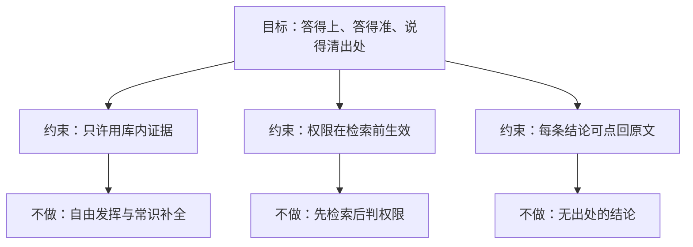

## 2 总体流程

系统由十一个模块组成。把它们拆开看，每个模块只做一件事，出问题也容易定位。

| 编号 | 模块 | 干什么 | 吃什么 | 吐什么 | 依赖 | 详见 |
|---|---|---|---|---|---|---|
| M1 | 接入与身份 | 收请求、解开身份、限流 | 登录凭证 | 问题与部门角色 | 无 | 第 9 章 |
| M2 | 听懂问题 | 对时、换说法、判单跳还是多跳 | 问题与身份 | 检索用的问句与条件 | M1 | 第 5、6 章 |
| M3 | 找资料 | 前置过滤、两路召回、精排 | 问句与条件 | 候选证据 | M2、M8 | 第 5 章 |
| M4 | 判够不够 | 分数分段、澄清、多跳编排 | 候选证据 | 放行或拒答或追问 | M3 | 第 6 章 |
| M5 | 作答与自查 | 受限生成、事后核查 | 证据包 | 答案与引用 | M4、M11 | 第 7 章 |
| M6 | 文档进库 | 版面、表格、图表、切片 | 样本文件 | 待转正的切片 | M8、M11 | 第 3 章 |
| M7 | 版本与清理 | 转正、下线、回收 | 切片与文档记录 | 唯一生效版本 | M8 | 第 3 章 |
| M8 | 存储 | 存真相、存向量 | 切片与向量 | 可检索的数据 | 无 | 第 4 章 |
| M9 | 前端溯源 | 双栏、角标、高亮框 | 答案与引用 | 人看到的界面 | M1、M5 | 第 8 章 |
| M10 | 回看与评测 | 审计、评测集、调参 | 问答记录 | 指标与阈值 | M5 | 第 10、11 章 |
| M11 | 出向模型网关 | 限流、脱敏、托管密钥 | 模型请求 | 模型返回 | 外部接口 | 第 7 章 |

一次提问走八步：

1. 进门：带上身份进来，网关解开部门与角色。
2. 听懂：把"上个月""这个文件"这类说法换成明确的日期与文档，判断是常规问题还是需要多步。
3. 找资料：先按权限、时间、生效状态筛一遍，再用语义与关键词两路各取 30 条。
4. 判够不够：看最高分落在哪一段，决定直接拒答、给疑似文档、追问，还是继续。
5. 追问或再找：条件不清就问选项；需要跨文档就进多跳循环，每跳都要单独过门槛。
6. 作答：只拿证据包里的内容组织语言，每句结尾标角标。
7. 自查：查引用编号是否真实、每句是否都有出处、数字能否在原文里定位、答案是否自相矛盾。
8. 送回：流式吐字，同时下发引用，前端渲染角标与高亮。

三条分叉：

| 分叉 | 触发条件 | 用户看到 |
|---|---|---|
| 直接拒答 | 最高分 < 0.20，或问题越界 | 一句"未找到可验证依据" |
| 澄清 | 条件缺失或存在多份冲突文档 | 可点击的选项按钮 |
| 多跳 | 单次检索无法覆盖问题，需要串起来 | 分步进度，最多 3 跳 |

时间预算：

| 环节 | 目标 |
|---|---|
| 前置过滤加向量召回 | 95% 请求在 30 毫秒内 |
| 单跳首字 | 约 1.0 秒，整答 1.5–2.5 秒 |
| 多跳 | 4–8 秒 |

举一个走查的例子：问"差旅住宿标准是多少"。第 2 步把"标准"扩成"住宿费限额"，第 3 步按提问人所在部门过滤掉其他部门的旧办法，第 4 步最高分 0.62 落在放行段，第 6 步只引用那一条制度原文，第 7 步把"每人每天 500 元"和原文数字对齐，第 8 步前端在角标处高亮。

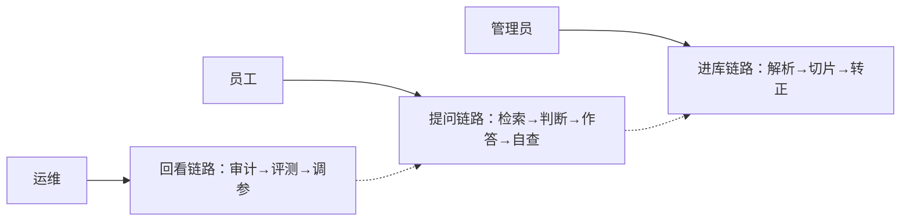

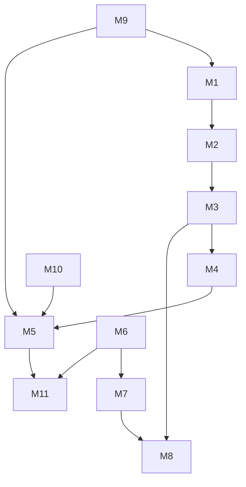

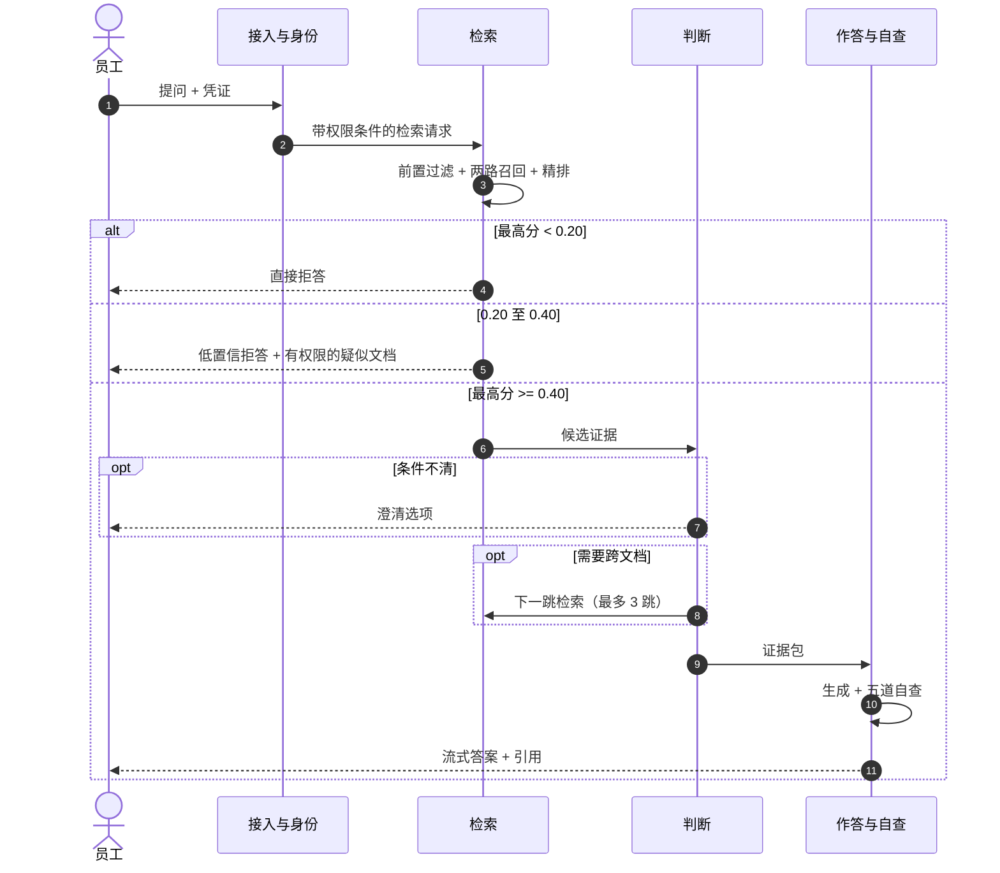


## 3 文档摄取

这一章解决一件事：把一份 PDF 变成一堆能被检索、能指回原文的切片，并且保证同一份文档任何时候只有一个生效版本。

### 3.1 扫描与判重

系统每次只看三件事：这份文档以前见过没有、内容变没变、变了怎么处理。

| 情况 | 判断 | 动作 |
|---|---|---|
| 指纹相同 | 同一份文档，内容没动 | 跳过，保持现状 |
| 没见过 | 新文档 | 解析并入库 |
| 指纹变了 | 同一份文档出了新版 | 走覆盖流程，新版先待转正 |

覆盖流程有一条不能违反的规定：不先删旧版。原因有三个——解析可能失败，失败时旧版还得继续服务；线上正在被检索；删完再写，中间这段时间用户搜不到。

本期触发方式是扫项目内的 `samples/` 目录；每周增量、对接网盘这些生产形态不在本期范围，只在边界里记一笔。

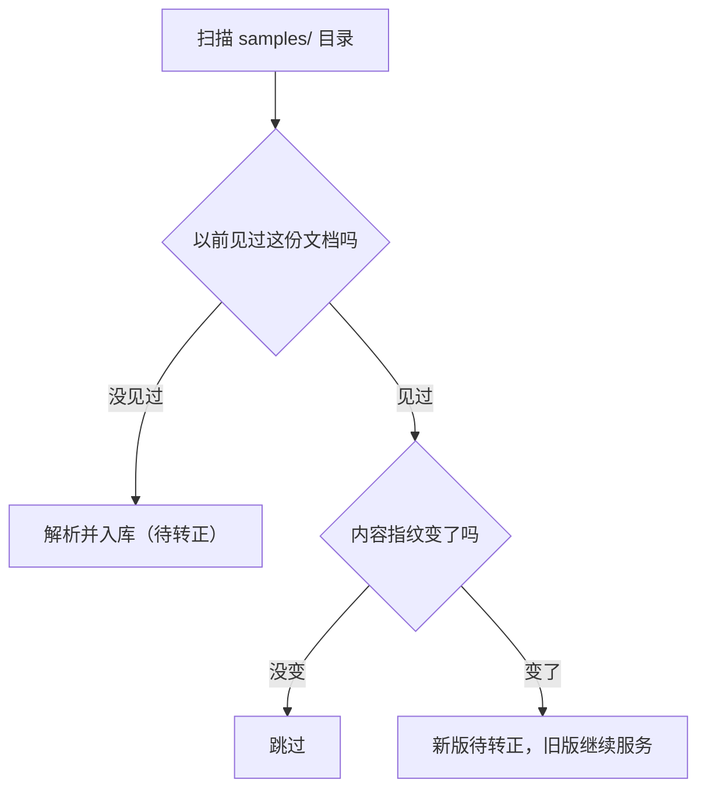

### 3.2 版面解析

一页纸进来先被切成四类区域：正文、表格、图、页眉页脚。前两类进库，页眉页脚丢掉——它们只是重复的页码和公司名，留下来只会污染检索。

每块内容记两样东西：页码，和它在页面上的位置。位置用相对坐标，横纵都按页面宽高归一化到 0 到 1。这么做是因为换分辨率、换缩放都不用重算；前端拿到 0.23 这样的数，乘上当前视口宽度就是像素位置。

扫描件的处理：整页字符数太少才去做文字识别，识别结果同样带页码与坐标。宁可保守一点判成需要识别，也不要把空文本送进索引——空文本不会报错，但会把检索带偏。

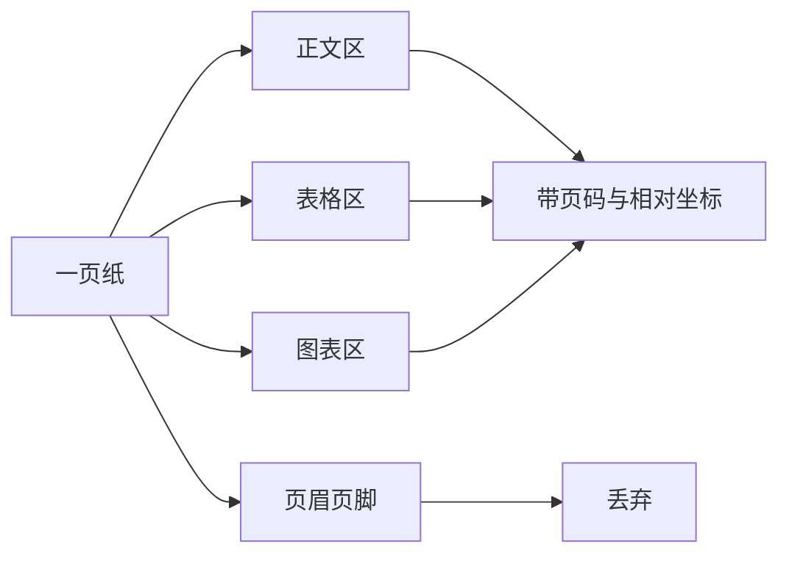

### 3.3 表格与图表

表格整表转成 HTML，不切断。跨行表头、合并单元格、合计行，一旦按行切开，语义就散了，检索到的只是半张表。

图表走三步：先把原图裁出来，按至少 200 DPI 保存到 `figures/`；再交给读图模型转译，统计图抽成"坐标轴 + 数值"的文字表，结构图抽成"节点 + 调用关系"；最后把转译结果和原图路径绑在一起。

这里有一条铁规矩：模型转出来的每个数字，都要能在原图上对得上。对不上就判这次转译失败，宁可这条图不入库，也不让错的数值进检索库——图表是数值幻觉最容易钻进来的地方。

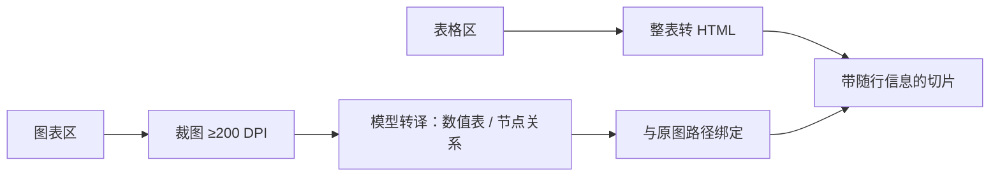

### 3.4 切片

切片分两级。子片 256 到 512 字、重叠 64 字，负责被检索命中；父片 1024 到 2048 字或整章，负责被送进模型。检索用小子片是为了精度，作答用大父片是为了上下文完整。

每个子片带六项随行信息：页码、坐标、类型、时间、权限、版本。这六项决定了它后面能不能被召回、能不能被引用、能不能被点回原文。

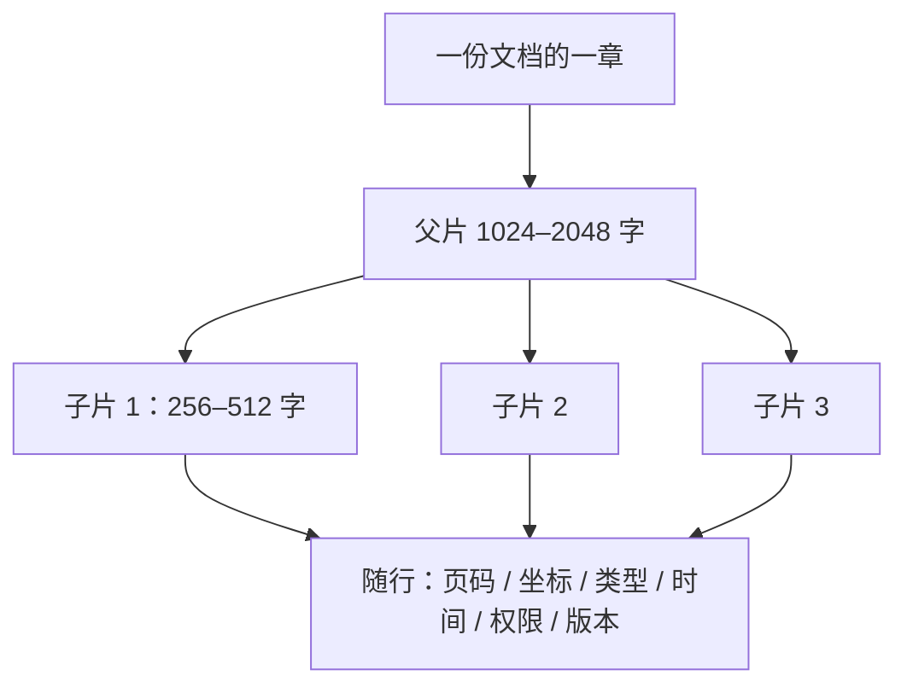

### 3.5 版本转正

新版本先进"待转正"状态，写完、抽检通过，才在一个事务里翻牌：旧版改成"已下线"，新版改成"生效"。同一个文档编号，任何时刻只能有一份生效——这一条没有例外，因为两份同时生效就意味着检索可能命中已废止的条款。

解析失败时什么都不翻，旧版继续服务。失败信息记在任务表里，人工可查、可重试，重试按文档编号去重，重复跑不会产生第二份。

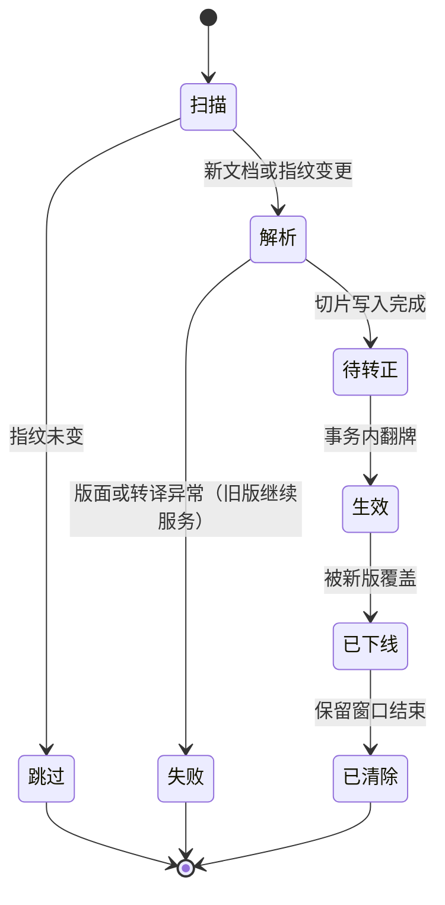

### 3.6 失败与清理

| 情况 | 系统怎么做 | 用户看到 |
|---|---|---|
| 解析失败 | 记失败原因，旧版继续服务 | 正常问答，无感知 |
| 转译数字对不上 | 该图不入库，记一条抽检项 | 这条图搜不到 |
| 版本翻牌失败 | 事务回滚，保持旧版 | 正常问答 |
| 旧版需要回收 | 先标已下线，24 小时后异步删除向量与库行 | 无感知 |

样本文件与切片图不删——它们是测试资产，删了就没法复现问题。要删的只有向量、正文行与词法索引。

## 4 数据存储

这一章解决一件事：东西到底存在哪，谁是准的，不一致的时候听谁的。

系统只有两个数据库，加一个随项目走的样本目录。

| 存什么 | 放哪 | 为什么是它 | 不能放什么 |
|---|---|---|---|
| 文档、版本状态、切片正文、权限、时间、审计、词法索引 | PostgreSQL | 需要事务翻牌、需要按任意维度回查 | 向量（占用大、扫描慢） |
| 向量与过滤字段 | Qdrant | 需要先按权限与时间筛、再做近邻检索 | 正文真相（会变成第二份真相） |
| 原件、切片图 | 项目内 `samples/` 与 `figures/` | 本期只有测试样本，不提供服务化下发 | 结构化查询要用的字段 |

真相在数据库里。版本状态、正文、权限、时间，以 PostgreSQL 为准；Qdrant 里的向量是副本，允许短暂落后。

一致性的做法是三步：事务里翻牌 → 按文档编号一次性改向量库里的状态字段 → 检索入口再用"当前生效版本"做一次校验。第三步是廉价兜底，一次主键查询，代价可以忽略，但能堵住中间那一小段窗口。落后多久可接受：翻牌后一分钟内完成同步；对账任务每小时扫一次，发现差异就补。

为什么能少两个库：

- 关键词通道放在数据库里，版本翻牌和词法可见性在同一个事务。原来的方案要在两套系统各写一次，中间总有窗口能搜到已废止的条款——对零幻觉是硬伤。
- 权限与时间过滤条件只写一处。写两处，漏一处就是越权召回。
- 少一套需要单独备份、单独运维、单独升版本的组件。

代价也要说清：长句和生僻词的关键词召回会弱一档，靠语义通道补；数据库承载全部正文与索引，扩容只能往上加。

什么时候再加回来：片数上千万、并发上到几十、或者评测显示关键词通道明显拖后腿时，才引入独立的全文引擎，而且只做旁路、必须能从数据库全量重建。文件服务等接入第一份真实文档时再设计。

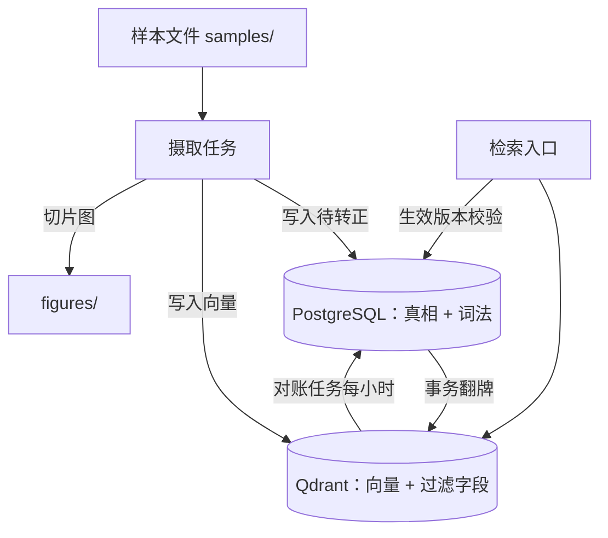

## 5 检索

这一章解决一件事：从几十万条切片里，把真正该看的那几条挑出来。

第一步是筛，而且是先筛后搜。权限、时间、是否生效，这三条必须在召回之前生效。后置过滤有两个恶果：把有权限的好证据挤出候选名单；让别人看到本不该知道存在的东西。

第二步两路召回，各取 30 条：

| 通道 | 擅长 | 弱项 |
|---|---|---|
| 语义 | 换个说法、同义表达、长句描述 | 精确编号、型号、条款号 |
| 关键词 | 编号、型号、人名、条款号 | 口语化改写、错别字 |

第三步合并去重，按名次融合：两路各排出名次，同一条在不同通道里的名次相加，和越小越靠前。只看名次不看分数，是因为两路的分数根本不可比，硬凑权重反而更难调。

第四步精排：把问句和每条候选成对送进精排模型，逐条打分，取前 5 到 8 条。召回分数只反映"大概相关"，精排才回答"到底能不能支撑这个问题"，后者才是门控的依据。


先筛后搜和先搜后筛的差别，用一张图说清：左边先筛，候选池里都是能看的；右边先搜，好证据可能被没权限的文档挤掉，同时还暴露了不该暴露的存在。

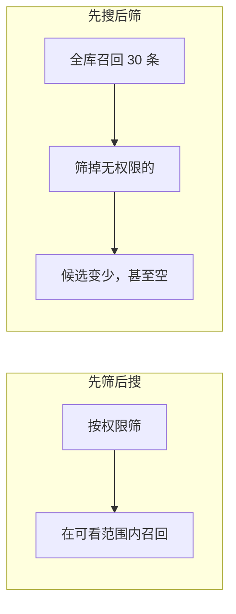

参数与预算：两路各 30 条，融合后仍按 30 条进精排，取 5 到 8 条进证据包；前置过滤加向量召回，95% 的请求在 30 毫秒内完成。

还有一道兜底：进精排之前，用候选切片所属的版本号回查一次"当前生效版本"。版本对不上就直接丢弃，不进入打分。这一步只花一次主键查询，但能防止翻牌同步那一分钟内的漏网。

| 情况 | 系统怎么做 | 用户看到 |
|---|---|---|
| 过滤后不足 5 条 | 有多少算多少，不硬凑 | 可能落进低置信档 |
| 精排超时 | 退回召回名次，置信降一档，记审计 | 答案更保守 |
| 关键词无命中 | 只用语义通道继续 | 无感知 |
| 两路指向不同文档 | 都留在候选池，交给下一章判断 | 无感知 |
| 版本校验不通过 | 直接丢弃该切片 | 可能拒答 |

## 6 证据判断与多跳

这一章解决一件事：找到的这几条，够不够回答问题；不够的时候，是拒答、追问，还是再去找一轮。

判断只看最高分落在哪一段，三段各有各的处置。

| 分数区间 | 含意 | 处置 | 用户看到 |
|---|---|---|---|
| < 0.20 | 库内没有相关内容 | 硬拒答，不调用生成模型 | 一句"未找到可验证依据" |
| 0.20 至 0.40 | 有一点像，但撑不住结论 | 低置信拒答，附有权限的疑似文档 | 拒答 + 几份可点的文档 |
| >= 0.40 | 有证据支撑 | 继续，先查歧义再生成 | 正常答案或追问 |

中间那一档是故意留的。全都放行会把"看起来相关但其实不相关"的答案放出去；全都拒掉又会让用户以为库里没有。给一份"你可能有权限看这几份"的清单，比一句冷拒更接近真实情况，也不泄露没有权限的文档。

追问有两个前提：一是条件确实缺（比如没说是哪个部门、哪一年），二是选项必须来自刚检索到的证据，不能凭空编几个选项让用户选。追问之后按新条件重新检索，不是接着上一轮硬凑。

多跳是成本项，不是默认项。常规的单一实体问题直接走单跳；只有问题本身要求把两份以上文档串起来（比如"A 制度规定的流程，在 B 系统里对应哪个环节"）才进多跳。多跳的规则很硬：最多 3 跳，每一跳单独过阈值，中间任何一跳不过就立刻停下，把已经查实的事实和断在哪一步一起交出去。

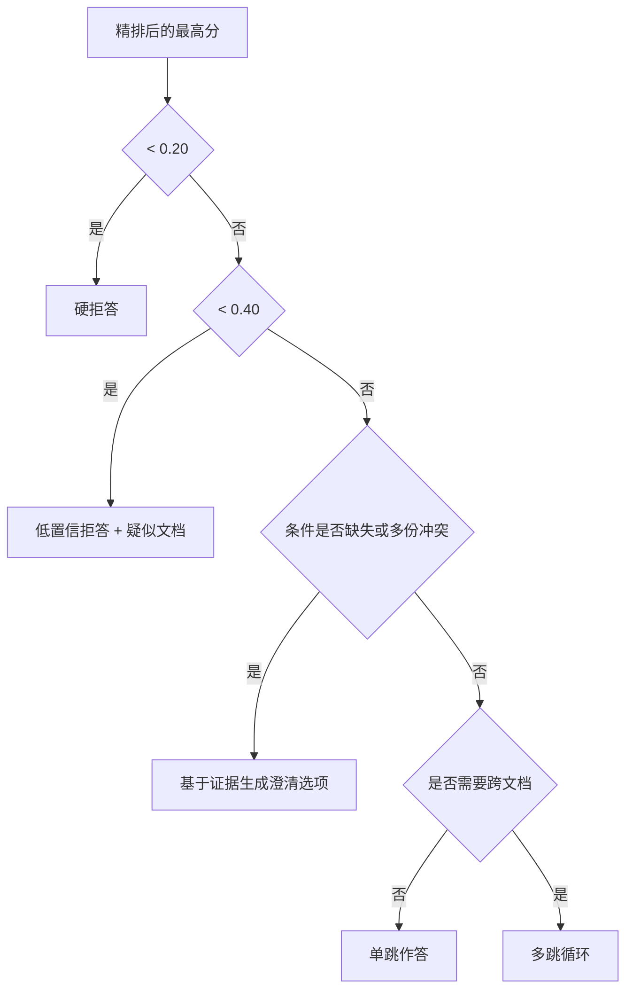

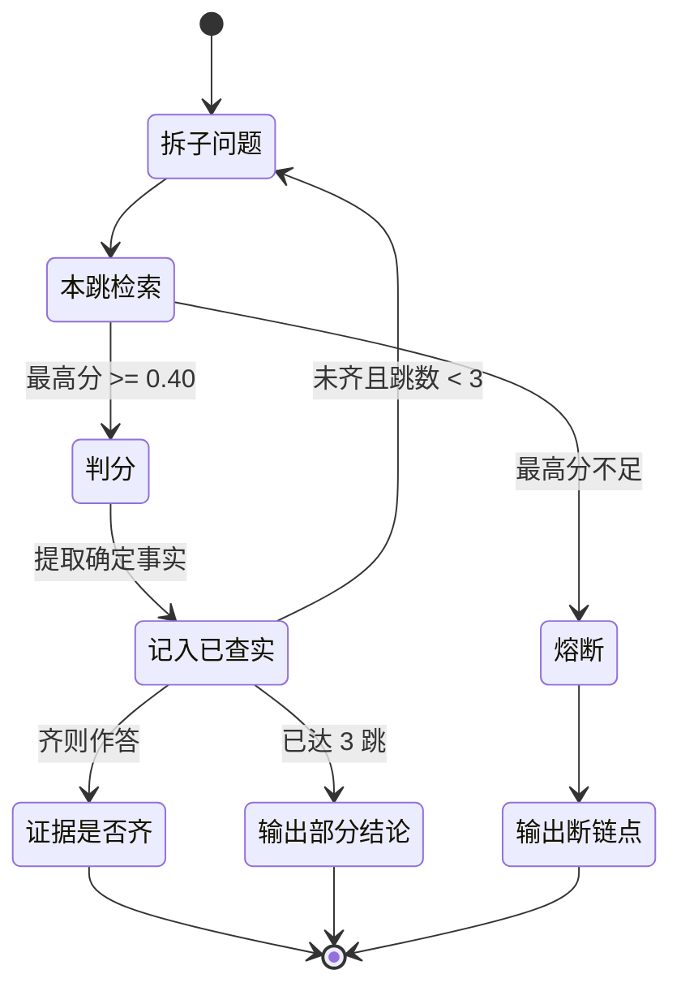

多跳的上限写死为 `Max Hops = 3`。跳数越多，错一次就一路错下去的概率越高；三跳基本覆盖"制度—流程—系统"这类三段式问题，再多就该拆成多个问题了。

还有一条容易被忽略：多跳的每一跳都要带同一份权限条件。换个说法不等于换了身份，任何一跳都不能放宽可看范围。

## 7 生成与校验

这一章解决一件事：即使是证据齐全，也不能让模型自由发挥；写出来的每一句都要能被证据接住。

生成阶段有三条约束：只用证据包里的话；每个事实句结尾标角标；证据不足就明说不知道。参数固定为 `Temperature = 0`，输出要求是结构化的——先给状态（已作答还是不知道），再给答案与引用编号。这样后面才有东西可校验，纯文本没法自动核对。

校验按成本从低到高分五道，任何一道不过就不放行：

| 顺序 | 查什么 | 不过怎么办 |
|---|---|---|
| 1 | 引用的编号是否真实存在 | 直接拒答 |
| 2 | 每个事实句是否至少有一个引用 | 直接拒答 |
| 3 | 数字、日期、百分比、专名能否在被引原文里定位 | 直接拒答 |
| 4 | 整段答案是否被证据支持（模型判别） | 拒答 |
| 5 | 答案内部是否自相矛盾 | 拒答 |

第四道是模型判别，也叫忠实性判别（NLI），输入只有三样：问题、被引证据、待判答案，输出只有"支持"或"不支持"。它不做生成，只做裁判。判别调用失败、超时、返回格式不对，一律按"不支持"处理——宁可拒答，也不放一条没验过的答案出去。

不通过时的降级不是"换个说法再试"，而是把结论全部撤掉，只给相关原文与页码，让人自己去读。这比给一个半对的答案安全。

| 触发点 | 用户看到的话 |
|---|---|
| 没证据 | 根据当前知识库资料，未找到与该问题直接相关的可验证依据。 |
| 无法验证 | 现有资料不足以支持一个完全可验证的答案，本次不作结论性回答。 |
| 超出范围 | 该问题不在当前知识库可回答的范围内。 |
| 系统异常 | 当前无法完成可靠回答，请稍后重试。 |

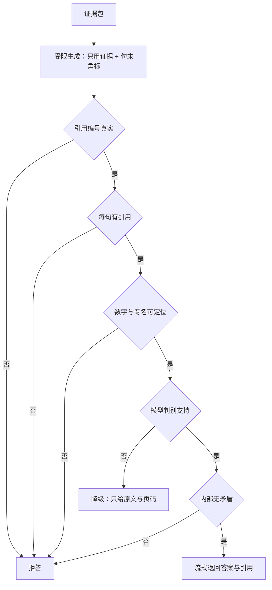

## 8 前端溯源

这一章解决一件事：让用户相信这个答案，方式是让他三秒内看到原文。

界面是双栏：左边问答，右边原文。答案里每个事实句结尾有角标，点一下右边跳到对应页，并在那一块画上半透明高亮框。

坐标换算很简单：左上角横坐标是 0 到 1 的数乘视口宽，纵坐标乘视口高，宽高由两个坐标差算出来。用相对坐标的好处是，窗口缩放、换设备、换缩放比例都不用重新计算，前端按当前视口换算即可。

| 事件 | 界面上是什么 |
|---|---|
| 进度 | 顶部一条步骤条，显示第几跳、正在检索还是正在核实 |
| 追问 | 答案区出现几个可点的选项按钮 |
| 逐字 | 正文按字流式出现，不整段闪现 |
| 引用 | 每句结尾的角标，可点 |
| 降级 | 一条提示，说明只提供原文不提供结论 |
| 结束 | 收尾，角标全部可点，可复制 |

三种异常各有各的说法：没有权限看这份文档、样本文件不存在、文档已下线。三种都不该显示成"系统错误"，因为前两种是正常状态。

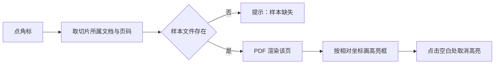

高亮框画不出来时不要静默：要么给出页码让人自己找，要么明确说这块图上没有坐标。静默的后果是用户以为系统在骗他，而这套系统最不能承受的就是这个印象。

角标编号在一次回答内从 1 开始递增，同一个引用多次出现用同一个号，不重复编号。用户点第 3 个角标，跳到的必须是第 3 条证据的原文，而不是"最像"的那条——编号和证据必须一一对应，这是可追溯的最低要求。

不做整页预加载。一次只取当前页和相邻页的渲染结果，翻页再取。理由是样例 PDF 动辄几十兆，整本塞进内存既慢又容易把浏览器拖死；按页取也能让"点角标跳到第 47 页"这种操作在两秒内完成。

## 9 权限与审计

这一章解决一件事：谁能看到什么，以及每一次"看到了"都有据可查。

身份不在系统里自己维护，从登录凭证里来：部门列表和角色列表跟着请求一起进来，网关解开后往下传。这样做的原因是权限的真相在企业目录里，系统里再存一份必然对不上。

闸有三道：

1. 检索前：部门、角色、是否公开，直接进过滤条件。没权限的切片根本不进候选池，不是"召回了再删"。
2. 取文件前：拿样本文件之前再核一次。前端传来的文档编号是用户可控的，不复核就等于把文件目录暴露给所有人。
3. 全程留痕：每一次问答都落一条审计，出问题能回到当时那一刻。

有一条容易忽略的规矩：不许泄露"存在"。低置信拒答时只能列提问人有权限的疑似文档；如果直接说"库里有三份关于薪酬的文件但你没权限"，这本身就是泄密。

审计每条至少记这些：问题、命中的切片编号、最高分与分布、两道门的判定、最终答案或拒答原因、跳数、耗时、模型版本。少记哪一项，事后都复盘不了当时为什么这么答。

对越权尝试的处理要克制：返回 403，不说明"这份文档存在但你没权限"，也不要把拒绝原因写进前端提示。审计里可以记细节，给运维查；给用户的话只有一句"无权查看"。

审计保存多久，按企业合规走，默认一年。审计里只存切片编号与分数摘要，不存完整原文——原文在库里本来就有，重复存只会让审计表变成第二份正文。密钥只在网关里，不进日志、不进数据库、不进代码仓库。

权限会变。今天在 A 部门的人，下个月可能调到 B 部门。已经产生的审计按当时的身份记，不跟着人改；但下一次问答必须用新身份重新过滤。把旧审计改成新权限，等于把历史擦掉了。

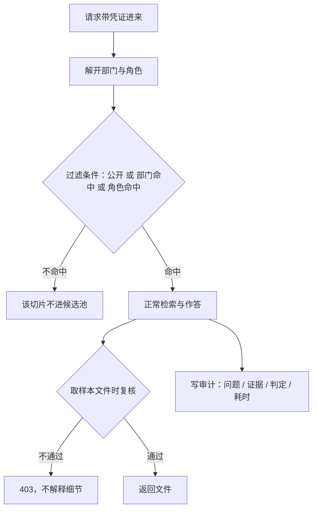

## 10 运行与容量

这一章解决一件事：这套东西在单机上跑得动，跑满之前知道该先加什么。

预算按环节算，不按平均值算：

| 环节 | 预算 | 说明 |
|---|---|---|
| 版面解析与切片 | 每份文档分钟级 | 批量跑，不阻塞问答 |
| 向量编码 | 每秒几十条 | 单机可用，靠后台任务消化 |
| 前置过滤加召回 | 95% 在 30 毫秒内 | 直接影响首字时间 |
| 精排 | 每条候选几十毫秒 | 候选越多越慢，所以要控在 5–8 条 |
| 生成 | 取决于外部接口 | 首字约 1 秒，整答 2 秒上下 |

六个指标要盯住，每个都有告警线：拒答率突然上升（说明召回或阈值出了问题）、向量库与数据库的版本不一致条数（说明同步卡住）、召回延迟抬升（说明索引或数据量到了拐点）、模型超时率、清理任务滞后、磁盘增长。

扩容顺序是固定的三步，不要跳：先加解析与编码的并行任务（这一层最容易加、收益最直接）；再拆向量库（把检索压力单独拿出去）；最后才考虑分片数据库。反过来做，会先花钱解决最不痛的地方。

单机容量按实际数字估：60 万条子片、每条 1024 维，向量本身约 2.3 GB，加上索引与副本，向量库按 6 GB 内存规划；正文约 0.5 GB，词法索引 1 到 1.5 GB；样本与切片图 60 GB 上下。这台机器的瓶颈会先出现在编码与精排的算力上，而不是存储。

三类故障要提前想好：向量库挂了，检索直接不可用，此时应该整站降级为"暂不可用"，而不是退化成只走关键词——那等于换了一套没验过的系统。数据库挂了，连审计都写不进去，正确答案宁可不给。外部模型超时，按章节 7 的规矩走降级，不给未验证的答案。


## 11 验收

这一章解决一件事：怎么算做成了，以及什么情况下不许上线。

评测集五十题，四类各有分工：

| 类型 | 题数 | 抓什么 |
|---|---|---|
| 基础与表格 | 20 | 答案在库里、能定位到页与段 |
| 图表 | 10 | 转译出来的数值是否准 |
| 时间与多跳 | 5 | 相对时间是否被正确换算、多跳是否收敛 |
| 陷阱 | 15 | 库里没有、只有半句、看起来像但有冲突 |

四条红线，任何一条不达标就不发布：

- 陷阱题拒答率 100%。只要有一道编了答案，这套系统就不该上线。
- 数值准确率不低于 96%。金额、比例、日期错一个都是事故。
- 角标可点回原文的比例不低于 98%。
- 忠实度优先于覆盖率：覆盖率掉了可以接受，忠实度掉了不行。

阈值不是拍脑袋定的，用波谷法标定：把可答题与不可答题的分数分布画在一起，取两条曲线的低谷区间，最终落在 0.38–0.42 之间。这个区间随语料变化，所以要能配置下发、能回滚，不能写死在代码里。

判分两条腿走路：机判看引用是否指向真实切片、数字能否在原文定位，这部分可以全自动；人判看答案是否真的回答了问题，抽样百分之十。只靠机判会漏掉"引用都对但答非所问"这类问题。

题目不是一次写完就锁死。上线后每周从审计里挑真实的坏例子补进题库，尤其是那些系统答了但用户追问了三次的。题库版本要跟参数版本一起留档，否则半年后没人说得清当时的红线是怎么过的。

还有一条判分口径要统一：拒答也算正确答案，只要它拒得对。陷阱题答不知道是满分，硬给一个答案是零分；可答题拒答是零分。别把「回答率」当质量指标，否则调参的人一定会去降阈值换覆盖率。

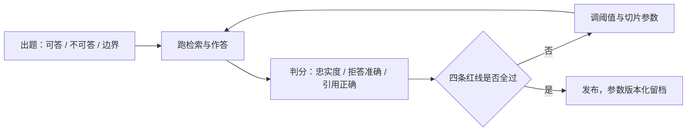

## 12 待确定事项

这一章只列还没定的事，以及各自的触发条件。写进正文的不是待定项，是已定项。

| 事项 | 现在怎么做 | 什么时候必须定 |
|---|---|---|
| 向量库选型 | 单节点 Qdrant | 片数上千万或需要多租户隔离时 |
| 队列 | 数据库任务表轮询 | 并发任务上到几十、需要重试编排时 |
| 读图模型 | 用一个商业多模态接口 | 出域审批与配额确定后 |
| 生成模型 | 企业已有兼容网关 | 上下文长度影响切片大小时 |
| 关键词通道 | 数据库三元组匹配 | 评测显示长句召回明显拖后腿时 |
| 真实文件服务 | 不做，只用样本 | 接入第一份真实文档或多副本部署时 |
| 身份字段 | 部门与角色两个列表 | 与目录服务对接时 |
| 数据库版本 | 单机主库 | 冷备与只读副本上线时 |

演进的顺序按疼了再做排，不按听起来先进排。多跳现在做了但默认不用，因为绝大多数问题的证据都在一份文档里；跨库联邦更等第二个知识库真的出现再说，现在做只会把两套烂数据连在一起。

演进分四段，每段都有明确的"什么时候才做"，不提前堆：

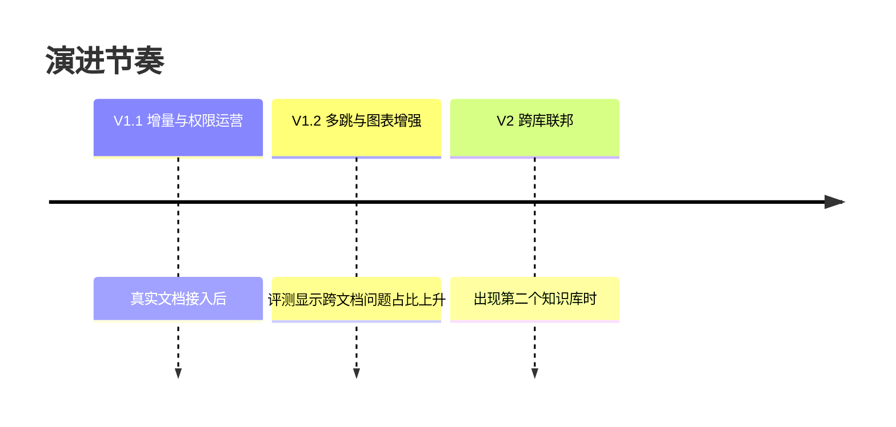

这几件事之所以没定，不是因为难，是因为现在定下来就是猜。

待定不等于免责：表里每一行都写清了「什么时候必须定」，到那个时点还没结论，就是评审要卡住的问题，不能靠以后再说拖过去。比如文件服务，样本阶段根本用不上；真接第一份文档时，"从哪来、谁能看、怎么按页取"三个问题的答案会一起出现，那时候再设计比现在拍脑袋靠谱。

有一条不变：上面任何一项改动，都不许削弱前三章的硬线与第 11 章的红线。换向量库、换队列、换模型都可以，拒答率掉下来就不行。

## 附录 A 字段字典

键用英文是为了机器稳定，中文名与口径是给人看的。任何一处口径跟这里对不上，以这里为准。

文档表 `documents`：

| 字段 | 类型 | 中文名 | 口径 |
|---|---|---|---|
| doc_key | text | 文档编号 | 由文件路径与标题生成的稳定标识，跨版本不变 |
| filename | text | 文件名 | 原始文件名，仅展示用 |
| page_count | int | 页数 | 解析后回填，用于前端翻页 |
| status | text | 入库状态 | queued / parsed / failed / active |
| created_at | timestamptz | 入库时间 | 首次入库，不随覆盖变化 |

版本表 `doc_versions`：

| 字段 | 类型 | 中文名 | 口径 |
|---|---|---|---|
| version_id | text | 版本号 | 文档编号 + 短指纹 |
| doc_key | text | 文档编号 | 同文档表 |
| file_hash | text | 内容指纹 | 文件字节的 SHA-256 |
| status | text | 版本状态 | 待转正 / 生效 / 已下线 / 已清除 |
| activated_at | timestamptz | 转正时间 | 翻牌那一刻，用于审计 |
| superseded_by | text | 被谁取代 | 新版本号，旧版为空 |

切片表 `chunks`：

| 字段 | 类型 | 中文名 | 口径 |
|---|---|---|---|
| chunk_id | text | 切片编号 | 全局唯一，向量库以它为主键 |
| doc_key / version_id | text | 归属 | 决定它属于哪份文档的哪一版 |
| status | text | 状态 | 与所属版本同步，检索只认生效 |
| chunk_type | text | 类型 | text / table / figure |
| parent_id | text | 父片编号 | 子片指向父片，父片为空 |
| page_num | int | 页码 | 从 1 开始 |
| bbox | jsonb | 坐标 | 归一化 0–1 的矩形数组，可多个 |
| image_path | text | 图路径 | 项目内相对路径，不存绝对路径 |
| content_text | text | 正文 | 检索与引用都以它为准 |
| table_html | text | 表格 | 整表 HTML，仅表格切片有值 |
| effective_date | int | 业务日期 | YYYYMMDD，可空 |
| effective_year | int | 业务年份 | 由业务日期推出，可空 |
| date_confidence | text | 时间可信度 | explicit / inferred，做时间过滤只认前者 |
| is_public | bool | 是否公开 | 公开文档跳过部门与角色判断 |
| allowed_depts | text[] | 可看部门 | 部门标识列表 |
| allowed_roles | text[] | 可看角色 | 角色标识列表 |
| embedding_dense | vector(1024) | 稠密向量 | 归一化后的语义向量 |
| token_count | int | 字数 | 中文按字符数近似 |

任务表 `ingest_jobs`：`job_id`、`doc_key`、`version_id`、`status`（排队 / 运行 / 完成 / 失败）、`error`、`retry_count`、`started_at`、`finished_at`。

问答日志 `qa_log`：`question`、`retrieved_ids`、`score_snapshot`（最高分与分布）、`gate1_verdict`、`gate2_verdict`、`hop_count`、`answer`、`citations`、`reject_reason`、`latency_ms`、`model`、`created_at`。

## 附录 B 表与索引

建表语句按 PostgreSQL 写，向量列用扩展类型。字段口径见附录 A，这里只给形状。

```sql
CREATE EXTENSION IF NOT EXISTS vector;

CREATE TABLE documents (
    doc_key      text PRIMARY KEY,
    filename     text NOT NULL,
    page_count   int,
    status       text NOT NULL DEFAULT 'queued',
    created_at   timestamptz NOT NULL DEFAULT now()
);

CREATE TABLE doc_versions (
    version_id    text PRIMARY KEY,
    doc_key       text NOT NULL REFERENCES documents(doc_key),
    file_hash     text NOT NULL,
    status        text NOT NULL DEFAULT 'pending',
    activated_at  timestamptz,
    superseded_by text,
    UNIQUE (doc_key, file_hash)
);

CREATE TABLE chunks (
    chunk_id         text PRIMARY KEY,
    doc_key          text NOT NULL,
    version_id       text NOT NULL REFERENCES doc_versions(version_id),
    status           text NOT NULL DEFAULT 'pending',
    chunk_type       text NOT NULL,
    parent_id        text,
    page_num         int  NOT NULL CHECK (page_num >= 1),
    bbox             jsonb NOT NULL,
    image_path       text,
    content_text     text NOT NULL,
    table_html       text,
    effective_date   int,
    effective_year   int,
    date_confidence  text NOT NULL DEFAULT 'inferred',
    is_public        boolean NOT NULL DEFAULT false,
    allowed_depts    text[]  NOT NULL DEFAULT '{}',
    allowed_roles    text[]  NOT NULL DEFAULT '{}',
    embedding_dense  vector(1024),
    token_count      int,
    created_at       timestamptz NOT NULL DEFAULT now()
);

CREATE INDEX idx_chunks_active ON chunks (doc_key, status);
CREATE INDEX idx_chunks_year   ON chunks (effective_year);
CREATE INDEX idx_chunks_date   ON chunks (effective_date);
CREATE INDEX idx_chunks_depts  ON chunks USING gin (allowed_depts);
CREATE INDEX idx_chunks_roles  ON chunks USING gin (allowed_roles);
```

索引按查询形状建，不按字段建。`doc_key + status` 给版本翻牌与校验用；年份与日期给时间过滤用；两个数组字段用 GIN，配合「命中任一」的判断。

向量集合只存三样：切片编号、向量、过滤字段（状态、部门、角色、是否公开、年份、文档编号）。正文不进向量库，避免出现第二份真相。过滤字段必须在集合里建索引，否则前置过滤会退化成全扫。

文件目录只两个，都随项目走：

```text
samples/{doc_key}.pdf        测试样本原件
figures/{chunk_id}.png       图表切片图，≥200 DPI
```

路径一律存相对路径。存绝对路径的后果是换机器、换目录就全断。

翻牌用一条事务把三处一起改完：版本表里旧版划下线、新版划生效，切片表按版本号批量改状态。改完之后再按文档编号通知向量库。反过来先改向量库，中间那段时间检索会命中旧片，等于新旧并存。

清理分两步：先标已下线，等一天，再删向量与库行。等这一天的原因是回滚——评审发现新版解析错了，还能在窗口内把旧版翻回来。

备份只备两样：数据库快照与向量快照，采样文件随代码仓库走。两样要同一时点，否则恢复后会出现「有切片、没向量」的空洞。

## 附录 C 接口与事件

五个接口，够跑通一条完整链路。失败码统一用 4xx 表示用户侧问题、503 表示依赖不可用。

| 方法 | 路径 | 作用 | 主要字段 | 失败码 |
|---|---|---|---|---|
| POST | /api/v1/ingest/scan | 触发扫描样本目录 | 无参，返回本轮新增与变更数 | 409 正在运行 |
| GET | /api/v1/documents/{doc_key} | 查入库状态 | 状态、页数、切片数、最近一次错误 | 404 |
| POST | /api/v1/qa/stream | 问答，流式返回 | 问题、可选文档范围、可选时间范围 | 503 模型不可用 |
| GET | /api/v1/samples/{doc_key}.pdf | 开发期直出样本 | 无（仅本机工作台使用） | 404 |
| GET | /healthz | 健康检查 | 数据库与向量库连通性 | 503 |

问答流里有六类事件，前端按类型分派：

| 事件 | 何时发 | 载荷 |
|---|---|---|
| step | 进入某一跳或某一阶段 | 跳数、阶段名、已耗时 |
| clarify | 条件缺失或多份冲突 | 选项数组，每项含标签与回填参数 |
| token | 生成过程中 | 增量文本 |
| citations | 生成结束 | 文档编号、页码、坐标、片段摘要、图路径 |
| fallback | 降级 | 原因码与一句人话 |
| done | 收尾 | 总耗时、跳数、是否降级 |

事件顺序固定：先 step，再 token 若干，随后 citations，最后 done。clarify 与 fallback 是分支，出现时后续不再出 token。前端不要假设一定有 token——拒答路径只有 step 与 done。

## 附录 D 提示词

四段提示词，都是约束型，不含业务解释。温度已在正文写死为 0，这里不再重复。

作答约束：

```text
你只能依据【证据包】回答，不得使用外部知识、常识补全或推断。
每个事实性陈述必须在句末标注引用编号，如 [1] 或 [1][3]，编号必须在证据包范围内。
证据不足以回答全部或部分问题时，状态置为 unknown，并说明未找到可验证依据。
不得输出证据中不存在的数字、日期、金额、名称或因果关系。
只输出 JSON：{"status":"answered|unknown","answer":"...","citations":[1,2]}
```

统计图转译：

```text
读出图中所有坐标轴名称、单位、刻度，以及每个数据点的类别与数值。
存在多条曲线时，逐条列出并注明图例名称。
无法确定的值写 null，不要估算。
输出 Markdown 表格，不要解释。
```

结构图转译：

```text
列出图中每个节点的名称与类型（系统、模块、外部服务）。
列出节点之间的连线，方向按箭头，注明连线上的文字。
看不清的节点写「无法识别」，不要补全。
输出两段：节点表、关系表，不要解释。
```

忠实性判别：

```text
判断【答案】是否完全由【证据】支持。
支持：每个事实都能从证据直接得到或被证据明确蕴含，且没有证据外信息。
不支持：包含证据未支持的事实、推断、数字，或与证据矛盾。
只输出 JSON：{"verdict":"SUPPORTED|NOT_SUPPORTED","reason":"..."}
```

提示词改动的规矩：约束条款只增不减。为了「答得更好看」把「不得使用外部知识」删掉这类改动，评审必须拦下。

转译提示词里要求「无法确定写 null，不要估算」，是因为模型天然倾向于把图读圆——给个大概的数比承认看不清更让它「有用」。这条约束是和铁规矩配套的：数字对不上就判转译失败，所以模型没有动力去猜。

判别器只喂三样东西：问题、被引证据、答案。不给整库、不给上下文，是为了让它只回答「这段文字能不能支撑这句话」，而不是重新作答。判别器一旦开始解释推理过程，就会引入自己的判断，那就不是裁判了。

对企业网关的兼容要留一手：有的网关只认单条 user 消息，有的不支持 JSON 模式。落地时把 system 约束并入用户消息、把 JSON 要求写进末尾，并在客户端做一次宽松解析（去代码块标记、取第一个大括号块）。解析失败按校验不通过处理，不放行。

### 失败路径

模型返回不是 JSON、返回了两个 JSON、字段名对不上——这三种在真实网关里都会遇到。统一处理：进降级，给原文不给结论，同时记一条审计。不要重试三次以上，重试解决不了模型不理解约束的问题，只会把延迟拉长。这条规则对转译同样适用：一张图连转两次都对不上数字，就记为转译失败，人工抽检，而不是继续换着措辞试第三次。

## 附录 E 术语表

正文里能说人话的都说人话了，这里只收那些绕不开的。

| 中文说法 | 英文 | 一句话解释 | 首次出现 |
|---|---|---|---|
| 前置过滤 | pre-filtering | 先按权限、时间、状态筛，再做检索 | 第 5 章 |
| 两路召回 | hybrid retrieval | 语义与关键词各取一批，再合并 | 第 5 章 |
| 名次融合 | RRF | 只看排名相加，不看分数 | 第 5 章 |
| 精排 | rerank | 问句与候选成对打分，取前几条 | 第 5 章 |
| 证据充足性 | evidence sufficiency | 分数够不够支撑结论 | 第 6 章 |
| 忠实性判别 | NLI | 判答案是否被证据支持 | 第 7 章 |
| 父子切片 | parent-child chunk | 子片检索、父片作答 | 第 3 章 |
| 待转正 | pending | 写完了但还没生效的版本 | 第 3 章 |
| 相对坐标 | normalized bbox | 0 到 1 的页面位置 | 第 3 章 |
| 断链熔断 | hop circuit break | 多跳中间某跳过不了阈值就停 | 第 6 章 |
| 降级 | fallback | 不给结论，只给原文 | 第 7 章 |
| 波谷法 | valley calibration | 在可答与不可答分布的谷底取阈值 | 第 11 章 |

## 附录 F 需求追踪矩阵

左边是两份输入的章节，右边是本文的落点与验证方式。任何一行找不到落点，说明设计漏了东西。

| 输入 | 章节 | 本文落点 | 怎么验证 |
|---|---|---|---|
| 架构图集 | 边界与约束 | 第 1 章 | 边界表逐条对上 |
| 架构图集 | 分层架构 | 第 2 章 | 模块表与全景图 |
| 架构图集 | 摄取与版本 | 第 3 章 | 状态机图与失败表 |
| 架构图集 | 在线链路 | 第 5、6、7 章 | 决策树与自查表 |
| 架构图集 | 时序 | 第 2 章 | 时序图三条分叉 |
| 架构图集 | 版本状态机 | 第 3.5 节 | 状态机图 |
| 架构图集 | 部署拓扑 | 第 4、10 章 | 存储分工与扩容顺序 |
| 概要设计 | 目标与非目标 | 第 1 章 | 做与不做表 |
| 概要设计 | 设计原则 | 第 1、6、7 章 | 三条硬线 + 分段门控 |
| 概要设计 | 摄取流水线 | 第 3 章 | 四张图 |
| 概要设计 | 在线流水线 | 第 5、6、7 章 | 五步链路 + 五道自查 |
| 概要设计 | 数据模型 | 附录 A、B | 字段字典与建表 |
| 概要设计 | 技术栈 | 第 4 章 + 附录 B | 两库分工表 |
| 概要设计 | 评测与指标 | 第 11 章 | 红线表 |
| 概要设计 | 风险与演进 | 第 12 章 | 待定表与节奏图 |

## 附录 G 概设变更登记

概设已就地改为 v1.1，与本文同一口径。这里登记改了哪些条款，供评审追溯，不是第二份设计。

| 位置 | 原口径 | 新口径 |
|---|---|---|
| 文档头约束 | 纯 CPU、单租户无权限、不做表格与多模态 | 本地解析与精排、严格权限隔离、表格与图表纳入 |
| 目标表 | 单机可运行、架构简洁 | 增加像素级溯源与受控多跳 |
| 非目标 | 排除权限、表格、多模态、大规模 | 改为不做自由发挥、目测估数、未授权可见、跨版本混答 |
| 原则 | 五条 | 增补先筛后答、分层拒答 |
| 架构总览图 | 单库、单路检索 | 两库、前置过滤、多跳与澄清 |
| 解析路由 | 文本提取为主 | 版面解析为主，识别作为兜底 |
| 切分 | 单层 300–500 字 | 父子两层 |
| 向量与索引 | 单库向量 | 向量库 + 数据库词法 |
| 版本状态 | 排队到索引完成 | 待转正到已清除 |
| 证据门控 | 单一阈值 | 三段式 |
| 忠实性门控 | 规则可选判别 | 规则必做 + 判别默认开启 |
| 阈值标定 | 保守取值 | 波谷区间 0.38–0.42 |
| 数据表 | 三张表 | 增加版本表与权限、时间、坐标字段 |
| 技术栈 | 单库、无编排、无队列 | 编排、队列、版面解析、精排 |
| 指标 | 六项 | 增加角标可点回、数值准确、陷阱拒答 |
| 部署 | 单机编排 | 开发单机、生产进集群 |
| 演进 | 四段 | 一期即目标态一期，后续按疼点推进 |
